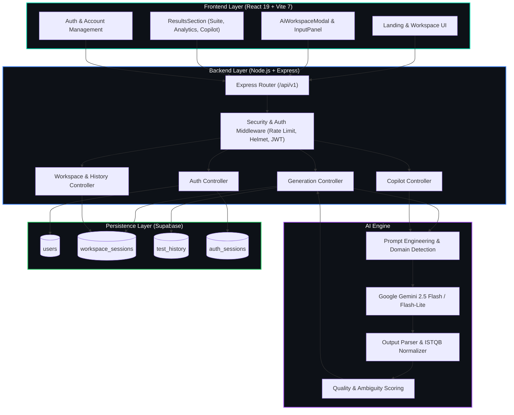
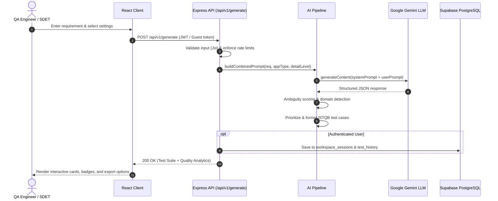
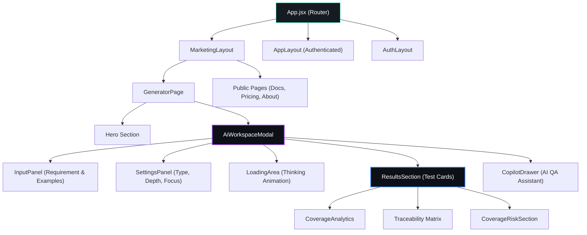

# Pull Request — Testnexa AI Platform & Documentation Suite

## 📌 Description

**What does this PR do?**

This pull request provides the complete, production-grade implementation and comprehensive architectural documentation for **Testnexa AI** — an AI-powered intelligent QA test case generator that transforms raw product requirements into ISTQB/IEEE 829-standard test suites across functional, negative, edge case, and API categories in seconds.

**Why is this change needed?**

Manual test case creation in agile sprints is time-consuming, prone to human bias, and frequently misses critical edge cases. Testnexa AI bridges this gap with domain-aware AI parsing (Google Gemini), ambiguity detection, automated risk prioritization, interactive refinement, and seamless export/session persistence with Supabase PostgreSQL.

---

## 🏗️ System Architecture Overview

---

## 🔄 End-to-End Test Suite Generation Pipeline

---

## 📦 Component Interaction Map

---

## 🏷️ Type of Change

- [x] ✨ **New Feature** — Multi-category test generation, ambiguity analysis, QA Copilot
- [x] 🎨 **Style/UI** — Enterprise dark mode, glassmorphism, responsive stack layouts
- [x] 📝 **Documentation** — 18-file architectural specification and user guide suite
- [x] ⚡ **Performance** — Client-side caching, connection pooling, lazy-loaded components
- [x] 🧪 **Tests** — E2E workspace tests, session isolation, Copilot verification
- [x] 🏗️ **Infrastructure** — Supabase PostgreSQL migration, Docker multi-stage builds

---

## 📋 Changes Made

### 1. Frontend (`frontend/`)
- **Modern React 19 + Vite 7** SPA setup with vanilla CSS custom design tokens.
- **AI Workspace Modal:** Full-featured test design environment with live requirement editing, example presets, settings drawer, and multi-version history.
- **Results Visualizer:** Categorized test cases (Functional, Negative, Edge Case, API) with copy, edit, export (JSON/CSV/Markdown), and filtering.
- **Interactive QA Copilot:** In-app AI copilot to identify test gaps, suggest additional coverage, and auto-insert new test scenarios.
- **Analytics & Traceability:** Requirements intelligence scores, test distribution radar, and ISTQB traceability matrix.

### 2. Backend (`backend/`)
- **Express REST API (`/api/v1`)**: Scalable controller-service-routes architecture.
- **Gemini AI Integration (`geminiService.js`)**: Structured JSON schema output parsing, resilient fallback, and dynamic prompt engineering.
- **Authentication System:** JWT access tokens, refresh mechanisms, Google & GitHub OAuth via Passport.js, and multi-session tracking.
- **Data Isolation:** User-scoped query filtering across all workspace and history queries.

### 3. Database (`Supabase PostgreSQL`)
- Clean migration from legacy MongoDB to relational PostgreSQL.
- Structured tables: `users`, `workspace_sessions`, `test_history`, and `auth_sessions` with indexed foreign keys and JSONB payload support.

### 4. Comprehensive Documentation Suite (`docs/`)
Complete technical documentation covering:
- [PRODUCT.md](file:///d:/Project/Testnexa%20AI/docs/PRODUCT.md) — Product vision, personas, and problem-solution matrix
- [ARCHITECTURE.md](file:///d:/Project/Testnexa%20AI/docs/ARCHITECTURE.md) — System architecture, pipeline, and data isolation
- [UI_UX.md](file:///d:/Project/Testnexa%20AI/docs/UI_UX.md) — Design system, tokens, layouts, and component inventory
- [FEATURES.md](file:///d:/Project/Testnexa%20AI/docs/FEATURES.md) — Detailed feature inventory and test schemas
- [USER_FLOWS.md](file:///d:/Project/Testnexa%20AI/docs/USER_FLOWS.md) — 10 end-to-end user journeys with Mermaid flowcharts
- [API.md](file:///d:/Project/Testnexa%20AI/docs/API.md) — Complete REST API endpoint reference
- [DATABASE.md](file:///d:/Project/Testnexa%20AI/docs/DATABASE.md) — Supabase PostgreSQL schema, tables, and ER diagram
- [AUTHENTICATION.md](file:///d:/Project/Testnexa%20AI/docs/AUTHENTICATION.md) — JWT, OAuth, session management, and security
- [SECURITY.md](file:///d:/Project/Testnexa%20AI/docs/SECURITY.md) — Threat model, defense-in-depth, and OWASP alignment
- [TESTING.md](file:///d:/Project/Testnexa%20AI/docs/TESTING.md) — Backend unit/E2E test suite and Playwright setup
- [DEPLOYMENT.md](file:///d:/Project/Testnexa%20AI/docs/DEPLOYMENT.md) — Vercel, Render, Docker, and Kubernetes deployment
- [ENVIRONMENT.md](file:///d:/Project/Testnexa%20AI/docs/ENVIRONMENT.md) — Configuration variables and secrets management
- [INTEGRATIONS.md](file:///d:/Project/Testnexa%20AI/docs/INTEGRATIONS.md) — Gemini AI, Supabase, OAuth, Nodemailer, Sentry
- [AI.md](file:///d:/Project/Testnexa%20AI/docs/AI.md) — Prompt engineering, model parameters, and evaluation metrics
- [HISTORY.md](file:///d:/Project/Testnexa%20AI/docs/HISTORY.md) — Project milestones, pivot history, and lessons learned
- [CHANGELOG.md](file:///d:/Project/Testnexa%20AI/docs/CHANGELOG.md) — Semantic version changelog
- [ROADMAP.md](file:///d:/Project/Testnexa%20AI/docs/ROADMAP.md) — Future quarters and feature milestones
- [DECISIONS.md](file:///d:/Project/Testnexa%20AI/docs/DECISIONS.md) — Architecture Decision Records (ADRs 001–009)

---

## 🧪 Testing

### Verification Performed

- [x] Unit tests pass (`backend/tests/*.test.js`)
- [x] E2E data isolation verification (`backend/tests/e2e-data-isolation.cjs`)
- [x] Full generation flow validation (`backend/tests/generation-flow.test.js`)
- [x] Multi-session revocation test (`backend/tests/auth-logout.test.js`)
- [x] QA Copilot interaction test (`backend/tests/copilot.test.js`)
- [x] Manual responsive verification across Desktop (1920x1080), Tablet (768x1024), and Mobile (390x844) viewports
- [x] No unhandled exceptions or console errors

---

## ✅ Quality Checklist

- [x] **Code Quality:** Adheres to enterprise modular JavaScript and React conventions
- [x] **Security:** No API keys, credentials, or secrets committed; all secrets use environment variables
- [x] **Input Validation:** Strict Joi schema validation on all backend mutations
- [x] **Database Integrity:** Foreign key constraints, UUID primary keys, and JSONB schemas verified
- [x] **Documentation:** Complete cross-referenced markdown documentation with interactive Mermaid diagrams
