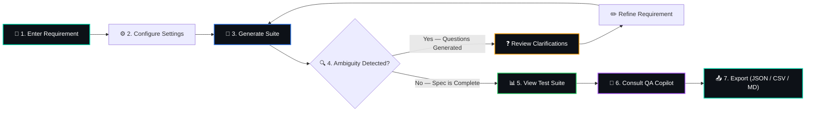
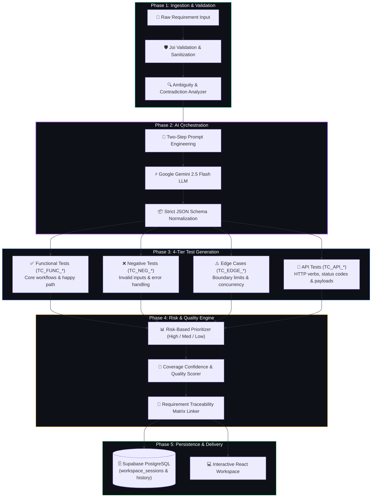
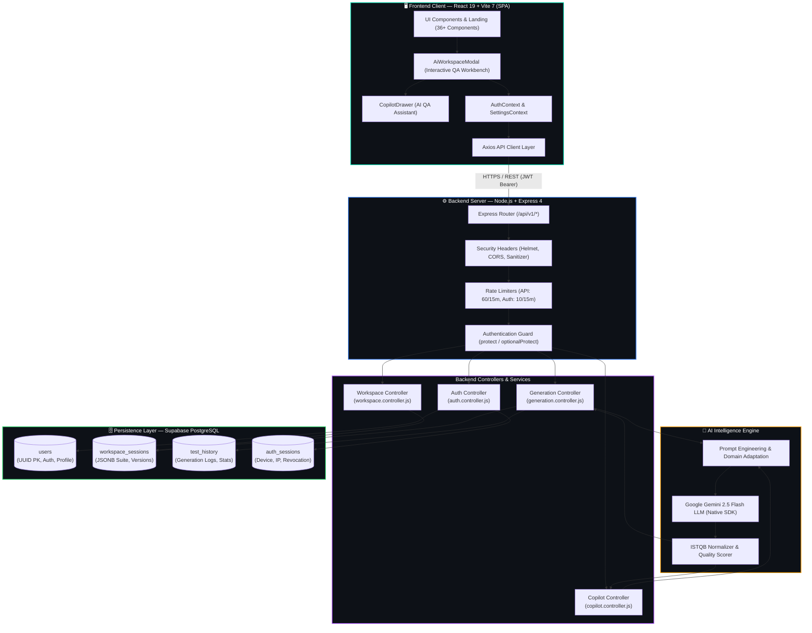

<p align="center">
  
</p>

<h1 align="center">🧪 Testnexa AI</h1>

<p align="center">
  <b>AI-Powered Intelligent QA Test Case Generator</b><br/>
  <i>Transform unclear product requirements into complete, prioritized test suites — in seconds.</i>
</p>

<p align="center">
  
  
  
  
  
  
</p>

---

## 🌟 Overview

**Testnexa AI** is a full-stack, AI-powered web application that automatically converts product requirements — user stories, PRDs, or API specs — into comprehensive, prioritized test suites. It leverages **Google Gemini AI** to deeply analyze requirements, detect ambiguities, and generate multi-category test cases covering functional, negative, edge case, and API testing scenarios.

> 🎯 *Stop missing edge cases. Stop writing test cases manually. Let AI handle the heavy lifting.*

---

## ✨ Key Features

| Feature | Description |
|---|---|
| 🧠 **AI-Powered Analysis** | Advanced LLM intelligence for context-aware requirement parsing and domain-specific logic understanding |
| 📋 **Multi-Category Tests** | Generates Functional, Negative, Edge Case, and API tests simultaneously in one pass |
| 🔍 **Ambiguity Detection** | Identifies contradictions, missing logic, and unclear specs — then generates targeted clarification questions |
| 📊 **Risk-Based Prioritization** | Automatically assigns High/Medium/Low priority based on business impact and complexity |
| 📤 **Multi-Format Export** | Export test suites in JSON, Markdown, or structured formats ready for your test management tools |
| 📈 **Requirement Insights** | Quality scores, coverage metrics, and actionable tips on requirement completeness |
| 🔐 **Auth System** | Google & GitHub OAuth + JWT-based authentication with guest trial mode |
| 📜 **History & Sidebar** | Full generation history with search, saved sessions, and quick access sidebar |
| 🎨 **Premium Dark UI** | Glassmorphism design, animated particle background, smooth micro-animations |
| 🔔 **Desktop Notifications** | Get notified when your test suite is ready |
| 🎓 **Guided Tour** | First-time user onboarding with step-by-step walkthrough |

---

## 🚀 How It Works — Detailed Walkthrough

### 1. High-Level User Workflow



#### How the User Workflow Operates:
1. **Step 1 — Input:** You paste any raw software requirement (e.g. user stories, PRD snippets, Jira acceptance criteria, or API endpoint docs).
2. **Step 2 — Settings:** Choose target platform (**Web**, **Mobile**, or **API**), depth level (**Essential**, **Standard**, or **Comprehensive**), and focus (**Mixed**, **Functional**, **Non-Functional**, or **API**).
3. **Step 3 — Generation:** The engine executes a single-pass, two-step prompt pipeline via Google Gemini 2.5 Flash with sub-second token streaming.
4. **Step 4 — Ambiguity Engine:** If requirements contain contradictory logic or missing edge cases (e.g. timeout behavior, rate limits), targeted clarification questions are surfaced instantly.
5. **Step 5 — Results:** Test cases are organized into 4 tabbed categories with priority badges, prerequisites, execution steps, and expected outputs.
6. **Step 6 — QA Copilot:** Need deeper audit? Open the embedded QA Copilot drawer to discover coverage gaps or auto-append missing edge cases with one click.
7. **Step 7 — Export & Persistence:** Authenticated users' suites are auto-saved to Supabase PostgreSQL with version history; guest users can export immediately as JSON, CSV, or Markdown.

---

### 2. The AI Test Generation Pipeline (Under the Hood)



#### Step-by-Step Pipeline Breakdown:

| Pipeline Stage | Component | What Happens |
|---|---|---|
| **1. Validation** | `validation.middleware.js` | Enforces minimum length (20 chars), strips harmful injections, and sanitizes payload before LLM transmission. |
| **2. Ambiguity Detection** | `ambiguityAnalyzer.service.js` | Analyzes requirement text for vague adjectives ("fast", "secure", "easy"), missing error states, and unstated assumptions. |
| **3. Orchestration** | `geminiService.js` | Uses a structured system instruction prompt instructing Gemini to return strict JSON adhering to IEEE 829/ISTQB standards. |
| **4. Classification** | `priorityEngine.service.js` | Automatically assigns **High**, **Medium**, or **Low** priority based on critical business impact and vulnerability. |
| **5. Traceability** | `traceability.service.js` | Links every test case back to a parent requirement ID (`REQ_001`, `REQ_002`) for complete audit compliance. |
| **6. Persistence** | `supabaseData.service.js` | Stores complete test suite JSONB into PostgreSQL with session isolation (`WHERE user_id = $1`). |

---

### 3. Concrete Example: From Raw Requirement to Test Cases

To illustrate how Testnexa AI transforms unclear requirements, consider this typical agile user story:

> **Input Requirement:** *"Users should be able to apply a discount coupon at checkout. If the coupon is valid, reduce the cart total by the coupon percentage. If invalid, show an error."*

Testnexa AI processes this requirement and generates:

#### 🔍 1. Clarification & Ambiguity Findings
- ❓ *Can a coupon reduce shipping fees, or only item subtotal?*
- ❓ *What happens if a coupon expires while the user is on the payment screen?*
- ❓ *Is there a minimum order amount required to use percentage coupons?*

#### 🧪 2. Multi-Category Test Suite (Sample ISTQB Format)

| Category | Test ID | Title | Priority | Test Data & Steps | Expected Result |
|---|---|---|---|---|---|
| **Functional** | `TC_FUNC_001` | Verify valid 20% discount coupon applied | **High** | Code: `SAVE20`, Cart: $100 | Cart total updates to $80; discount line item displayed |
| **Negative** | `TC_NEG_001` | Attempt expired coupon code | **High** | Code: `EXPIRED2023` | Error: *"This coupon has expired"*; total remains unchanged |
| **Negative** | `TC_NEG_002` | Apply coupon with empty cart | **Medium** | Code: `SAVE20`, Cart: $0 | Checkout button disabled or error: *"Cart is empty"* |
| **Edge Case** | `TC_EDGE_001` | Apply coupon resulting in $0.00 total | **High** | Code: `100OFF`, Cart: $100 | Total is $0.00; payment gateway skipped or zero-auth used |
| **Edge Case** | `TC_EDGE_002` | Concurrent coupon use across two tabs | **Medium** | Same single-use code used twice | First tab succeeds; second tab throws: *"Coupon already used"* |
| **API** | `TC_API_001` | `POST /api/v1/checkout/apply-coupon` | **Critical** | `{"code":"SAVE20","cartId":"123"}` | `200 OK` with updated discount payload and signature |

---

### 4. Full System Architecture



#### Architectural Design Highlights:
- **Stateless Express API with State-Backed Tokens:** JWTs allow fast authorization without server memory bottlenecks, while `auth_sessions` in Supabase provides immediate token revocation capabilities.
- **Enterprise Multi-Tenant Data Isolation:** Every database operation in `supabaseData.service.js` enforces `WHERE user_id = $userId` filtering, ensuring complete tenant isolation.
- **Resilient AI Calling:** The backend implements automatic exponential backoff retry (`AI_MAX_RETRIES=3`) with dynamic model fallback to ensure 99.9% test generation availability.

---

## 🎯 Who Is This For?

### 🔧 SDETs (Software Development Engineers in Test)
> Accelerate test design and automation planning. Get structured test cases with automation feasibility ratings, execution prerequisites, and API coverage analysis.

### 📋 Product Managers & Business Analysts
> Identify requirement gaps before development starts. Receive clear visibility into missing acceptance criteria, business risk areas, and ambiguous requirements.

### 🎓 QA Freshers & Entry-Level Engineers
> Learn testing fundamentals while building real test cases. Get guided test cases with explanations of testing concepts and clear priorities.

---

## 🛠️ Real QA Pain Points, Solved

| ❌ Problem | ✅ Solution |
|---|---|
| Missing edge cases in fast sprints | AI generates functional, negative, edge & API tests automatically |
| Ambiguous requirements from product | Auto-detects ambiguity and asks targeted clarification questions |
| Manual test case writing takes hours | Outputs clean, reusable test cases instantly |

---

## 💡 Why This Matters

- **🛡️ Reduce Production Risk** — Catch critical edge cases before they reach your users
- **⚡ Accelerate Sprints** — Reduce manual test design time by up to 80%
- **📝 Improve Clarity** — Force requirement precision early in the SDLC

---

## 🏗️ Tech Stack

### Frontend
| Technology | Purpose |
|---|---|
| **React 19.2** | UI framework with hooks & context API |
| **Vite 7.2** | Lightning-fast build tool & dev server |
| **React Router DOM 7.12** | Client-side routing & navigation |
| **Lucide React** | Beautiful, consistent icon library |
| **Axios** | HTTP client for API communication |
| **Vanilla CSS** | Custom glassmorphism design system |

### Backend
| Technology | Purpose |
|---|---|
| **Node.js + Express** | REST API server |
| **Google Gemini AI** | LLM for intelligent test generation |
| **Supabase (PostgreSQL)** | Database for users, history, sessions & workspaces |
| **JWT + bcryptjs** | Token-based authentication & password hashing |
| **Passport.js** | OAuth strategies (Google, GitHub) |
| **Joi** | Request validation schemas |

---

## 📂 Project Structure

```
Testnexa-AI/
├── 📁 public/                    # Static assets & logo
├── 📁 frontend/                  # Frontend source code
│   ├── 📁 components/            # Reusable UI components
│   │   ├── AnimatedBackground    # Particle animation system
│   │   ├── AntigravityBackground # Dynamic space-like background
│   │   ├── Features              # Key features showcase grid
│   │   ├── Hero                  # Landing hero section
│   │   ├── HowItWorks            # Step-by-step process
│   │   ├── InputPanel            # Requirement input with examples
│   │   ├── ResultsSection        # Generated test suite display
│   │   ├── RefineRegeneratePanel # Iterative refinement controls
│   │   ├── HistorySidebar        # Collapsible history panel
│   │   ├── Navbar                # Navigation with auth state
│   │   ├── Footer                # Site-wide footer
│   │   └── ... (22 components)
│   ├── 📁 pages/                 # Route-level pages
│   │   ├── GeneratorPage         # Main AI test generator
│   │   ├── HistoryPage           # Past generation history
│   │   ├── LoginPage             # Email/OAuth login
│   │   ├── SignUpPage            # Registration with OAuth
│   │   ├── AboutUsPage           # Company information
│   │   ├── ContactPage           # Contact form
│   │   ├── HelpPage              # Documentation
│   │   ├── ApiReferencePage      # API documentation
│   │   ├── BestPracticesPage     # QA best practices
│   │   ├── PrivacyPolicyPage     # Privacy policy
│   │   └── TermsPage             # Terms of service
│   ├── 📁 context/               # React Context providers
│   ├── 📁 hooks/                 # Custom React hooks
│   ├── 📁 services/              # API service layer
│   ├── 📁 styles/                # Additional stylesheets
│   └── 📁 utils/                 # Utility functions
├── 📁 backend/                   # Backend API server
│   └── 📁 src/
│       ├── 📁 config/            # Database & auth config
│       ├── 📁 controllers/       # Route handlers
│       ├── 📁 middleware/        # Auth & validation middleware
│       ├── 📁 routes/            # API route definitions
│       ├── 📁 services/          # Business logic & AI service
│       ├── 📁 utils/             # Helper utilities
│       └── server.js             # Express server entry point
├── index.html                    # App entry point
├── vite.config.js                # Vite configuration
└── package.json                  # Frontend dependencies
```

---

## 🚀 Getting Started

### Prerequisites
- **Node.js** (v18 or higher)
- **Supabase** (PostgreSQL cloud database project)
- **Google Gemini API Key**

### 1. Clone the Repository
```bash
git clone https://github.com/KISHOR403/Testnexa-Ai.git
cd Testnexa-Ai
```

### 2. Install Frontend Dependencies
```bash
npm install
```

### 3. Install Backend Dependencies
```bash
cd backend
npm install
```

### 4. Configure Environment Variables
Create a `.env` file in the `backend/` directory:
```env
PORT=5000
SUPABASE_URL=your_supabase_project_url
SUPABASE_SECRET_KEY=your_supabase_secret_key
SUPABASE_PUBLISHABLE_KEY=your_supabase_publishable_key
GEMINI_API_KEY=your_google_gemini_api_key
JWT_SECRET=your_jwt_secret
GOOGLE_CLIENT_ID=your_google_oauth_client_id
GOOGLE_CLIENT_SECRET=your_google_oauth_client_secret
GITHUB_CLIENT_ID=your_github_oauth_client_id
GITHUB_CLIENT_SECRET=your_github_oauth_client_secret
```

### 5. Start the Backend Server
```bash
cd backend
npm run dev
```

### 6. Start the Frontend Dev Server
```bash
npm run dev
```

### 7. Open in Browser
```
http://localhost:5173
```

---

## 📸 Website Sections

| Section | Description |
|---|---|
| **🏠 Hero** | Eye-catching landing with animated particle background and key value propositions |
| **⚡ AI Workspace** | Main input panel with example requirements dropdown and detail level selector |
| **📊 Results Dashboard** | Comprehensive test suite output with quality scores, test cases, and export options |
| **🌟 Key Features** | 6-card interactive grid showcasing AI capabilities |
| **🔧 Pain Points** | Problem vs. Solution comparison for real QA challenges |
| **⚙️ How It Works** | 4-step engineering process visualization |
| **👥 Who Is This For** | Persona-based cards for SDETs, PMs, and QA Freshers |
| **💡 Why This Matters** | Decision-maker value proposition with key metrics |
| **📚 Help & Docs** | Comprehensive documentation and API reference |
| **📞 Contact** | Contact form and support information |

---

## 🔒 Authentication

Testnexa AI supports multiple authentication methods:
- **Guest Mode** — Try the tool with limited free generations
- **Email/Password** — Traditional signup with JWT tokens
- **Google OAuth** — One-click Google sign-in
- **GitHub OAuth** — Developer-friendly GitHub login

---

## 📄 License

This project is licensed under the **ISC License**.

---

<p align="center">
  Built with ❤️ by <b>Testnexa AI Team</b><br/>
  <a href="https://github.com/KISHOR403/Testnexa-Ai">⭐ Star this repo</a> if you find it useful!
</p>
