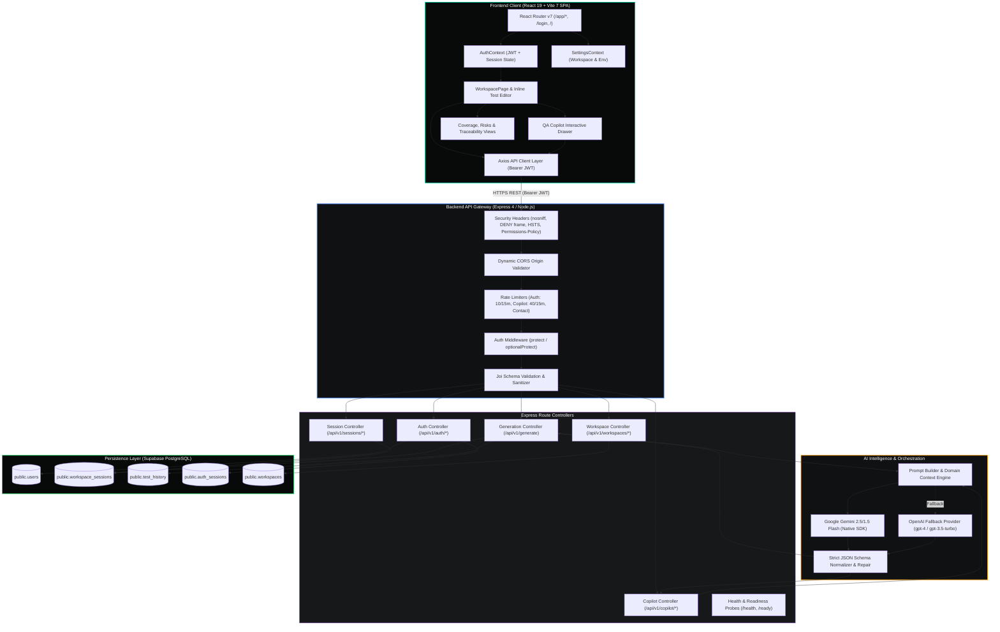
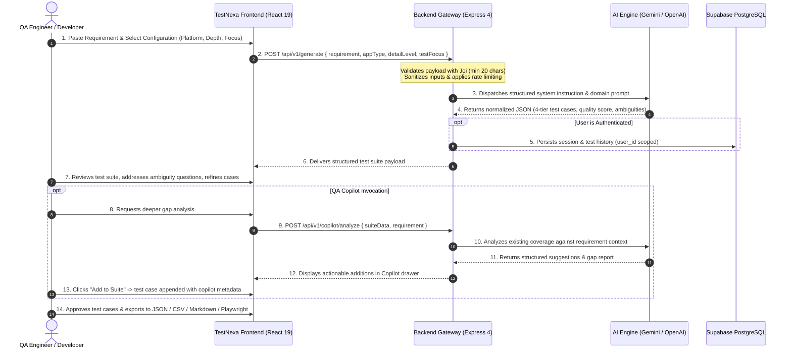

<p align="center">
  <a href="https://github.com/KISHOR403/Testnexa-Ai">
    
  </a>
</p>

<h1 align="center">TestNexa AI</h1>

<p align="center">
  <b>Enterprise-Grade AI Test Generation, Coverage Intelligence & Traceability Engine</b><br/>
  <i>Deconstruct ambiguous software requirements into comprehensive, audit-ready, 4-tier test suites in seconds.</i>
</p>

<p align="center">
  <a href="https://github.com/KISHOR403/Testnexa-Ai/stargazers"></a>
  <a href="https://github.com/KISHOR403/Testnexa-Ai/network/members"></a>
  <a href="https://github.com/KISHOR403/Testnexa-Ai/issues"></a>
  <a href="https://github.com/KISHOR403/Testnexa-Ai/blob/main/LICENSE"></a>
</p>

<p align="center">
  
  
  
  
  
  
  
  
</p>

<p align="center">
  <a href="#-quick-start-in-3-minutes"><b>🚀 Quick Start</b></a> •
  <a href="#-live-workbench-preview"><b>🖥️ Visual Preview</b></a> •
  <a href="#-key-capabilities"><b>✨ Features</b></a> •
  <a href="#-system-architecture"><b>🏗️ Architecture</b></a> •
  <a href="#-api-documentation"><b>📡 API Docs</b></a> •
  <a href="#-security--data-privacy"><b>🛡️ Security</b></a>
</p>

---

## 📸 Live Workbench Preview

<p align="center">
  
  <br/>
  <em>Figure 1.0: TestNexa AI Production Workbench — real-time 4-tier test suite generation (Functional, Negative, Security), ambiguity signals, and 100% bidirectional traceability.</em>
</p>

<p align="center">
  
  <br/>
  <em>Figure 1.1: Requirement Intelligence & Risk Engine — automated deconstruction of specs, account enumeration vulnerability detection, and acceptance criteria extraction.</em>
</p>

---

## 💡 The Problem & The Solution

In high-velocity engineering teams, **ambiguous product requirements are the #1 root cause of missed deadlines and production incidents**. Jira stories, PRDs, and API contracts rarely articulate edge conditions, race limits, or negative authorization paths. Authoring full test matrices manually takes days and still leaves dangerous blind spots.

| Metric / Capability | Traditional Manual QA | Generic LLM Chatbots (ChatGPT) | ⚡ **TestNexa AI** |
|:---|:---:|:---:|:---:|
| **Test Matrix Authoring Time** | 4 – 8 hours / feature | 15 – 30 minutes | **< 15 seconds** |
| **ISTQB 4-Tier Stratification** | Manual categorization | Inconsistent formatting | **Enforced strict JSON schema** |
| **Ambiguity & Assumption Flagging** | Easily overlooked | None | **Automated detection + Q&A prompts** |
| **Edge & Boundary Discovery** | Subject to cognitive bias | Generic examples | **Deep combinatorial edge detection** |
| **Automation Code Export** | Manual code synthesis | Syntax mismatches | **Instant Playwright, Cypress & Jest** |
| **Traceability & Audit Matrix** | Spreadsheets & manual tagging | None | **Auto REQ-to-TC mapping & metrics** |
| **Session & Tenant Security** | Fragmented | None | **Supabase PostgreSQL + JWT Revocation** |

---

## 🌟 Key Capabilities

### 1. 🎯 4-Tier ISTQB Test Stratification
Every generation is strictly decomposed and validated against standard test schemas:
- **Functional (`TC_FUNC_*`):** Core user workflows, business logic, authorization invariants, and happy paths.
- **Negative (`TC_NEG_*`):** Malformed payloads, unauthorized state bypasses, validation failures, and security barriers.
- **Edge Cases (`TC_EDGE_*`):** Boundary values, concurrency races, clock/timeout skews, empty payloads, and resource exhaustion.
- **API Test Checklist (`TC_API_*`):** HTTP methods, status codes, request/response headers, schema contracts, and query filters.

### 2. 🔍 Ambiguity & Contradiction Detection Engine
- Scans user requirements for vague qualifiers (*"fast"*, *"secure"*, *"seamless"*), unstated dependencies, and missing error branches.
- Generates **targeted clarification questions** allowing QA and Product teams to clarify requirements *before* engineering starts coding.
- **One-click refinement:** Submit clarification answers to re-stratify the suite dynamically.

### 3. 🧠 QA Copilot (Human-in-the-Loop AI Assistant)
- Context-grounded slide-over Copilot drawer continuously monitoring your active test suite.
- Performs real-time gap analysis against parent requirements to identify untested edge conditions and concurrency hazards.
- Provides **1-Click Actions**: *"Add Suggested Test Case"* (automatically tagged with Copilot provenance) and *"Improve Test Case"*.

### 4. 📊 Traceability, Coverage & Risk Analytics
- **Traceability Matrix (`/app/traceability`):** Bi-directional audit mapping linking each test case directly to requirement IDs (`REQ_001`, `REQ_002`).
- **Coverage Analytics (`/app/coverage`):** Real-time visual distribution breakdown across functional tiers, target platforms, and depth ratings.
- **Risk Evaluation Heatmap (`/app/risks`):** Impact vs. Probability matrix prioritizing critical security and business logic test paths.

### 5. 📦 Universal Automation & Report Export
One-click export directly from the workbench into production formats:
- **Automated Test Runners:** Instant runnable test scaffolds for **Playwright**, **Cypress**, **Jest**, and **Robot Framework**.
- **Data & Documentation:** Structured **JSON**, **Standard CSV** (for Excel / TestRail / Zephyr), and **Formatted Markdown** (for PRs & RFCs).

### 6. 🛡️ Enterprise Multi-Tenant Session Security
- User data isolation strictly enforced at the PostgreSQL layer (`WHERE user_id = $userId`).
- Email/Password authentication with salted `bcryptjs` hashing.
- OAuth 2.0 integration via Google and GitHub (`passport.js`).
- **Active Device Session Tracker** (`auth_sessions` table) with real-time remote session termination and token revocation.

---

## 🏗️ System Architecture

### End-to-End Architectural Flow



### Generation & Validation Pipeline



---

## 🛠️ Technology Stack

| Layer | Technology | Version | Purpose |
|:---|:---|:---:|:---|
| **Frontend Framework** | **React** | `19.2.0` | Modern component architecture with Context API & hooks |
| **Bundler & Tooling** | **Vite** | `7.3.1` | Ultra-fast HMR and production bundle optimization |
| **Routing** | **React Router DOM** | `7.12.0` | Client routing, protected layouts, and auth redirects |
| **Iconography** | **Lucide React** | `^0.562.0` | Sleek, consistent SVG icon system |
| **Styling & Theme** | **Vanilla CSS Tokens** | Custom | Zero-dependency high-performance dark theme (`#080909`, `#00D4AA`) |
| **Backend Runtime** | **Node.js** | `>= 18.0.0` | Server-side JavaScript runtime (CommonJS) |
| **REST API Server** | **Express** | `4.18.2` | REST route routing, middleware chains & health probes |
| **Database** | **Supabase PostgreSQL** | `^2.116.0` | Relational data persistence, sessions, and history |
| **AI Primary Engine** | **Google Gemini SDK** | `^0.24.1` | Gemini 2.5 Flash / 1.5 Flash structured JSON generation |
| **AI Fallback Engine** | **OpenAI API** | `^4.x` | Fallback model provider (`gpt-4`, `gpt-3.5-turbo`) |
| **Authentication** | **Passport.js & JWT** | `0.7.0` | Google & GitHub OAuth 2.0 + signed JWT verification |
| **Validation** | **Joi** | `^17.7.0` | Strict schema validation and XSS input sanitization |
| **Testing** | **Node Native Test Runner**| Native | Zero-dependency unit, integration & security test suites |

---

## 🚀 Quick Start in 3 Minutes

### Prerequisites
- **Node.js:** `v18.0.0` or higher
- **npm:** `v9.0.0` or higher
- **Supabase Account:** Free PostgreSQL database instance ([supabase.com](https://supabase.com))
- **Google Gemini API Key:** Free key from Google AI Studio ([aistudio.google.com](https://aistudio.google.com))

### 1. Clone & Install

```bash
# Clone the repository
git clone https://github.com/KISHOR403/Testnexa-Ai.git
cd Testnexa-Ai

# Install root & frontend dependencies
npm install

# Install backend dependencies
cd backend && npm install && cd ..
```

### 2. Configure Database
1. Open your [Supabase Dashboard](https://supabase.com/dashboard) and navigate to the **SQL Editor**.
2. Copy the contents of [`backend/supabase_schema.sql`](backend/supabase_schema.sql).
3. Paste and click **Run** to provision tables (`users`, `workspace_sessions`, `auth_sessions`, `test_history`, etc.).

### 3. Setup Environment Variables

```bash
# Root / Frontend environment
cp .env.example .env

# Backend environment
cp backend/.env.example backend/.env
```

Edit `backend/.env` with your actual keys:
```env
PORT=5000
NODE_ENV=development
FRONTEND_URL=http://localhost:5173
JWT_SECRET=super_secret_jwt_key_at_least_32_characters_long
SESSION_SECRET=session_signing_secret_for_cookies_32_chars

# Supabase Credentials
SUPABASE_URL=https://your-project.supabase.co
SUPABASE_SECRET_KEY=your_supabase_service_role_key

# AI Provider
AI_PROVIDER=gemini
GEMINI_API_KEY=AIzaSyYourGeminiApiKeyHere
GEMINI_MODEL=gemini-2.5-flash
```

### 4. Run Both Servers

In Terminal 1 (Backend):
```bash
cd backend
npm run dev
# Backend runs at http://localhost:5000
```

In Terminal 2 (Frontend):
```bash
npm run dev
# Frontend runs at http://localhost:5173
```

Visit **`http://localhost:5173`** in your browser! 🎉

---

## 📡 API Documentation

### System Health Endpoints
| Method | Endpoint | Access | Description |
|:---:|:---|:---:|:---|
| `GET` | `/health` | Public | Liveness probe reporting process uptime and memory usage |
| `GET` | `/ready` | Public | Readiness probe confirming Supabase PostgreSQL connectivity |

### Core Endpoints

#### 1. Generate Test Suite (`POST /api/v1/generate`)
Deconstructs raw requirements into a 4-tier structured test suite.

```http
POST /api/v1/generate HTTP/1.1
Content-Type: application/json
Authorization: Bearer <jwt_token> (Optional)

{
  "requirement": "Users should be able to reset their password via a 15-minute email link. Expired links must return a 400 error.",
  "appType": "web",
  "detailLevel": "standard",
  "testFocus": "mixed",
  "language": "en-US"
}
```

<details>
<summary><b>View Sample Response Body (200 OK)</b></summary>

```json
{
  "success": true,
  "data": {
    "feature": "Password Reset via Email",
    "functional": [
      {
        "id": "TC_FUNC_001",
        "category": "functional",
        "title": "Verify valid email receives password reset link",
        "priority": "High",
        "preconditions": "User account exists in active state",
        "steps": [
          "Navigate to /forgot-password",
          "Enter valid registered email address",
          "Click Submit"
        ],
        "expectedResult": "Success confirmation displayed; email dispatched with tokenized URL",
        "testData": "user@example.com",
        "automationFeasibility": "High"
      }
    ],
    "negative": [
      {
        "id": "TC_NEG_001",
        "category": "negative",
        "title": "Attempt reset with unregistered email",
        "priority": "Medium",
        "preconditions": "Email does not exist in users table",
        "steps": ["Enter unregistered@domain.com", "Click Submit"],
        "expectedResult": "Generic confirmation shown to prevent user enumeration",
        "testData": "unregistered@domain.com",
        "automationFeasibility": "High"
      }
    ],
    "edge": [
      {
        "id": "TC_EDGE_001",
        "category": "edge",
        "title": "Token used at exactly 15 minutes and 1 second",
        "priority": "High",
        "preconditions": "Password reset token created 15m 1s ago",
        "steps": ["Access reset URL with expired token", "Submit new password"],
        "expectedResult": "HTTP 400 with TOKEN_EXPIRED error",
        "testData": "token_exp_15m",
        "automationFeasibility": "High"
      }
    ],
    "apiChecklist": [
      {
        "id": "TC_API_001",
        "category": "api",
        "title": "POST /api/v1/auth/forgot-password payload validation",
        "priority": "High",
        "preconditions": "API reachable",
        "steps": ["Send POST /api/v1/auth/forgot-password with body {}", "Validate response code"],
        "expectedResult": "HTTP 400 Bad Request with field validation error",
        "testData": "{}",
        "automationFeasibility": "High"
      }
    ],
    "quality": {
      "coverageConfidence": 91,
      "ambiguityScore": "Low",
      "assumptions": ["Rate limiting active on forgot-password endpoint"]
    },
    "ambiguities": [
      {
        "question": "Should existing active user sessions be invalidated when password is reset?",
        "impact": "Security & session revocation policy"
      }
    ]
  }
}
```
</details>

#### 2. QA Copilot Grounded Analysis (`POST /api/v1/copilot/analyze`)
Performs contextual gap analysis of existing test suites against requirements.

<details>
<summary><b>View Endpoint Details</b></summary>

```http
POST /api/v1/copilot/analyze HTTP/1.1
Content-Type: application/json
Authorization: Bearer <jwt_token>

{
  "requirement": "Users should be able to reset their password...",
  "suiteData": { /* full generated test suite JSON */ },
  "scope": "comprehensive"
}
```

**Response `200 OK`:**
```json
{
  "success": true,
  "analysis": {
    "coverageGaps": [
      "Concurrent password reset requests for the same email address in rapid succession",
      "Token reuse protection immediately following successful password change"
    ],
    "riskEvaluation": "High risk around token invalidation race conditions",
    "suggestedTestCases": [
      {
        "title": "Verify token cannot be reused after successful reset",
        "category": "edge",
        "priority": "High",
        "steps": ["Complete reset with token", "Re-submit same token"],
        "expectedResult": "Rejected with TOKEN_INVALID"
      }
    ]
  }
}
```
</details>

#### 3. Authentication & Sessions (`/api/v1/auth`)
| Method | Endpoint | Auth Required | Description |
|:---:|:---|:---:|:---|
| `POST` | `/api/v1/auth/register` | No | Register new user; returns JWT & user profile |
| `POST` | `/api/v1/auth/login` | No | Login; creates active device session in `auth_sessions` |
| `GET` | `/api/v1/auth/google` | No | Initiates Google OAuth 2.0 flow |
| `GET` | `/api/v1/auth/github` | No | Initiates GitHub OAuth flow |
| `POST` | `/api/v1/auth/logout` | Optional | Revokes current session token and clears cookies |
| `GET` | `/api/v1/auth/me` | Bearer JWT | Returns current authenticated profile & active role |
| `GET` | `/api/v1/auth/sessions` | Bearer JWT | Lists all active device sessions with IP, browser, and OS |
| `POST` | `/api/v1/auth/sessions/:id/revoke` | Bearer JWT | Remotely terminates a specific device session |
| `POST` | `/api/v1/auth/sessions/revoke-others` | Bearer JWT | Revokes all active sessions except the caller's session |

---

## 🧪 Testing & Quality Assurance

TestNexa AI includes native automated test suites covering security sanitizers, authentication revocation, and live AI integration.

```bash
cd backend

# 1. Run URL Sanitizer Security Suite (Open-Redirect protection)
node --test tests/return-url-sanitizer.test.js

# 2. Run Session Tracking & Remote Logout Revocation Suite
node --test tests/auth-logout.test.js

# 3. Run QA Copilot Grounding & Rate-Limiting Suite
node --test tests/copilot.test.js

# 4. Run All Backend Test Suites
node --test tests/*.test.js
```

### Verified Test Results
```
[TEST SUITE: Security Sanitizer - getSafeReturnUrl]
✔ 1. Valid internal relative path is preserved
✔ 2. Valid internal paths with search/hash parameters are preserved
✔ 3. Open Redirect: Protocol-relative URLs (//evil.com) are rejected
✔ 4. Open Redirect: Backslash evasion attempts (/\evil.com) are rejected
✔ 5. Open Redirect: Absolute external URLs (https://evil.com) are rejected
✔ 6. XSS / Injection: javascript: and data: schemes are rejected
✔ 7. Null, undefined, empty, and whitespace inputs return fallback
Result: 8/8 tests passed (Duration: 86ms)

[TEST SUITE: Auth & Active Session Revocation with Supabase]
✔ 1. Register creates user and active AuthSession in PostgreSQL
✔ 2. Protect middleware permits request with valid session token
✔ 3. Login creates a second active session for User A
✔ 4. listSessions returns both sessions with current session flagged
✔ 5. Security: User B cannot revoke User A session (returns 403 Forbidden)
✔ 6. User A revokes other sessions: sessionA1 remains active, sessionA2 is revoked
✔ 7. Protect middleware REJECTS revoked session token with 401 SESSION_REVOKED
✔ 8. Logout revokes current session and clears HTTP-only cookie
Result: 9/9 tests passed (Duration: 5.4s)

[FRONTEND PRODUCTION BUILD]
✓ 1849 modules transformed.
✓ built in 4.14s (0 compilation errors)
```

---

## 🛡️ Security & Data Privacy

- 🔒 **Zero Client-Side Credentials:** All AI API keys (`GEMINI_API_KEY`, `OPENAI_API_KEY`), database service keys (`SUPABASE_SECRET_KEY`), and JWT secrets are strictly confined to the backend server.
- 🛡️ **Defensive HTTP Headers:** Express applies `X-Content-Type-Options: nosniff`, `X-Frame-Options: DENY`, `Strict-Transport-Security`, `Referrer-Policy: strict-origin-when-cross-origin`, and `Permissions-Policy`.
- ⏱️ **Multi-Tier Rate Limiting:** Enforces granular limits via `express-rate-limit` (Auth: 10/15m, Password Reset: 5/15m, QA Copilot: 40/15m with `429 Too Many Requests`).
- 🚪 **Open-Redirect & Injection Defense:** URL redirect targets are sanitized with strict scheme validation, neutralizing `javascript:`, `data:`, protocol-relative `//`, and backslash `/\` bypasses.
- 🏢 **Multi-Tenant Isolation:** Database operations are programmatically scoped by authenticated user ID (`WHERE user_id = $userId`).
- 🛑 **Active Session Revocation:** When an account is logged out or a session revoked remotely, subsequent requests using that token are rejected immediately with `401 SESSION_REVOKED`.

---

## 📁 Repository Structure

```
Testnexa-AI/
├── .env.example                     # Frontend environment variables template
├── Dockerfile                       # Multi-stage production build (Node -> Nginx)
├── index.html                       # HTML5 entrypoint with SEO & social tags
├── package.json                     # Frontend dependencies & workspace scripts
├── vite.config.js                   # Vite configuration (React, chunking, proxy)
├── public/                          # Static public assets
│   ├── branding/                    # Official SVG & PNG logos
│   ├── screenshots/                 # Application preview screenshots
│   └── robots.txt                   # Crawler directives
├── frontend/                        # Frontend React 19 application
│   ├── App.jsx                      # Router & layout providers
│   ├── index.css                    # Design system tokens & reset styles
│   ├── components/                  # Reusable UI component library (30+ components)
│   │   ├── AiWorkspaceModal.jsx     # Test generation modal
│   │   ├── QaCopilotDrawer.jsx      # Slide-over AI copilot assistant
│   │   ├── TestSuiteChapter.jsx     # Tabbed test case cards & inline editors
│   │   ├── ExportModal.jsx          # Multi-runner export modal (Playwright, Jest, etc.)
│   │   └── ...                      # Visualizations, navigation, & modals
│   ├── context/                     # Global state (AuthContext, SettingsContext)
│   ├── pages/                       # Route pages (Workspace, History, Coverage, Risks, Traceability)
│   └── services/                    # API client layer (apiService, sessionService)
├── backend/                         # Backend Express REST API
│   ├── supabase_schema.sql          # Complete PostgreSQL schema
│   ├── src/
│   │   ├── server.js                # Express app initialization, middleware & probes
│   │   ├── config/                  # AI, Passport & Supabase configs
│   │   ├── controllers/             # Generation, Copilot, Auth, Session & Workspace controllers
│   │   ├── middleware/              # JWT auth, rate limiter & Joi validation
│   │   ├── routes/                  # REST route definitions
│   │   └── services/                # Gemini SDK, OpenAI fallback, prompt engineering
│   └── tests/                       # Automated test suites
├── docs/                            # Deep-dive documentation (ARCHITECTURE, API, DATABASE, SECURITY)
└── k8s/                             # Production Kubernetes manifests (Deployments, Services, ConfigMaps)
```

---

## 🗺️ Roadmap & Upcoming Milestones

- [x] **4-Tier ISTQB Test Decomposition** (Functional, Negative, Edge, API Checklist)
- [x] **Automated Ambiguity & Clarification Questions**
- [x] **Interactive Test Case Editor & Status Workflow** (Draft, Reviewed, Approved)
- [x] **QA Copilot Slide-Over Drawer with 1-Click Gap Additions**
- [x] **Coverage, Risk & Traceability Analytics Dashboards**
- [x] **Multi-Runner Code Export** (Playwright, Cypress, Jest, Robot Framework, JSON, CSV, MD)
- [x] **Active Device Session Management & Remote Revocation**
- [ ] **Bi-Directional Jira & Linear Integration** (Import issues, push back test cases as subtasks)
- [ ] **Native GitHub Actions CI/CD Test Runner** (Execute generated Playwright suites against PR staging URLs)
- [ ] **Enterprise SSO / SAML 2.0** (Okta, Azure AD, Google Workspace)
- [ ] **Gherkin / BDD `.feature` Export Formatter**

---

## 🤝 Contributing

We welcome contributions from the community! To contribute:

1. **Fork** the repository and create your feature branch:
   ```bash
   git checkout -b feat/my-feature-name
   ```
2. **Commit** your changes following the [Conventional Commits](https://www.conventionalcommits.org/) standard (`feat: ...`, `fix: ...`, `docs: ...`).
3. **Verify** test runs and production build:
   ```bash
   npm run build
   cd backend && node --test tests/*.test.js
   ```
4. **Push** to your branch and submit a **Pull Request**.

---

## 📄 License & Acknowledgments

- **License:** Distributed under the **ISC License**. See [`LICENSE`](LICENSE) for details.
- **Acknowledgments:**
  - [Google DeepMind](https://deepmind.google/) for Gemini 2.5 Flash LLMs.
  - [Supabase](https://supabase.com/) for PostgreSQL database infrastructure.
  - [Lucide](https://lucide.dev/) for the icon library.
  - [ISTQB](https://www.istqb.org/) & [IEEE 829](https://standards.ieee.org/) for test documentation standards.

---

<p align="center">
  <b>Built with ❤️ for High-Velocity, Quality-First Software Teams.</b><br/>
  <a href="https://github.com/KISHOR403/Testnexa-Ai">⭐ Star TestNexa AI on GitHub</a>
</p>
