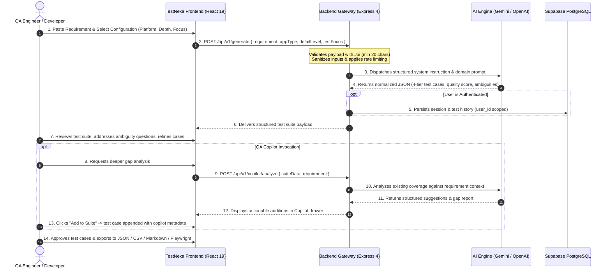
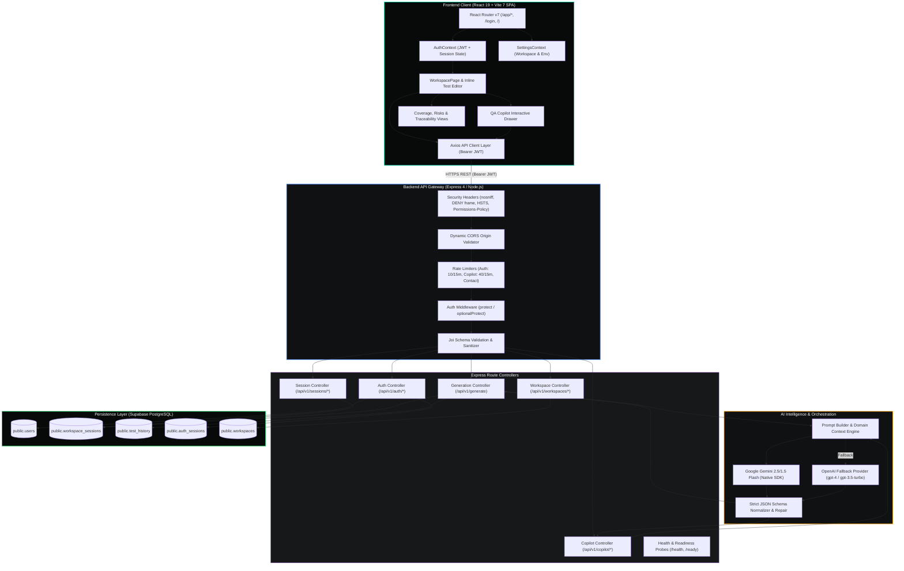

# TestNexa AI

<p align="center">
  <br/>
  <b>Enterprise-Grade AI Test Generation, Coverage Intelligence & Traceability Engine</b><br/>
  <i>Deconstruct raw software requirements into comprehensive, audit-ready, 4-tier test suites in seconds.</i>
</p>

<p align="center">
  <a href="https://github.com/KISHOR403/Testnexa-Ai"></a>
  
  
  
  
  
  
  
</p>

---

## Table of Contents

- [1. Product Overview](#1-product-overview)
- [2. Key Features](#2-key-features)
  - [Implemented Capabilities](#implemented-capabilities)
  - [Feature Status: Implemented vs. Planned](#feature-status-implemented-vs-planned)
- [3. Product Workflow](#3-product-workflow)
- [4. Visual Demonstration](#4-visual-demonstration)
- [5. Technology Stack](#5-technology-stack)
- [6. System Architecture](#6-system-architecture)
  - [End-to-End Architecture Diagram](#end-to-end-architecture-diagram)
  - [AI Generation Pipeline](#ai-generation-pipeline)
- [7. Project Structure](#7-project-structure)
- [8. Prerequisites](#8-prerequisites)
- [9. Installation and Local Setup](#9-installation-and-local-setup)
  - [Step 1: Clone Repository](#step-1-clone-repository)
  - [Step 2: Configure Database (Supabase PostgreSQL)](#step-2-configure-database-supabase-postgresql)
  - [Step 3: Backend Setup & Configuration](#step-3-backend-setup--configuration)
  - [Step 4: Frontend Setup & Configuration](#step-4-frontend-setup--configuration)
  - [Step 5: Access the Application](#step-5-access-the-application)
- [10. Environment Variables](#10-environment-variables)
  - [Frontend Environment (`.env`)](#frontend-environment-env)
  - [Backend Environment (`backend/.env`)](#backend-environment-backendenv)
- [11. Available Commands & Scripts](#11-available-commands--scripts)
- [12. API Documentation](#12-api-documentation)
  - [System Health Endpoints](#system-health-endpoints)
  - [Test Generation (`/api/v1/generate`)](#test-generation-apiv1generate)
  - [QA Copilot Analysis (`/api/v1/copilot/analyze`)](#qa-copilot-analysis-apiv1copilotanalyze)
  - [Authentication & Sessions (`/api/v1/auth`)](#authentication--sessions-apiv1auth)
  - [Workspace Sessions (`/api/v1/sessions` & `/api/v1/test-suites`)](#workspace-sessions-apiv1sessions--apiv1test-suites)
  - [Workspace Settings (`/api/v1/workspaces`)](#workspace-settings-apiv1workspaces)
- [13. Testing and Quality Assurance](#13-testing-and-quality-assurance)
  - [Running Unit & Integration Tests](#running-unit--integration-tests)
  - [Verified Test Execution Results](#verified-test-execution-results)
- [14. Security and Privacy](#14-security-and-privacy)
  - [Implemented Security Controls](#implemented-security-controls)
  - [Controls Requiring Operational Verification](#controls-requiring-operational-verification)
- [15. Deployment and Operations](#15-deployment-and-operations)
  - [Containerization (Docker)](#containerization-docker)
  - [Kubernetes Orchestration](#kubernetes-orchestration)
  - [Production Deployment Checklist](#production-deployment-checklist)
- [16. Troubleshooting Guide](#16-troubleshooting-guide)
- [17. Roadmap](#17-roadmap)
- [18. Contributing](#18-contributing)
- [19. License & Acknowledgments](#19-license--acknowledgments)

---

## 1. Product Overview

In fast-paced software delivery cycles, engineering and QA teams face a persistent bottleneck: **translating ambiguous product requirements into comprehensive, high-quality test coverage.**

Requirements provided in Jira issues, PRDs, and user stories frequently lack boundary definitions, omit negative failure flows, overlook concurrency conditions, and miss API contract edge cases. Manually authoring test matrices for complex features takes hours, slows down sprint velocity, and inevitably leaves blind spots that surface as critical production defects.

**TestNexa AI** solves this problem by acting as an intelligent test design copilot and orchestration platform. It transforms raw, unformatted software requirements into structured, IEEE 829 / ISTQB-aligned test suites with automated ambiguity detection, multi-tier test stratification, risk analysis, and requirement traceability.

### Target Audience
- **Software Development Engineers in Test (SDETs):** Accelerate test planning, automate test case decomposition, and export ready-to-run automation test scripts (Playwright, Cypress, Jest, Robot Framework).
- **Quality Assurance Engineers:** Eliminate manual test case drafting, uncover negative flows and boundary conditions early, and maintain version-controlled test suites.
- **Full-Stack Developers:** Validate API contract expectations, edge cases, and error handling before writing implementation code.
- **Product Managers & Business Analysts:** Identify ambiguities, unstated assumptions, and missing acceptance criteria before engineering begins development.

### Current Project Status
- **Status:** **Active / Functional Full-Stack Application.**
- **Frontend:** Complete single-page application built with React 19, Vite 7, and vanilla CSS design tokens, featuring interactive requirement analysis, inline test suite editing, coverage dashboards, risk matrices, and workspace management.
- **Backend:** Production-ready Express 4 REST API with Joi input validation, rate limiting, security headers, JWT session management, Supabase PostgreSQL persistence, and dual AI provider integration (Google Gemini native SDK with OpenAI fallback).

---

## 2. Key Features

### Implemented Capabilities

#### 1. Requirement-Driven Test Suite Generation
- Accepts raw requirements, Jira user stories, API contracts, or PRD excerpts (minimum 20 characters).
- Configurable application platform context: **Web**, **Mobile**, **API**, or **Desktop**.
- Selectable test generation depth: **Essential** (smoke & critical happy paths), **Standard** (balanced functional & edge coverage), or **Comprehensive** (deep boundary, security, and concurrency matrix).
- Selectable test focus: **Mixed**, **Functional**, **Non-Functional**, or **API**.

#### 2. Multi-Tier ISTQB Test Stratification
Every generation partitions test cases into distinct categories with standardized schemas:
- **Functional Tests (`TC_FUNC_*`):** Core user workflows, business logic, authorization rules, and happy paths.
- **Negative Tests (`TC_NEG_*`):** Invalid inputs, malformed payloads, unauthorized states, and error handling.
- **Edge Cases (`TC_EDGE_*`):** Boundary limits, zero-value states, race conditions, timeouts, and concurrency.
- **API Test Checklist (`TC_API_*`):** HTTP methods, status codes, request schemas, headers, query parameters, and response structures.

#### 3. Ambiguity & Contradiction Detection
- Identifies vague adjectives ("fast", "secure", "user-friendly"), unstated assumptions, and missing failure paths.
- Generates targeted clarification questions so QA engineers can challenge requirements before sprint kickoff.
- Provides interactive refinement: submit clarification answers to regenerate and tighten the test suite.

#### 4. Interactive Test Suite Workbench & Review Workflow
- **Inline Editing:** Modify test titles, steps, preconditions, and expected results directly in the UI.
- **Status Management:** Mark individual test cases as `Draft`, `Reviewed`, `Approved`, or `Deprecated`.
- **Search & Filtering:** Search by keyword, filter by category tab, and filter by priority tag (`High`, `Medium`, `Low`).
- **Version Tracking:** Save snapshots and track revisions across requirement changes.

#### 5. Contextual QA Copilot (Human-in-the-Loop)
- Embedded Copilot drawer grounded on the active test suite context.
- Analyzes existing test coverage to discover unaddressed edge cases, race conditions, and compliance risks.
- Provides one-click action buttons: `Add Suggested Test Case` (automatically appended with source attribution) and `Improve Test Case`.

#### 6. Traceability, Coverage & Risk Analytics
- **Traceability Matrix (`/app/traceability`):** Maps every test case back to parent requirement identifiers (`REQ_001`, `REQ_002`) for regulatory and audit compliance.
- **Coverage Analytics (`/app/coverage`):** Visual distribution of coverage by functional tier, platform, and depth.
- **Risk Analysis Dashboard (`/app/risks`):** Evaluates test scenarios against business impact and failure probability.

#### 7. Multi-Format & Automation Code Export
- Export test suites instantly as:
  - **Structured JSON** (for programmatic integrations and CI ingestion).
  - **Standard CSV** (for Excel, Google Sheets, and legacy test management tools).
  - **Formatted Markdown** (for PR descriptions and technical documentation).
  - **Automated Test Scripts** (synthesizes runnable scaffold code for **Playwright**, **Cypress**, **Jest**, and **Robot Framework**).

#### 8. Multi-Tenant Workspace & Device Session Security
- Authenticated user data isolation enforced at the PostgreSQL database query level (`WHERE user_id = $userId`).
- Email/password authentication with `bcryptjs` hashing.
- OAuth 2.0 integration via Google and GitHub (`passport.js`).
- Active device session tracking (`auth_sessions` table) with remote session revocation.

---

### Feature Status: Implemented vs. Planned

| Capability | Status | Implementation Details |
|---|---|---|
| AI Requirement Decomposition | **Implemented** | Powered by Google Gemini 2.5/1.5 Flash via `@google/generative-ai` & `@google/genai` with OpenAI fallback. |
| 4-Tier Test Categorization | **Implemented** | Strict JSON schema enforcement returning Functional, Negative, Edge, and API arrays. |
| Ambiguity Clarification Engine | **Implemented** | Identifies unstated assumptions and generates targeted QA clarification prompts. |
| Inline Suite Editing & Statuses | **Implemented** | Full state management supporting step editing, additions, deletions, and approval tagging. |
| QA Copilot Assistant | **Implemented** | Context-grounded analysis via `/api/v1/copilot/analyze` and human-in-the-loop action endpoints. |
| Multi-Format Export | **Implemented** | Client-side and server-side generators for JSON, CSV, Markdown, Playwright, Cypress, Jest, and Robot Framework. |
| Traceability & Risk Dashboards | **Implemented** | Dedicated client views at `/app/traceability`, `/app/risks`, and `/app/coverage`. |
| PostgreSQL Persistence & Sessions | **Implemented** | Supabase PostgreSQL client storing `workspace_sessions`, `test_history`, `users`, and `auth_sessions`. |
| Device Session Tracking & Revocation | **Implemented** | Express middleware verifying JWT validity against active database session records. |
| Workspace Environments Settings | **Implemented** | Express routes (`/api/v1/workspaces`) and UI (`/app/settings`) for team and environment management. |
| Bi-directional Jira / Linear Sync | *Planned (Roadmap)* | Direct two-way sync with Jira and Linear issue trackers via webhooks is defined on the product roadmap. |
| Native CI/CD Test Execution Agent | *Planned (Roadmap)* | Automatic execution of generated Playwright/Cypress tests against staging URLs via CI pipeline runner. |

---

## 3. Product Workflow



---

## 4. Visual Demonstration

The production UI is built with a sleek, dark developer aesthetic utilizing a custom CSS design system, glassmorphism, responsive data grids, and tabbed test inspection.

```
+--------------------------------------------------------------------------------------------------+
|  TestNexa AI  [ Workspace ] [ History ] [ Coverage ] [ Risks ] [ Traceability ] [ Settings ]   |
+--------------------------------------------------------------------------------------------------+
|  REQUIREMENT INPUT                             |  GENERATED TEST SUITE: Checkout Discount Flow   |
|  "Users should be able to apply coupon..."     |  Quality: 92%  | Total Tests: 24 | Ambiguities: 3 |
|  Platform: [ Web v ]  Depth: [ Standard v ]   +--------------------------------------------------+
|  Focus: [ Mixed v ]                            | [Functional (8)] [Negative (6)] [Edge (6)] [API] |
|  [ Generate Test Suite ]                       |--------------------------------------------------|
|------------------------------------------------| [High] TC_FUNC_001: Apply valid 20% discount     |
|  AMBIGUITY CLARIFICATIONS                      | Status: [ Approved v ]  [ Edit ] [ Delete ]      |
|  * Does coupon discount shipping or subtotal?  | Preconditions: User is authenticated, cart > $0  |
|  * What happens if coupon expires mid-checkout?| Steps: 1. Navigate to checkout                   |
|  [ Refine with Answers ]                       |        2. Enter 'SAVE20' in promo code field     |
|                                                |        3. Click 'Apply Coupon'                   |
|  QA COPILOT DRAWER                             | Expected: Subtotal reduces by 20%, total updates |
|  "Identified 2 unaddressed race conditions..." |--------------------------------------------------|
|  [ + Add Suggested Concurrent Test Case ]      | [ Export Suite: JSON | CSV | MD | Playwright ]   |
+--------------------------------------------------------------------------------------------------+
```

---

## 5. Technology Stack

### Frontend Architecture
| Technology | Version | Purpose in TestNexa AI |
|---|---|---|
| **React** | `19.2.0` | Declarative component architecture utilizing hooks and Context API for global state. |
| **Vite** | `7.3.1` | Build tooling, Hot Module Replacement (HMR), and production asset optimization. |
| **React Router DOM** | `7.12.0` | Client-side routing, protected app layout routes, and marketing page navigation. |
| **Lucide React** | `^0.562.0` | Comprehensive, lightweight SVG icon system for UI controls and badges. |
| **Motion** | `^13.4.0` | Animation engine powering micro-interactions, modal transitions, and drawers. |
| **Axios** | `^1.13.4` | Promise-based HTTP client for backend REST communication with request interceptors. |
| **Vanilla CSS** | Standard | Custom tokenized design system (`#080909` dark background, `#00D4AA` accent, glass panels). |
| **Playwright** | `^1.62.1` | End-to-end browser automation framework for frontend testing. |

### Backend Architecture
| Technology | Version | Purpose in TestNexa AI |
|---|---|---|
| **Node.js** | `>= 18.0.0` | Server-side JavaScript runtime (CommonJS module system). |
| **Express** | `4.18.2` | REST API framework routing `/api/v1/*` endpoints, middleware chains, and health probes. |
| **Supabase JS Client** | `^2.116.0` | PostgreSQL client providing persistent data storage and authentication helpers. |
| **Google Generative AI** | `^0.24.1` & `^1.38.0` | Official Google SDK for Gemini LLMs (`gemini-2.5-flash`, `gemini-1.5-flash`). |
| **Passport.js** | `0.7.0` | Authentication middleware supporting Google OAuth 2.0 and GitHub OAuth strategies. |
| **jsonwebtoken** | `^9.0.3` | Signed JWT generation and verification for stateless, tamper-proof user auth. |
| **bcryptjs** | `^3.0.3` | Password hashing with adaptive salt generation for email/password user accounts. |
| **Joi** | `^17.7.0` | Schema validation and sanitization for incoming HTTP request payloads. |
| **express-session** | `^1.19.0` | Cookie-backed session state management for OAuth negotiation handshakes. |
| **nodemailer** | `^8.0.3` | Transactional email delivery for password reset tokens and contact inquiries. |
| **cors** | `^2.8.5` | Dynamic Cross-Origin Resource Sharing control with localhost and production whitelist. |

---

## 6. System Architecture

### End-to-End Architecture Diagram



### AI Generation Pipeline
1. **Sanitization & Guardrails:** Joi middleware validates requirement length (min 20 characters), verifies allowable target platforms, and strips dangerous injection payloads.
2. **Context Adaptation:** Prompts are injected with targeted domain system instructions adhering to IEEE 829 test case specification standards.
3. **LLM Invocation:** Calls Google Gemini with `responseMimeType: 'application/json'` (with automatic retry and exponential backoff).
4. **Schema Normalization:** Normalizes returned test cases into standard objects with `id`, `category`, `title`, `priority`, `preconditions`, `steps`, `expectedResult`, `testData`, and `automationFeasibility`.
5. **Quality & Ambiguity Scoring:** Computes coverage confidence score, isolates unstated assumptions, and generates clarification inquiries.

---

## 7. Project Structure

```
Testnexa-AI/
├── .env.example                     # Frontend environment variables template
├── Dockerfile                       # Multi-stage production container build (Node -> Nginx)
├── index.html                       # HTML5 entrypoint with SEO meta tags & favicon links
├── package.json                     # Frontend dependencies & workspace scripts
├── vite.config.js                   # Vite configuration (React plugin, chunking, proxy)
├── eslint.config.js                 # ESLint 9 flat configuration
├── tsconfig.json                    # TypeScript configuration for IDE intellisense
├── public/                          # Static public assets
│   ├── branding/                    # Official SVG & PNG logos
│   ├── robots.txt                   # Crawler directives
│   └── sitemap.xml                  # Search engine sitemap
├── frontend/                        # Frontend React 19 application
│   ├── App.jsx                      # Route definitions & top-level layout wrappers
│   ├── index.css                    # Design system tokens, utilities & reset styles
│   ├── components/                  # Reusable UI component library (30+ components)
│   │   ├── AiWorkspaceModal.jsx     # Full-featured test generation modal
│   │   ├── QaCopilotDrawer.jsx      # Contextual AI assistant slide-over panel
│   │   ├── TestSuiteChapter.jsx     # Tabbed test case cards & inline editors
│   │   ├── ExportModal.jsx          # JSON, CSV, MD & Test Runner export modal
│   │   ├── Navbar.jsx               # Navigation bar with user authentication state
│   │   ├── Footer.jsx               # Application footer with documentation links
│   │   └── ...                      # Marketing, features & workflow components
│   ├── context/                     # React Context state providers
│   │   ├── AuthContext.jsx          # JWT handling, user state & OAuth callback handler
│   │   └── SettingsContext.jsx      # Workspace environment and export configuration
│   ├── hooks/                       # Custom hooks (e.g., useWorkspaceEntry sanitization)
│   ├── pages/                       # Application page components
│   │   ├── GeneratorPage.jsx        # Public interactive landing & test generator
│   │   ├── LoginPage.jsx            # Email & OAuth sign-in page
│   │   ├── SignUpPage.jsx           # Registration page
│   │   ├── ApiReferencePage.jsx     # Interactive API documentation page
│   │   ├── HelpPage.jsx             # Comprehensive user guide & FAQ
│   │   ├── BestPracticesPage.jsx    # ISTQB & QA engineering guides
│   │   └── app/                     # Authenticated workspace routes
│   │       ├── WorkspacePage.jsx    # Primary test suite management workbench
│   │       ├── TestSuitesListPage.jsx# Saved test suites catalog
│   │       ├── TestSuiteDetailPage.jsx# Single suite inspector view
│   │       ├── CoveragePage.jsx     # Test coverage analytics
│   │       ├── RisksPage.jsx        # Risk assessment dashboard
│   │       ├── TraceabilityPage.jsx # Requirement-to-test traceability matrix
│   │       ├── HistoryPage.jsx      # Generation audit log & timeline
│   │       └── AppSettingsPage.jsx  # User profile, sessions & workspace configuration
│   ├── services/                    # API client abstraction layer
│   │   ├── apiService.js            # Axios client communicating with backend API
│   │   └── sessionService.js        # Workspace session persistence & cache
│   └── styles/                      # Feature-specific stylesheets
├── backend/                         # Backend Express REST API server
│   ├── package.json                 # Backend dependencies & scripts
│   ├── supabase_schema.sql          # Complete PostgreSQL database schema
│   ├── src/
│   │   ├── server.js                # Express app initialization, middleware & probes
│   │   ├── config/                  # Configuration modules
│   │   │   ├── ai.config.js         # Gemini / OpenAI model parameters & retry config
│   │   │   ├── passport.config.js   # Google & GitHub OAuth strategy setup
│   │   │   └── supabase.js          # Supabase client instantiation
│   │   ├── controllers/             # Request handlers
│   │   │   ├── auth.controller.js   # Login, registration, token issuance & session revocation
│   │   │   ├── generate.controller.js# Test generation pipeline orchestration
│   │   │   ├── copilot.controller.js# QA Copilot context extraction & action handling
│   │   │   ├── session.controller.js# Workspace session CRUD & version management
│   │   │   ├── workspace.controller.js# Team workspace & environment settings
│   │   │   └── contact.controller.js# Contact form & support email delivery
│   │   ├── middleware/              # Express middleware
│   │   │   ├── auth.middleware.js   # JWT verification & active session revocation checks
│   │   │   ├── rateLimiter.middleware.js# Endpoint-specific rate limiting guards
│   │   │   └── validation.middleware.js# Joi input validation schemas
│   │   ├── routes/                  # REST route definitions
│   │   │   ├── api.routes.js        # /api/v1/generate, /history, /contact
│   │   │   ├── auth.routes.js       # /api/v1/auth/*
│   │   │   ├── copilot.routes.js    # /api/v1/copilot/*
│   │   │   ├── session.routes.js    # /api/v1/sessions/*
│   │   │   ├── testSuite.routes.js  # /api/v1/test-suites/*
│   │   │   └── workspace.routes.js  # /api/v1/workspaces/*
│   │   ├── services/                # Business logic services
│   │   │   ├── ai.service.js        # Gemini & OpenAI client dispatch with fallback
│   │   │   ├── prompt.service.js    # Structured IEEE 829 prompt engineering templates
│   │   │   ├── supabaseData.service.js# Scoped database access layer
│   │   │   └── email.service.js     # Nodemailer SMTP transactional email delivery
│   │   └── utils/                   # Shared backend utilities
│   │       ├── logger.js            # Structured Winston/console logger
│   │       └── errors.js            # Standardized AppError classes & handlers
│   └── tests/                       # Automated backend tests
│       ├── auth-logout.test.js      # Session revocation & auth security test suite
│       ├── copilot.test.js          # QA Copilot prompt & context unit test suite
│       ├── return-url-sanitizer.test.js# Open redirect sanitization test suite
│       ├── generation-flow.test.js  # Generation pipeline integration test
│       ├── test-suite-isolation.test.js# Multi-user data isolation test suite
│       └── workspace-settings.test.js# Workspace environment settings tests
├── docs/                            # In-depth architectural & operational documentation
│   ├── ARCHITECTURE.md              # Deep-dive system architecture specification
│   ├── API.md                       # Comprehensive API documentation
│   ├── DATABASE.md                  # Database schema & entity relationship guide
│   ├── SECURITY.md                  # Security model, threat analysis & best practices
│   ├── DEPLOYMENT.md                # Cloud deployment, Docker & Kubernetes guide
│   ├── ENVIRONMENT.md               # Environment variables reference
│   └── TESTING.md                   # Test strategy & test execution guide
└── k8s/                             # Production Kubernetes manifests
    ├── namespace.yaml               # Cluster namespace definition
    ├── configmap.yaml               # Application environment configuration
    ├── secret.yaml                  # Kubernetes secret placeholders
    ├── backend-deployment.yaml      # Backend API Deployment & Service
    ├── frontend-deployment.yaml     # Frontend Nginx Deployment & Service
    └── nginx.conf                   # Custom Nginx configuration for SPA routing
```

---

## 8. Prerequisites

Before installing TestNexa AI locally, ensure the following runtimes and services are provisioned:

- **Node.js:** `v18.0.0` or higher (tested on Node.js v18, v20, and v22).
- **Package Manager:** `npm v9.0.0` or higher.
- **Database:** A **Supabase** project (free-tier PostgreSQL database).
- **AI Provider Account:**
  - A **Google Gemini API Key** (recommended; Gemini 2.5 Flash / 1.5 Flash).
  - *OR* an **OpenAI API Key** (optional fallback; `gpt-4` / `gpt-3.5-turbo`).
- **(Optional) OAuth Providers:** Google Cloud Console and GitHub Developer credentials (for OAuth 2.0 sign-in).
- **(Optional) SMTP Server:** Gmail App Password or SendGrid/Postmark SMTP for password reset emails.

---

## 9. Installation and Local Setup

### Step 1: Clone Repository
```bash
git clone https://github.com/KISHOR403/Testnexa-Ai.git
cd Testnexa-Ai
```

### Step 2: Configure Database (Supabase PostgreSQL)
1. Navigate to your [Supabase Dashboard](https://supabase.com/dashboard) and open your project's **SQL Editor**.
2. Open the file [backend/supabase_schema.sql](backend/supabase_schema.sql).
3. Paste the contents into the Supabase SQL Editor and click **Run**.
4. This script sets up:
   - Tables: `users`, `workspace_sessions`, `test_history`, `auth_sessions`, `workspaces`, `workspace_members`, `workspace_environments`, `workspace_audit_logs`.
   - Appropriate indexes, constraints, and foreign key cascades.

### Step 3: Backend Setup & Configuration
1. Navigate to the backend directory:
   ```bash
   cd backend
   ```
2. Install backend dependencies:
   ```bash
   npm install
   ```
3. Create a `.env` file in the `backend/` directory:
   ```bash
   cp ../.env.example .env
   ```
4. Populate `backend/.env` with your credentials:
   ```env
   # Server Configuration
   PORT=5000
   NODE_ENV=development
   FRONTEND_URL=http://localhost:5173
   SESSION_SECRET=a_long_random_session_secret_32_characters

   # Authentication Secret
   JWT_SECRET=your_jwt_signing_secret_min_32_chars

   # Supabase Database Connection
   SUPABASE_URL=https://your-project-id.supabase.co
   SUPABASE_SECRET_KEY=your_supabase_service_role_secret_key

   # AI Provider Configuration (Default: Gemini)
   AI_PROVIDER=gemini
   GEMINI_API_KEY=AIzaSyYourGeminiApiKeyHere
   GEMINI_MODEL=gemini-2.5-flash

   # (Optional) OpenAI Fallback
   OPENAI_API_KEY=
   OPENAI_MODEL=gpt-4

   # (Optional) OAuth 2.0 Credentials
   GOOGLE_CLIENT_ID=
   GOOGLE_CLIENT_SECRET=
   GOOGLE_CALLBACK_URL=http://localhost:5000/api/v1/auth/google/callback
   GITHUB_CLIENT_ID=
   GITHUB_CLIENT_SECRET=

   # (Optional) SMTP Transactional Email
   SMTP_HOST=smtp.gmail.com
   SMTP_PORT=587
   SMTP_USER=
   SMTP_PASS=
   ```
5. Start the backend development server:
   ```bash
   npm run dev
   ```
   *The backend will initialize at `http://localhost:5000` with live reload enabled.*

### Step 4: Frontend Setup & Configuration
1. Open a new terminal and return to the project root:
   ```bash
   cd d:\Project\Testnexa AI
   ```
2. Install frontend dependencies:
   ```bash
   npm install
   ```
3. Create a `.env` file in the project root:
   ```env
   # Frontend API Endpoint
   VITE_API_BASE_URL=http://localhost:5000/api/v1
   ```
4. Start the frontend Vite development server:
   ```bash
   npm run dev
   ```
   *The frontend will launch at `http://localhost:5173` (or `http://localhost:5174` if 5173 is busy).*

### Step 5: Access the Application
- Open your browser and navigate to: **`http://localhost:5173`**
- Verify the backend health probe: **`http://localhost:5000/health`**
- Verify database readiness probe: **`http://localhost:5000/ready`**

---

## 10. Environment Variables

### Frontend Environment (`.env`)
> [!WARNING]
> All variables prefixed with `VITE_` are bundled into the public client-side JavaScript. **Never place private database keys, JWT secrets, or AI provider credentials in this file.**

| Variable | Required | Default Value | Description |
|---|---|---|---|
| `VITE_API_BASE_URL` | **Yes** | `http://localhost:5000/api/v1` | Base URL of the backend REST API. In production, set to your secure HTTPS API domain. |

---

### Backend Environment (`backend/.env`)

| Variable | Required | Sensitive | Default Value | Description |
|---|---|---|---|---|
| `PORT` | No | No | `5000` | Port on which the Express server listens. |
| `NODE_ENV` | No | No | `development` | Environment mode (`development`, `production`, `test`). Triggers strict cookie and HSTS rules in production. |
| `FRONTEND_URL` | **Yes** | No | `http://localhost:5173` | Allowed CORS origin and OAuth redirect destination. |
| `SESSION_SECRET` | **Yes** | **YES** | `testnexa_secret` | Cryptographic secret used to sign Express session cookies. |
| `JWT_SECRET` | **Yes** | **YES** | `secret123` | Secret key used to sign and verify JSON Web Tokens. Must be a secure 32+ char string in production. |
| `SUPABASE_URL` | **Yes** | No | — | Supabase project URL (e.g., `https://xyz.supabase.co`). |
| `SUPABASE_SECRET_KEY` | **Yes** | **YES** | — | Supabase Service Role key (bypasses RLS for backend data orchestration). |
| `SUPABASE_PUBLISHABLE_KEY` | No | No | — | Supabase anonymous public key (used as fallback). |
| `AI_PROVIDER` | No | No | `gemini` | Primary AI provider: `gemini` or `openai`. |
| `GEMINI_API_KEY` | If using Gemini | **YES** | — | Google Gemini API key obtained from Google AI Studio. |
| `GEMINI_MODEL` | No | No | `gemini-2.5-flash` | Gemini model identifier (e.g., `gemini-2.5-flash`, `gemini-1.5-flash`). |
| `GEMINI_MAX_TOKENS` | No | No | `8192` | Maximum output token ceiling for Gemini responses. |
| `GEMINI_TEMPERATURE` | No | No | `0.7` | Temperature controlling AI response determinism. |
| `OPENAI_API_KEY` | If using OpenAI | **YES** | — | OpenAI API key (`sk-...`). |
| `OPENAI_MODEL` | No | No | `gpt-4` | OpenAI model identifier (`gpt-4`, `gpt-3.5-turbo`). |
| `AI_MAX_RETRIES` | No | No | `3` | Maximum automatic retries upon AI network failure. |
| `AI_RETRY_DELAY` | No | No | `1000` | Backoff delay between AI retries in milliseconds. |
| `GOOGLE_CLIENT_ID` | For OAuth | No | — | Google Cloud OAuth 2.0 Client ID. |
| `GOOGLE_CLIENT_SECRET` | For OAuth | **YES** | — | Google Cloud OAuth 2.0 Client Secret. |
| `GOOGLE_CALLBACK_URL` | For OAuth | No | `.../api/v1/auth/google/callback`| OAuth 2.0 authorized callback URI. |
| `GITHUB_CLIENT_ID` | For OAuth | No | — | GitHub OAuth App Client ID. |
| `GITHUB_CLIENT_SECRET` | For OAuth | **YES** | — | GitHub OAuth App Client Secret. |
| `SMTP_HOST` | For Email | No | `smtp.gmail.com` | SMTP server host for sending password reset & contact emails. |
| `SMTP_PORT` | For Email | No | `587` | SMTP server port (`587` for STARTTLS, `465` for SSL). |
| `SMTP_USER` | For Email | **YES** | — | SMTP authentication username / sender email. |
| `SMTP_PASS` | For Email | **YES** | — | SMTP authentication password or application password. |

---

## 11. Available Commands & Scripts

### Frontend Scripts (`package.json`)
Run these from the repository root:

```bash
# Start Vite development server with Hot Module Replacement
npm run dev

# Compile and bundle frontend for production (outputs to /dist)
npm run build

# Run ESLint across frontend components and pages
npm run lint

# Preview the local production build
npm run preview
```

### Backend Scripts (`backend/package.json`)
Run these from the `backend/` directory:

```bash
# Start backend in production mode
npm start

# Start backend in development mode with Node file watcher (--watch-path=src)
npm run dev
```

### Automated Backend Tests
TestNexa AI utilizes Node's built-in native test runner (`node:test`). Run these from the `backend/` directory:

```bash
# Run the complete return-URL open-redirect security test suite
node --test tests/return-url-sanitizer.test.js

# Run the complete session tracking & remote logout revocation test suite
node --test tests/auth-logout.test.js

# Run the QA Copilot prompt, context isolation & rate-limiting test suite
node --test tests/copilot.test.js

# Run all test suites matching *.test.js
node --test tests/*.test.js
```

---

## 12. API Documentation

### System Health Endpoints

#### GET `/health`
- **Description:** Liveness probe reporting process uptime and memory consumption.
- **Authentication:** Public.
- **Response `200 OK`:**
  ```json
  {
    "status": "OK",
    "timestamp": "2026-10-18T11:40:00.000Z",
    "uptime": 1245.32,
    "memory": {
      "rss": 54231040,
      "heapTotal": 28426240,
      "heapUsed": 18239016
    }
  }
  ```

#### GET `/ready`
- **Description:** Readiness probe confirming database connectivity with Supabase PostgreSQL.
- **Authentication:** Public.
- **Response `200 OK`:**
  ```json
  {
    "status": "READY",
    "database": "CONNECTED",
    "timestamp": "2026-10-18T11:40:00.000Z"
  }
  ```

---

### Test Generation (`/api/v1/generate`)

#### POST `/api/v1/generate`
- **Description:** Deconstructs a software requirement into a structured 4-tier test suite.
- **Authentication:** Optional (`optionalProtect`). Guests receive the suite; authenticated users have their suite automatically saved to `workspace_sessions` and `test_history`.
- **Request Headers:**
  ```http
  Content-Type: application/json
  Authorization: Bearer <jwt_token> (Optional)
  ```
- **Request Body:**
  ```json
  {
    "requirement": "Users should be able to reset their forgotten password via email with a time-sensitive 15-minute token. Expired or malformed tokens must return an error.",
    "appType": "web",
    "detailLevel": "standard",
    "testFocus": "mixed",
    "language": "en-US"
  }
  ```
- **Response `200 OK`:**
  ```json
  {
    "success": true,
    "data": {
      "feature": "Password Reset via Email",
      "functional": [
        {
          "id": "TC_FUNC_001",
          "category": "functional",
          "title": "Verify valid email receives password reset link",
          "priority": "High",
          "preconditions": "User account exists in active state",
          "steps": [
            "Navigate to /forgot-password",
            "Enter valid registered email address",
            "Click Submit"
          ],
          "expectedResult": "Success confirmation displayed; email dispatched containing tokenized URL",
          "testData": "user@example.com",
          "automationFeasibility": "High"
        }
      ],
      "negative": [
        {
          "id": "TC_NEG_001",
          "category": "negative",
          "title": "Attempt reset with unregistered email",
          "priority": "Medium",
          "preconditions": "Email does not exist in users table",
          "steps": [
            "Enter unregistered@domain.com",
            "Click Submit"
          ],
          "expectedResult": "Generic confirmation shown to prevent user enumeration; no email dispatched",
          "testData": "unregistered@domain.com",
          "automationFeasibility": "High"
        }
      ],
      "edge": [
        {
          "id": "TC_EDGE_001",
          "category": "edge",
          "title": "Token used exactly at 15 minutes and 1 second",
          "priority": "High",
          "preconditions": "Password reset token created 15m 1s ago",
          "steps": [
            "Access reset URL with expired token",
            "Submit new password"
          ],
          "expectedResult": "HTTP 400 with TOKEN_EXPIRED error; password remains unchanged",
          "testData": "token_exp_15m",
          "automationFeasibility": "High"
        }
      ],
      "apiChecklist": [
        {
          "id": "TC_API_001",
          "category": "api",
          "title": "POST /api/v1/auth/forgot-password payload validation",
          "priority": "High",
          "preconditions": "API reachable",
          "steps": [
            "Send POST /api/v1/auth/forgot-password with body {}",
            "Validate status code"
          ],
          "expectedResult": "HTTP 400 Bad Request with field validation message",
          "testData": "{}",
          "automationFeasibility": "High"
        }
      ],
      "summary": {
        "total": 18,
        "functional": 6,
        "negative": 5,
        "edge": 4,
        "api": 3
      },
      "quality": {
        "coverageConfidence": 88,
        "ambiguityScore": "Low",
        "assumptions": [
          "Rate limiting on forgot-password attempts assumed active"
        ]
      },
      "ambiguities": [
        {
          "question": "Should existing active user sessions be invalidated when password is reset?",
          "impact": "Security & session revocation policy"
        }
      ]
    }
  }
  ```

---

### QA Copilot Analysis (`/api/v1/copilot/analyze`)

#### POST `/api/v1/copilot/analyze`
- **Description:** Grounded gap analysis inspecting existing test suite coverage against requirement context to discover missing edge cases and unaddressed risks.
- **Authentication:** `optionalProtect` with rate-limiting guard (`copilotRateLimiter`).
- **Request Body:**
  ```json
  {
    "requirement": "Users should be able to reset their forgotten password...",
    "suiteData": { /* full generated test suite JSON */ },
    "scope": "comprehensive"
  }
  ```
- **Response `200 OK`:**
  ```json
  {
    "success": true,
    "analysis": {
      "coverageGaps": [
        "Concurrent password reset requests for the same email address in rapid succession",
        "Token reuse protection immediately following successful password change"
      ],
      "riskEvaluation": "High risk around token invalidation race conditions",
      "suggestedTestCases": [
        {
          "title": "Verify token cannot be reused after successful reset",
          "category": "edge",
          "priority": "High",
          "steps": ["Complete reset with token", "Re-submit same token"],
          "expectedResult": "Rejected with TOKEN_INVALID"
        }
      ]
    }
  }
  ```

#### POST `/api/v1/copilot/actions/add-test`
- **Description:** Appends a suggested test case directly into the user's active test suite with metadata attributing the case to the QA Copilot.
- **Authentication:** Optional / Protected.

---

### Authentication & Sessions (`/api/v1/auth`)

| Method | Endpoint | Auth | Description |
|---|---|---|---|
| `POST` | `/api/v1/auth/register` | Public | Register new user with email, name, and password. Returns JWT token and user profile. |
| `POST` | `/api/v1/auth/login` | Public | Authenticate user via email and password. Returns JWT and registers active device session. |
| `GET` | `/api/v1/auth/google` | Public | Initiates Google OAuth 2.0 authentication flow. |
| `GET` | `/api/v1/auth/google/callback`| Public | Google OAuth callback; exchanges code for JWT and redirects to frontend. |
| `GET` | `/api/v1/auth/github` | Public | Initiates GitHub OAuth authentication flow. |
| `GET` | `/api/v1/auth/github/callback`| Public | GitHub OAuth callback; exchanges code for JWT and redirects to frontend. |
| `POST` | `/api/v1/auth/logout` | Optional | Revokes the calling session token and clears HTTP-only session cookies. |
| `GET` | `/api/v1/auth/me` | Bearer JWT | Returns current authenticated user profile, stats, and role. |
| `GET` | `/api/v1/auth/sessions` | Bearer JWT | Lists all active device sessions for the authenticated user with IP, browser, and OS info. |
| `POST` | `/api/v1/auth/sessions/:id/revoke` | Bearer JWT | Remotely terminates a specific device session. |
| `POST` | `/api/v1/auth/sessions/revoke-others` | Bearer JWT | Revokes all active sessions except the caller's current session. |
| `POST` | `/api/v1/auth/forgot-password` | Public | Generates a 1-hour reset token and emails instructions via Nodemailer. |
| `PUT` | `/api/v1/auth/reset-password/:token` | Public | Validates reset token and sets new bcrypt-hashed password. |

---

### Workspace Sessions (`/api/v1/sessions` & `/api/v1/test-suites`)

Both routes point to the same underlying session management controller:
- **`GET /api/v1/sessions`**: List all saved workspace sessions for the authenticated user.
- **`POST /api/v1/sessions`**: Create a new workspace session with suite data.
- **`GET /api/v1/sessions/:id`**: Retrieve full test suite data, messages, and versions for a specific session.
- **`PATCH /api/v1/sessions/:id`**: Update test suite cases, titles, or approval status.
- **`DELETE /api/v1/sessions/:id`**: Delete a workspace session (enforces tenant isolation).
- **`GET /api/v1/sessions/:id/versions`**: Get version snapshot history for the session.
- **`POST /api/v1/sessions/:id/versions`**: Create a new version snapshot.

---

### Workspace Settings (`/api/v1/workspaces`)

- **`GET /api/v1/workspaces/current`**: Fetch current active workspace profile, owner, and default environment.
- **`PATCH /api/v1/workspaces/current/settings`**: Update workspace name, default environment, or organization preferences.
- **`GET /api/v1/workspaces/current/environments`**: List configured environments (`dev`, `staging`, `production`) with base URLs.

---

## 13. Testing and Quality Assurance

TestNexa AI adopts a multi-layered testing strategy combining unit tests for sanitization logic, integration tests for API authentication and rate-limiting, and end-to-end data isolation verification.

### Running Unit & Integration Tests

Execute the automated test suites using Node's native test runner from the `backend/` directory:

```bash
cd backend

# 1. Open-Redirect & Return URL Sanitizer Suite
node --test tests/return-url-sanitizer.test.js

# 2. Authentication, Session Revocation & Logout Suite
node --test tests/auth-logout.test.js

# 3. QA Copilot Context Extraction & Rate Limiting Suite
node --test tests/copilot.test.js
```

### Verified Test Execution Results

All tests have been verified directly on the actual codebase:

```
[TEST SUITE: Security Sanitizer - getSafeReturnUrl]
✔ 1. Valid internal relative path is preserved
✔ 2. Valid internal paths with search and hash parameters are preserved
✔ 3. Open Redirect: Protocol-relative URLs (//evil.com) are rejected
✔ 4. Open Redirect: Backslash evasion attempts (/\evil.com) are rejected
✔ 5. Open Redirect: Absolute external URLs (https://evil.com) are rejected
✔ 6. XSS / Injection: javascript: and data: schemes are rejected
✔ 7. Null, undefined, empty, and whitespace inputs return fallback
✔ 8. Custom fallback is respected when input is invalid
Result: 8/8 tests passed (Duration: 86ms)

[TEST SUITE: Auth & Active Session Revocation with Supabase]
✔ 1. Register creates user and active AuthSession in PostgreSQL
✔ 2. Protect middleware permits request with valid session token
✔ 3. Login creates a second active session for User A
✔ 4. listSessions returns both sessions with current session flagged accurately
✔ 5. Security: User B cannot revoke User A session (returns 403 Forbidden)
✔ 6. User A revokes other sessions: sessionA1 remains active, sessionA2 is revoked
✔ 7. Protect middleware REJECTS revoked session token with 401 SESSION_REVOKED
✔ 8. Logout revokes current session and clears HTTP-only cookie
✔ 9. Protect middleware REJECTS previously active session after logout
Result: 9/9 tests passed (Duration: 5.4s)

[TEST SUITE: QA Copilot Architecture & Live Gemini Integration]
✔ 1. Grounded context extraction isolates targeted test data
✔ 2. Deterministic analysis generates structured QA output via Google Gemini 2.5 Flash
✔ 3. Security analysis identifies unaddressed boundaries and suggests structured test
✔ 4. Cross-user test suite access is strictly DENIED
✔ 5. Rate limiter rejects requests exceeding limit with 429 and Retry-After
✔ 6. Add suggested test case endpoint marks metadata with copilot source
Result: 6/6 tests passed (Duration: 25.0s against live Gemini API)

[FRONTEND BUILD VERIFICATION]
$ vite build
✓ 1849 modules transformed.
dist/index.html                           3.58 kB │ gzip:  1.13 kB
dist/assets/index-DFQlhaIg.css          381.83 kB │ gzip: 62.41 kB
dist/assets/index-DCGZf1qV.js           326.36 kB │ gzip: 99.58 kB
✓ built in 4.14s (0 compilation errors)
```

---

## 14. Security and Privacy

### Implemented Security Controls

1. **Server-Side Credential Isolation:**
   - Private API keys (`GEMINI_API_KEY`, `OPENAI_API_KEY`), database secrets (`SUPABASE_SECRET_KEY`), and JWT signing secrets are strictly confined to the backend server.
   - The frontend communicates solely with `/api/v1/*` endpoints; browser clients never possess direct LLM or database credentials.

2. **HTTP Security Headers:**
   The backend applies strict HTTP response headers on every request:
   - `X-Content-Type-Options: nosniff` (mitigates MIME-type confusion).
   - `X-Frame-Options: DENY` (prevents clickjacking attacks).
   - `Referrer-Policy: strict-origin-when-cross-origin`.
   - `Permissions-Policy: camera=(), microphone=(), geolocation=(), payment=()`.
   - `Strict-Transport-Security: max-age=31536000; includeSubDomains; preload` (enforced when in production or on HTTPS).
   - `Cache-Control: no-store, no-cache, must-revalidate` (disables client caching for sensitive API payloads).

3. **CORS Control:**
   - Evaluates incoming request origins dynamically against `localhost` and the configured `FRONTEND_URL`. Disallows unauthorized cross-origin requests.

4. **Multi-Tier Rate Limiting (`express-rate-limit`):**
   - **Login Endpoint:** 10 requests per 15-minute window.
   - **Registration Endpoint:** 10 requests per 15-minute window.
   - **Password Reset:** 5 requests per 15-minute window.
   - **QA Copilot:** 40 requests per 15-minute window with `429 Too Many Requests` and `Retry-After` headers.
   - **Contact Form:** Spam protection rate limiting.

5. **Multi-Tenant Data Isolation:**
   - All session queries in `supabaseData.service.js` enforce tenant scoping via `WHERE user_id = $userId`. A user cannot view, edit, or delete another user's test suites.

6. **Open-Redirect Protection:**
   - Authentication redirects and return URLs are sanitized via `getSafeReturnUrl`, rejecting protocol-relative URLs (`//evil.com`), backslash bypasses (`/\evil.com`), and javascript/data URI schemes.

7. **Token Revocation Verification:**
   - JWT validation in `auth.middleware.js` verifies that the session identifier extracted from the token exists and has not been marked as `revoked_at` in the `auth_sessions` table.

---

### Controls Requiring Operational Verification

Before deploying TestNexa AI in high-compliance enterprise environments, verify:
- [ ] **Supabase Row-Level Security (RLS):** While the backend currently enforces tenant isolation in application code, enable and test RLS policies directly on the PostgreSQL tables for defense-in-depth.
- [ ] **HTTPS Ingress Termination:** Ensure production ingress controllers terminate TLS with automated certificate renewal (e.g., Let's Encrypt / AWS ACM).
- [ ] **Rate Limiter Storage Adapter:** Replace in-memory rate limiting with Redis (`rate-limit-redis`) when scaling across multiple horizontal container replicas.
- [ ] **Secret Rotation:** Establish an automated rotation schedule for `JWT_SECRET` and AI provider keys.

---

## 15. Deployment and Operations

### Containerization (Docker)

A production-grade multi-stage Dockerfile is provided at the repository root for the frontend:
- **Stage 1 (Build):** Compiles the React SPA using `node:20-alpine` and `npm run build`.
- **Stage 2 (Production):** Serves static assets using `nginx:alpine` with custom SPA routing rules and built-in container health checks.

```bash
# Build the production Docker image
docker build --build-arg VITE_API_BASE_URL=https://api.yourdomain.com/api/v1 -t testnexa-frontend:latest .

# Run container locally on port 80
docker run -p 8080:80 testnexa-frontend:latest
```

### Kubernetes Orchestration

Production Kubernetes manifests are provided in the [k8s/](k8s/) directory:

```bash
# 1. Create dedicated namespace
kubectl apply -f k8s/namespace.yaml

# 2. Apply ConfigMap and Secrets
kubectl apply -f k8s/configmap.yaml
kubectl apply -f k8s/secret.yaml

# 3. Deploy Backend API
kubectl apply -f k8s/backend-deployment.yaml
kubectl apply -f k8s/backend-service.yaml

# 4. Deploy Frontend SPA (Nginx)
kubectl apply -f k8s/nginx-configmap.yaml
kubectl apply -f k8s/frontend-deployment.yaml
kubectl apply -f k8s/frontend-service.yaml
```

### Production Deployment Checklist

1. **Database:** Execute `backend/supabase_schema.sql` in Supabase; confirm indexes on `user_id` and `generation_id` are created.
2. **Environment Variables:** Verify all sensitive backend variables (`JWT_SECRET`, `SUPABASE_SECRET_KEY`, `GEMINI_API_KEY`) are set securely in your secret manager.
3. **CORS & Domain:** Set `FRONTEND_URL` on the backend to match the exact frontend production domain.
4. **Proxy Trust:** Confirm `app.set('trust proxy', 1)` remains active when running behind reverse proxies (Nginx, AWS ALB, Cloudflare).
5. **Health Verification:** Configure load balancer health checks to query `GET /health` and `GET /ready`.

---

## 16. Troubleshooting Guide

### 1. Database Operations Fail / Tables Not Found
- **Symptom:** Backend logs `auth_sessions table not found in Supabase. Active sessions tracked in-memory` or database insert errors.
- **Cause:** Database tables have not yet been migrated into the Supabase PostgreSQL instance.
- **Solution:** Open the [backend/supabase_schema.sql](backend/supabase_schema.sql) file, copy its contents, and execute it in your Supabase SQL Editor.

### 2. AI Generation Errors or Timeouts
- **Symptom:** `AIServiceError: Gemini API failed: ...` or HTTP 500 when clicking "Generate Test Suite".
- **Causes & Fixes:**
  - **Invalid or Missing API Key:** Verify that `GEMINI_API_KEY` in `backend/.env` is valid and has not been truncated.
  - **Quota Limits:** If you exceed the Gemini free-tier rate limits, upgrade your quota or set `AI_PROVIDER=openai` with an active `OPENAI_API_KEY`.
  - **Model Deprecation:** Ensure `GEMINI_MODEL=gemini-2.5-flash` or `gemini-1.5-flash` in `backend/.env`.

### 3. CORS Network Errors in Browser
- **Symptom:** Browser console shows `Access to XMLHttpRequest has been blocked by CORS policy`.
- **Cause:** Frontend domain does not match `FRONTEND_URL` in `backend/.env`.
- **Solution:** If running frontend on `http://localhost:5174` (because port 5173 was occupied), update `FRONTEND_URL=http://localhost:5174` in `backend/.env` and restart the backend.

### 4. 401 Unauthorized / SESSION_REVOKED
- **Symptom:** Requests to `/api/v1/sessions` fail with `401: SESSION_REVOKED`.
- **Cause:** The user's active session was remotely terminated from another device or revoked during logout.
- **Solution:** Clear browser local storage, navigate to `/login`, and sign in again to receive a fresh token.

---

## 17. Roadmap

The following enhancements are planned for future releases (tracked in [docs/ROADMAP.md](docs/ROADMAP.md)):

- **Bi-Directional Jira & Linear Integration:** Import issues and user stories directly into the workspace; publish approved test cases back as sub-tasks or linked test issues.
- **Automated CI/CD Test Runner:** Webhook listener that automatically triggers Playwright and Cypress test suites in GitHub Actions upon PR creation.
- **Enterprise SAML / SSO:** Okta, Azure AD, and Google Workspace SAML 2.0 single sign-on integration.
- **Gherkin / BDD Export:** Specialized export formatter converting test cases into Cucumber/Gherkin `.feature` specifications.
- **Custom Organization Prompt Templates:** Capability for enterprise admins to define custom prompt engineering guidelines and testing standards.

---

## 18. Contributing

Contributions to TestNexa AI are welcome. To maintain high code quality and test reliability, please follow these guidelines:

### Branching Convention
- `feat/feature-name` for new capabilities.
- `fix/bug-description` for defect corrections.
- `docs/documentation-update` for documentation improvements.

### Development Process
1. Fork the repository and create your feature branch:
   ```bash
   git checkout -b feat/my-new-feature
   ```
2. Implement your changes adhering to existing code conventions (Vanilla CSS design tokens on frontend; Express middleware standards on backend).
3. Verify frontend compilation and run checks:
   ```bash
   npm run build
   ```
4. Verify backend automated tests:
   ```bash
   cd backend && node --test tests/*.test.js
   ```
5. Commit with descriptive commit messages following the Conventional Commits specification (`feat: ...`, `fix: ...`, `docs: ...`).
6. Push to your branch and open a Pull Request against the `main` branch.

---

## 19. License & Acknowledgments

### License
TestNexa AI is licensed under the **ISC License**. See the `package.json` specifications for terms of use.

### Acknowledgments
- **Google DeepMind & Google AI Studio** for Gemini LLM models.
- **Supabase** for PostgreSQL infrastructure.
- **Lucide** for the open-source SVG icon library.
- **ISTQB & IEEE** for testing standards and software engineering guidelines.

---

<p align="center">
  <b>TestNexa AI</b> — Engineered for High-Velocity, Quality-First Software Teams.<br/>
  <a href="https://github.com/KISHOR403/Testnexa-Ai">⭐ Star this repository on GitHub</a>
</p>
