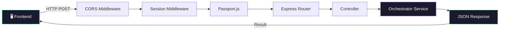
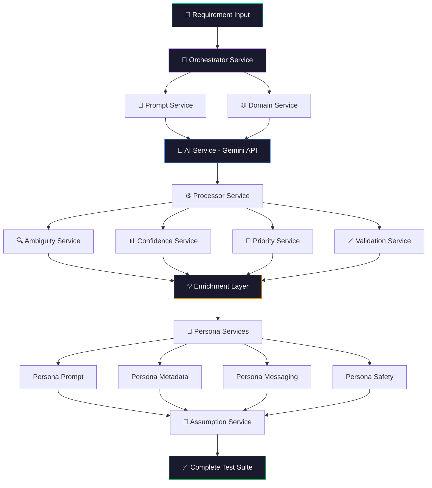
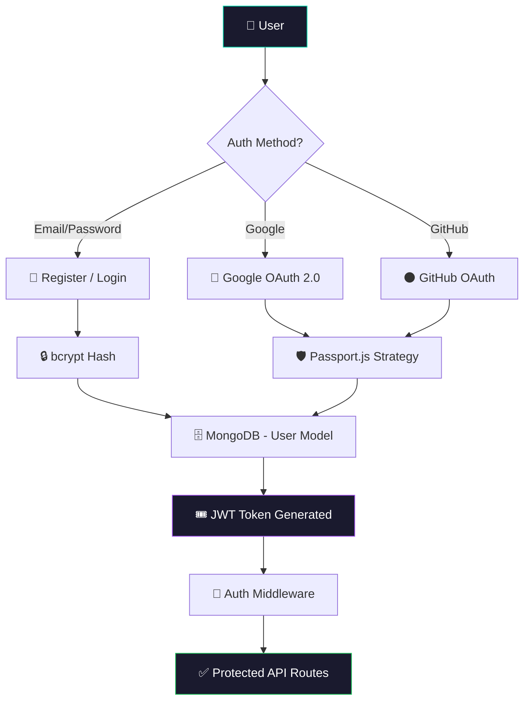

<h1 align="center">⚙️ Testnexa AI — Backend</h1>

<p align="center">
  <b>AI-Powered Test Generation API Server</b><br/>
  <i>Node.js + Express backend powering intelligent test case generation with Google Gemini AI</i>
</p>

<p align="center">
  
  
  
  
  
</p>

---

## 🌟 Overview

The backend is the core engine behind Testnexa AI. It receives product requirements from the frontend, processes them through a sophisticated **multi-service AI pipeline**, and returns comprehensive, prioritized test suites. It also handles user authentication via JWT, Google OAuth, and GitHub OAuth.

---

## 🏗️ Architecture

### Request Lifecycle



### AI Orchestration Pipeline



### Authentication Flow



---

## 📂 Project Structure

```
backend/
├── 📁 src/
│   ├── 📁 config/
│   │   ├── ai.config.js              # Gemini AI model configuration
│   │   └── passport.config.js         # Google & GitHub OAuth strategies
│   ├── 📁 controllers/
│   │   ├── auth.controller.js         # Login, Register, OAuth callbacks
│   │   └── generate.controller.js     # Test suite generation endpoint
│   ├── 📁 middleware/
│   │   └── auth.middleware.js         # JWT verification & route protection
│   ├── 📁 models/
│   │   └── user.model.js             # Mongoose User schema
│   ├── 📁 routes/
│   │   ├── api.routes.js             # /api/v1/* generation routes
│   │   └── auth.routes.js            # /api/v1/auth/* auth routes
│   ├── 📁 services/
│   │   ├── ai.service.js             # Google Gemini API integration
│   │   ├── orchestrator.service.js   # Main pipeline orchestrator
│   │   ├── prompt.service.js         # Dynamic prompt construction
│   │   ├── processor.service.js      # Response parsing & structuring
│   │   ├── ambiguity.service.js      # Requirement gap detection
│   │   ├── confidence.service.js     # Quality & confidence scoring
│   │   ├── domain.service.js         # Domain-specific logic detection
│   │   ├── priority.service.js       # Risk-based test prioritization
│   │   ├── assumption.service.js     # Assumption extraction & handling
│   │   ├── validation.service.js     # Input & output validation
│   │   ├── persona-prompt.service.js # Persona-based prompt tuning
│   │   ├── persona-metadata.service.js # Role-specific metadata
│   │   ├── persona-messaging.service.js # Persona-aware messaging
│   │   └── persona-safety.service.js # Safety & guardrail checks
│   ├── 📁 utils/
│   │   ├── errors.js                 # Custom error classes & formatting
│   │   └── logger.js                 # Structured logging utility
│   └── server.js                     # Express server entry point
├── .env                              # Environment variables
├── .env.example                      # Environment template
└── package.json                      # Dependencies & scripts
```

---

## 🔌 API Endpoints

| Method | Endpoint | Description | Auth |
|--------|----------|-------------|------|
| `POST` | `/api/v1/generate` | Generate test suite from requirement | Optional |
| `POST` | `/api/v1/auth/register` | Register new user | Public |
| `POST` | `/api/v1/auth/login` | Email/password login | Public |
| `GET` | `/api/v1/auth/google` | Initiate Google OAuth | Public |
| `GET` | `/api/v1/auth/google/callback` | Google OAuth callback | Public |
| `GET` | `/api/v1/auth/github` | Initiate GitHub OAuth | Public |
| `GET` | `/api/v1/auth/github/callback` | GitHub OAuth callback | Public |
| `GET` | `/api/v1/auth/me` | Get current user profile | Protected |
| `POST` | `/api/v1/auth/logout` | Logout user | Protected |
| `GET` | `/health` | Server health check | Public |

---

## 🛠️ Tech Stack

| Technology | Purpose |
|---|---|
| **Express.js** | REST API framework |
| **Google Gemini AI** | LLM for test generation |
| **Supabase (PostgreSQL)** | Database for users, test history, sessions & workspaces |
| **Passport.js** | OAuth 2.0 strategies |
| **JWT + bcryptjs** | Token auth & password hashing |
| **Joi** | Request validation |
| **express-session** | Session management |
| **CORS** | Cross-origin resource sharing |
| **dotenv** | Environment configuration |

---

## 🚀 Getting Started

```bash
# Install dependencies
npm install

# Configure environment variables
cp .env.example .env
# Edit .env with your API keys

# Start development server
npm run dev

# Server runs on http://localhost:5000
```

### Required Environment Variables

```env
PORT=5000
MONGODB_URI=mongodb://localhost:27017/testnexa
GEMINI_API_KEY=your_gemini_api_key
JWT_SECRET=your_jwt_secret
SESSION_SECRET=your_session_secret
FRONTEND_URL=http://localhost:5173
GOOGLE_CLIENT_ID=your_google_client_id
GOOGLE_CLIENT_SECRET=your_google_client_secret
GITHUB_CLIENT_ID=your_github_client_id
GITHUB_CLIENT_SECRET=your_github_client_secret
```

---

## 🧪 Services Overview

| Service | Purpose |
|---|---|
| **Orchestrator** | Coordinates the entire generation pipeline |
| **AI Service** | Direct integration with Google Gemini API |
| **Prompt Service** | Builds dynamic, context-aware prompts |
| **Processor** | Parses and structures raw AI responses |
| **Ambiguity** | Detects contradictions & missing requirements |
| **Confidence** | Calculates quality & coverage scores |
| **Domain** | Identifies domain-specific testing patterns |
| **Priority** | Assigns risk-based priority levels |
| **Assumption** | Extracts & documents assumptions made |
| **Validation** | Validates inputs and outputs |
| **Persona (4 services)** | Adapts output for SDETs, PMs, and QA Freshers |

---

<p align="center">
  Part of <a href="https://github.com/KISHOR403/Testnexa-Ai"><b>Testnexa AI</b></a>
</p>
