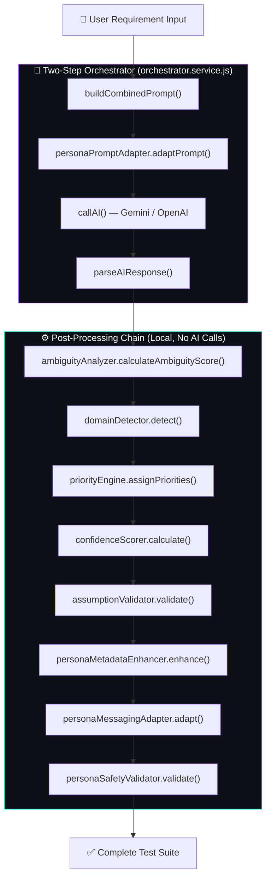

# AI Pipeline — Testnexa AI

> AI architecture, prompt engineering, and the test generation pipeline.

---

## Overview

Testnexa AI's intelligence layer is built around a **Two-Step Orchestrator** pattern that combines requirement understanding with test generation in a single optimized AI call, followed by a chain of local post-processing services.

---

## Pipeline Architecture



---

## Service Inventory (17 Services)

### Core AI Services

| Service | File | Size | Purpose |
|---------|------|------|---------|
| **AI Service** | `ai.service.js` | 5.5KB | Provider abstraction (Gemini/OpenAI) with retry logic |
| **Orchestrator** | `orchestrator.service.js` | 51KB | Main generation pipeline coordinator |
| **Prompt Service** | `prompt.service.js` | 19KB | Prompt templates for all generation modes |

### Analysis Services (Local, No AI Calls)

| Service | File | Size | Purpose |
|---------|------|------|---------|
| **Ambiguity** | `ambiguity.service.js` | 9KB | Scores requirement ambiguity (Low/Medium/High) |
| **Assumption** | `assumption.service.js` | 9KB | Validates and documents implicit assumptions |
| **Confidence** | `confidence.service.js` | 13KB | Calculates coverage confidence (0–100%) |
| **Domain** | `domain.service.js` | 13KB | Detects business domain (e-commerce, fintech, etc.) |
| **Priority** | `priority.service.js` | 10KB | Risk-based priority assignment (High/Medium/Low) |

### Persona Services

| Service | File | Size | Purpose |
|---------|------|------|---------|
| **Persona Prompt** | `persona-prompt.service.js` | 3KB | Adapts prompts for user persona (SDET/PM/Fresher) |
| **Persona Metadata** | `persona-metadata.service.js` | 16KB | Enriches test metadata per persona |
| **Persona Messaging** | `persona-messaging.service.js` | 9KB | Adapts UI messaging per persona |
| **Persona Safety** | `persona-safety.service.js` | 7KB | Validates persona-specific output safety |

### Support Services

| Service | File | Size | Purpose |
|---------|------|------|---------|
| **Copilot** | `copilot.service.js` | 27KB | QA Copilot analysis engine |
| **Processor** | `processor.service.js` | 6KB | Response parsing and normalization |
| **Validation** | `validation.service.js` | 6KB | Input validation with Joi schemas |
| **Supabase Data** | `supabaseData.service.js` | 26KB | Database operations layer |
| **Email** | `email.service.js` | 10KB | Email delivery (welcome, reset) |

---

## Prompt Engineering

### System Prompt

The core system prompt establishes the AI as a senior QA architect:

```
You are a senior QA architect and SDET with deep industry experience.
Your task is to design high-quality, realistic, execution-ready test cases
strictly following industry standards (e.g., ISTQB, IEEE 829, BDD).
```

**Key instructions:**
- Output must be valid JSON only
- Follow strict 12-field test case schema
- Use professional QA terminology
- Don't invent features or assume unstated behavior
- Prefer clarity, structure, and testability
- Expected results must have unambiguous pass/fail criteria

### Test Case Schema

Every test case must contain exactly these fields:

| Field | Type | Example |
|-------|------|---------|
| `id` | string | `TC_FUNC_001` |
| `testScenario` | string | `User Authentication` |
| `module` | string | `Login` |
| `title` | string | `Verify successful login with valid credentials` |
| `type` | string | `Functional` / `Negative` / `Edge` / `API` |
| `priority` | string | `High` / `Medium` / `Low` |
| `severity` | string | `Critical` / `Major` / `Minor` / `Trivial` |
| `preconditions` | string | `User has a registered account` |
| `testData` | string | `Email: test@mail.com, Password: Pass123` |
| `steps` | string[] | `["Navigate to login page", "Enter email"]` |
| `expectedResult` | string | `User is redirected to dashboard` |
| `requirementId` | string | `REQ_001` |

### Prompt Templates

The `prompt.service.js` contains specialized templates for each test focus:

| Template | Purpose |
|----------|---------|
| `buildFunctionalFocusPrompt()` | Functional tests only (happy paths, core workflows) |
| `buildNonFunctionalFocusPrompt()` | Performance, security, usability tests |
| `buildApiFocusPrompt()` | API endpoint-level tests |
| `buildMixedPrompt()` | All categories combined (default) |
| `buildRegenerationPrompt()` | Refinement with prior context |

### Combined Prompt Strategy

The orchestrator uses a **single combined prompt** that merges requirement understanding and test generation into one AI call for efficiency:

```javascript
buildCombinedPrompt(requirement, config) {
    // Combines:
    // 1. Requirement deconstruction instructions
    // 2. Business rule extraction
    // 3. Test generation for all categories
    // 4. Quality assessment
    // All in a single prompt → single AI call
}
```

---

## AI Provider Abstraction

### Provider Selection

```javascript
const provider = aiConfig.provider; // 'gemini' or 'openai'

if (provider === 'gemini') {
    response = await callGemini(prompt, options);
} else if (provider === 'openai') {
    response = await callOpenAI(prompt, options);
}
```

### Gemini Configuration

```javascript
generationConfig = {
    maxOutputTokens: 65536,           // Large output for comprehensive suites
    temperature: 0.2,                 // Low for consistency
    responseMimeType: 'application/json',  // Structured JSON output
    thinkingConfig: { thinkingBudget: 2048 }  // Reasoning for 2.5+ models
};
```

### Retry Logic

```javascript
const callAI = async (prompt, options = {}) => {
    const maxRetries = 3;
    const baseRetryDelay = 1000;

    for (let attempt = 1; attempt <= maxRetries; attempt++) {
        try {
            return await callProvider(prompt, options);
        } catch (error) {
            const isRateLimit = error.statusCode === 429;
            
            if (attempt === maxRetries) throw error;
            
            // Exponential backoff, longer for rate limits
            const delay = isRateLimit
                ? Math.max(baseRetryDelay * 2, 5000) * Math.pow(1.5, attempt - 1)
                : baseRetryDelay * attempt;
            
            await sleep(delay);
        }
    }
};
```

---

## Post-Processing Chain

After the AI returns its response, a chain of **local** services enriches the output without additional AI calls:

### 1. Ambiguity Analysis

Scores the requirement clarity based on the AI's extracted understanding:
- Counts unresolved ambiguities and missing information
- Produces: `Low`, `Medium`, or `High` ambiguity score

### 2. Domain Detection

Identifies the business domain from keywords and context:
- E-commerce, fintech, healthcare, social media, etc.
- Enables domain-specific test case enrichment

### 3. Priority Assignment

Applies risk-based prioritization to test cases:
- `High` — Business-critical paths, data integrity, security
- `Medium` — Important but non-blocking workflows
- `Low` — Cosmetic, edge cases with low impact

### 4. Confidence Scoring

Calculates overall coverage confidence (0–100%):
- Based on requirement complexity vs. test coverage
- Considers category distribution completeness
- Factors in ambiguity level

### 5. Persona Enrichment

Adapts output for the target persona:
- **SDET:** Technical depth, automation hints, API specifics
- **PM/BA:** Business language, acceptance criteria framing
- **Fresher:** Explanatory content, learning-oriented descriptions

---

## QA Copilot AI

### Architecture

The Copilot uses a separate AI interaction pattern:

```javascript
const COPILOT_SYSTEM_PROMPT = `You are TestNexa QA Copilot, an intelligent 
QA analysis layer embedded directly inside the TestNexa Test Suite...`;
```

**Key principles:**
1. **Grounding** — Only reference provided requirement and test artifacts
2. **Honest Reporting** — Never claim the application implements untested behavior
3. **No Fluff** — No conversational pleasantries
4. **Structured Output** — JSON-only responses

### Context Building

The Copilot builds token-efficient context from:
- Suite metadata (title, requirement, quality scores)
- Test case summaries (categorized counts)
- Coverage gaps and risks
- Specific target test case (if scoped)

### Actions

| Action | Endpoint | Description |
|--------|----------|-------------|
| `analyze` | POST `/copilot/analyze` | Full suite analysis |
| `add-test` | POST `/copilot/actions/add-test` | Add suggested test |
| `improve-test` | POST `/copilot/actions/improve-test` | Improve existing test |
| `context` | GET `/copilot/context/:id` | Retrieve suite context |

---

## Fallback Generation

When the AI service is unavailable (non-rate-limit errors), the orchestrator generates fallback test cases using rule-based logic:

```javascript
generateFallbackTestCases(requirement, config) {
    // Generates basic test cases without AI:
    // - 3 functional tests (happy path patterns)
    // - 2 negative tests (invalid input patterns)
    // - 2 edge cases (boundary patterns)
    // Uses keyword extraction from requirement text
}
```

This ensures the user always receives output, even during AI outages.

---

## Debugging

### Raw Response Logging

Every AI response is saved to `backend/debug_raw_ai_response.txt` for debugging:

```javascript
fs.writeFileSync(
    path.join(__dirname, '../../debug_raw_ai_response.txt'),
    text || '(empty)'
);
```

### Short Response Warning

Responses under 200 characters trigger a warning log:

```javascript
if (text && text.length < 200) {
    logger.warn('Gemini response suspiciously short:', text);
}
```

---

*Last updated: September 2026*
