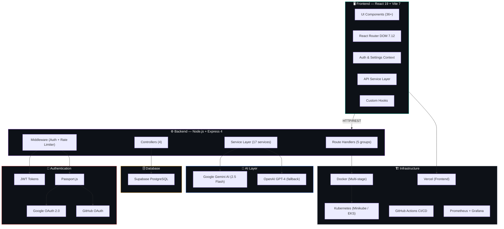
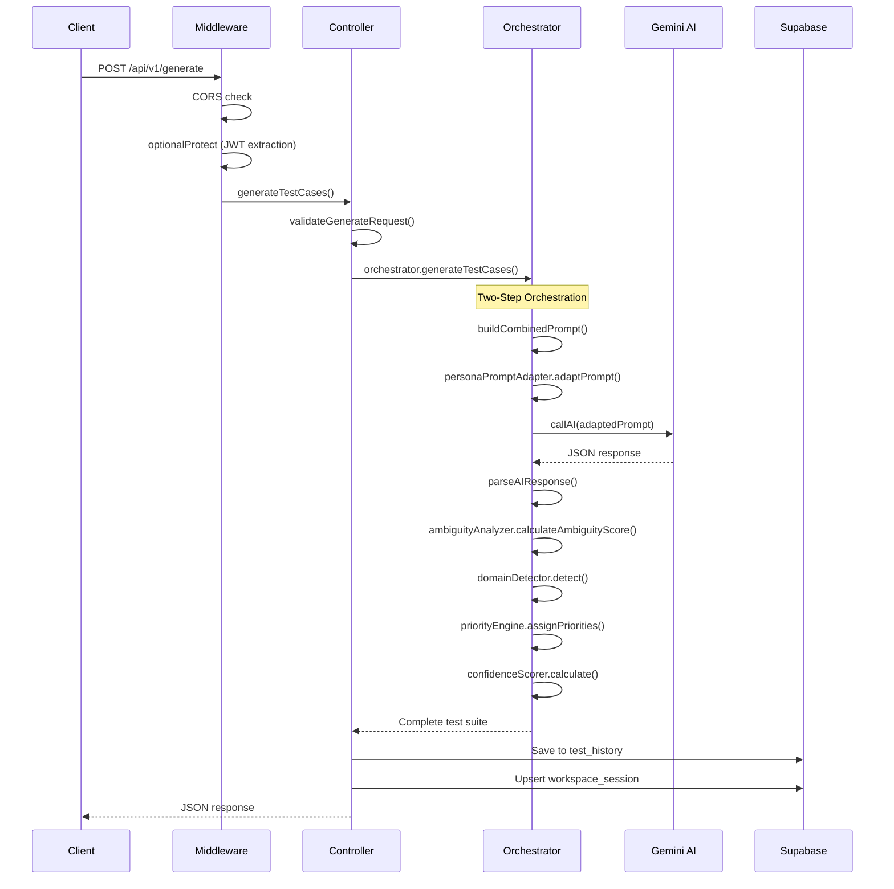

# Architecture — Testnexa AI

> System architecture, component design, and data flow documentation.

---

## High-Level Architecture

Testnexa AI follows a **client-server architecture** with a React SPA frontend, a Node.js/Express REST API backend, Google Gemini AI for intelligence, and Supabase PostgreSQL for persistence.



---

## Frontend Architecture

### Tech Stack

| Technology | Version | Purpose |
|------------|---------|---------|
| React | 19.2 | UI framework with hooks & context API |
| Vite | 7.2 | Build tool & dev server |
| React Router DOM | 7.12 | Client-side routing |
| Axios | 1.13 | HTTP client for API communication |
| Lucide React | 0.562 | Icon library |
| Motion | 13.4 | Animation library |
| Supabase JS | 2.116 | Client-side Supabase SDK |
| Vanilla CSS | — | Custom glassmorphism design system |

### Directory Structure

```
frontend/
├── App.jsx                    # Root component with route definitions
├── main.jsx                   # React DOM entry point
├── index.css                  # Global design system (527KB)
├── App.css                    # App-level styles
│
├── components/                # 36+ reusable UI components
│   ├── app/                   # Application shell components
│   ├── copilot/               # QA Copilot drawer components
│   ├── ui/                    # Primitive UI elements
│   ├── AiWorkspaceModal.jsx   # AI workspace overlay
│   ├── Hero.jsx               # Landing hero section
│   ├── InputPanel.jsx         # Requirement input with examples
│   ├── ResultsSection.jsx     # Test suite display (85KB)
│   ├── Navbar.jsx             # Navigation with auth state
│   ├── HistorySidebar.jsx     # Collapsible history panel
│   ├── ProfileModal.jsx       # User profile management
│   └── ... (30+ more)
│
├── pages/                     # Route-level pages
│   ├── app/                   # Authenticated app pages (8)
│   │   ├── WorkspacePage.jsx  # Main QA workbench
│   │   ├── HistoryPage.jsx    # Generation history
│   │   ├── TestSuitesListPage.jsx
│   │   ├── TestSuiteDetailPage.jsx
│   │   ├── CoveragePage.jsx
│   │   ├── RisksPage.jsx
│   │   ├── TraceabilityPage.jsx
│   │   └── AppSettingsPage.jsx
│   ├── GeneratorPage.jsx      # Public landing / generator
│   ├── LoginPage.jsx          # Email + OAuth login
│   ├── SignUpPage.jsx         # Registration
│   └── ... (10+ more)
│
├── context/                   # React Context providers
│   ├── AuthContext.jsx        # Authentication state management
│   └── SettingsContext.jsx    # User preferences
│
├── hooks/                     # Custom React hooks
│   ├── useHistory.js          # Generation history management
│   ├── useScrollReveal.js     # Scroll animation hook
│   └── useWorkspaceEntry.js   # Workspace session management
│
├── services/                  # API service layer
│   ├── apiService.js          # Test generation API client
│   ├── copilotService.js      # Copilot API client
│   ├── sessionService.js      # Session/workspace API client
│   └── supabaseClient.js      # Supabase client instance
│
├── layouts/                   # Layout wrappers
│   ├── MarketingLayout.jsx    # Public pages (Navbar + Footer)
│   ├── AuthLayout.jsx         # Login/signup (minimal chrome)
│   └── AppLayout.jsx          # App shell (sidebar + content)
│
├── styles/                    # Component-specific stylesheets
│   ├── redesign.css           # Core design system (172KB)
│   ├── enterprise-qa.css      # QA workspace styles (77KB)
│   └── ... (11 more CSS files)
│
└── utils/                     # Utility functions
    ├── coverageAnalytics.js   # Coverage calculation logic
    └── mockGenerator.js       # Mock data generators
```

### Routing Architecture

The app uses three layout tiers:

```mermaid
flowchart TD
    Router["BrowserRouter"]
    
    Router --> AuthLayout["AuthLayout (Minimal)"]
    Router --> MarketingLayout["MarketingLayout (Navbar + Footer)"]
    Router --> AppLayout["AppLayout (Protected + Sidebar)"]
    
    AuthLayout --> Login["/login"]
    AuthLayout --> Signup["/signup"]
    AuthLayout --> Forgot["/forgot-password"]
    AuthLayout --> Reset["/reset-password/:token"]
    
    MarketingLayout --> Home["/ (Generator)"]
    MarketingLayout --> Help["/help"]
    MarketingLayout --> Terms["/terms"]
    MarketingLayout --> API["/api-reference"]
    MarketingLayout --> Best["/best-practices"]
    MarketingLayout --> About["/about"]
    MarketingLayout --> Contact["/contact"]
    
    AppLayout --> Workspace["/app/workspace"]
    AppLayout --> History["/app/history"]
    AppLayout --> Suites["/app/test-suites"]
    AppLayout --> Coverage["/app/coverage"]
    AppLayout --> Risks["/app/risks"]
    AppLayout --> Trace["/app/traceability"]
    AppLayout --> Settings["/app/settings"]

    style AuthLayout fill:#1a1a2e,stroke:#ef4444,color:#fff
    style MarketingLayout fill:#1a1a2e,stroke:#00d4aa,color:#fff
    style AppLayout fill:#1a1a2e,stroke:#a855f7,color:#fff
```



Convenience redirects map legacy/shortcut URLs:
- `/workspace` → `/app/workspace`
- `/history` → `/app/history`
- `/suites/:id` → `/app/test-suites/:id`
- `/settings` → `/app/settings`

---

## Backend Architecture

### Tech Stack

| Technology | Version | Purpose |
|------------|---------|---------|
| Node.js | 20.x | Runtime environment |
| Express | 4.18 | REST API framework |
| @google/generative-ai | 0.24 | Gemini AI SDK |
| @google/genai | 1.38 | Next-gen Gemini SDK |
| Supabase JS | 2.116 | PostgreSQL client |
| Passport.js | 0.7 | OAuth strategies |
| JWT | 9.0 | Token authentication |
| bcryptjs | 3.0 | Password hashing |
| Joi | 17.7 | Request validation |
| Nodemailer | 8.0 | Email delivery |

### Directory Structure

```
backend/
├── src/
│   ├── server.js              # Express app entry point
│   │
│   ├── config/
│   │   ├── ai.config.js       # AI provider configuration
│   │   ├── passport.config.js # OAuth strategy setup
│   │   └── supabase.js        # Supabase client initialization
│   │
│   ├── controllers/
│   │   ├── auth.controller.js     # Authentication handlers
│   │   ├── generate.controller.js # Test generation handler
│   │   ├── session.controller.js  # Workspace session CRUD
│   │   └── copilot.controller.js  # QA Copilot analysis
│   │
│   ├── middleware/
│   │   ├── auth.middleware.js       # JWT verification (protect / optionalProtect)
│   │   └── rateLimiter.middleware.js # Sliding-window rate limiting
│   │
│   ├── routes/
│   │   ├── api.routes.js        # /api/v1/generate, /history
│   │   ├── auth.routes.js       # /api/v1/auth/*
│   │   ├── session.routes.js    # /api/v1/sessions/*
│   │   ├── testSuite.routes.js  # /api/v1/test-suites/*
│   │   └── copilot.routes.js    # /api/v1/copilot/*
│   │
│   ├── services/                # 17 specialized services
│   │   ├── ai.service.js              # AI provider abstraction (Gemini/OpenAI)
│   │   ├── orchestrator.service.js    # Two-step generation pipeline (51KB)
│   │   ├── prompt.service.js          # Prompt engineering templates
│   │   ├── ambiguity.service.js       # Ambiguity scoring engine
│   │   ├── assumption.service.js      # Assumption validation
│   │   ├── confidence.service.js      # Confidence scoring
│   │   ├── domain.service.js          # Domain detection
│   │   ├── priority.service.js        # Risk-based prioritization
│   │   ├── persona-prompt.service.js  # Persona prompt adaptation
│   │   ├── persona-metadata.service.js # Persona metadata enrichment
│   │   ├── persona-messaging.service.js # Persona messaging adaptation
│   │   ├── persona-safety.service.js  # Persona safety validation
│   │   ├── copilot.service.js         # QA Copilot analysis engine
│   │   ├── processor.service.js       # Response processing
│   │   ├── validation.service.js      # Input validation
│   │   ├── supabaseData.service.js    # Database operations (26KB)
│   │   └── email.service.js           # Email delivery (welcome, reset)
│   │
│   └── utils/
│       ├── logger.js            # Logging utility
│       ├── errors.js            # Custom error classes
│       └── deviceParser.js      # User-agent device detection
│
├── tests/                       # Test files
│   ├── auth-logout.test.js
│   ├── copilot.test.js
│   ├── generation-flow.test.js
│   ├── test-suite-isolation.test.js
│   ├── return-url-sanitizer.test.js
│   ├── e2e-data-isolation.cjs
│   ├── e2e-generation-flow.cjs
│   └── e2e-workspace-flow.cjs
│
├── supabase_schema.sql          # Database schema definition
├── Dockerfile                   # Production Docker image
└── package.json                 # Dependencies
```

### Request Processing Pipeline



---

## Data Flow

### Test Generation Data Flow

```
User Input (requirement text)
    │
    ▼
┌──────────────────────────┐
│  Validation Service      │ ← Joi schema validation
│  (min 20 chars, no junk) │
└──────────┬───────────────┘
           │
           ▼
┌──────────────────────────┐
│  Orchestrator Service    │ ← Single-pass combined prompt
│  (Two-Step Pipeline)     │
└──────────┬───────────────┘
           │
    ┌──────┴──────┐
    │             │
    ▼             ▼
┌────────┐  ┌──────────┐
│ Gemini │  │ Fallback │
│   AI   │  │ Generator│
└───┬────┘  └────┬─────┘
    │            │
    └─────┬──────┘
          │
          ▼
┌──────────────────────────┐
│  Post-Processing Chain   │
│  ├─ Ambiguity Analysis   │ ← Local scoring (no AI call)
│  ├─ Domain Detection     │ ← Local detection
│  ├─ Priority Assignment  │ ← Risk-based engine
│  ├─ Confidence Scoring   │ ← Quality assessment
│  └─ Persona Enrichment   │ ← SDET/PM/Fresher adaptation
└──────────┬───────────────┘
           │
           ▼
┌──────────────────────────┐
│  Persistence Layer       │
│  ├─ test_history         │
│  └─ workspace_sessions   │
└──────────────────────────┘
```

---

## Deployment Architecture

### Local Development

```
Frontend (Vite dev server) → http://localhost:5173
Backend (Express server)   → http://localhost:5000
Supabase (Cloud hosted)    → https://xxx.supabase.co
```

### Production — Kubernetes

```
┌──────────────────────────────────────────────────────┐
│                 Kubernetes Cluster                     │
│                                                       │
│  Namespace: testnexa                                  │
│  ┌──────────────────┐  ┌───────────────────────────┐ │
│  │ Frontend (×4)    │  │ Backend (×10)             │ │
│  │ Nginx + React    │  │ Node.js + Express         │ │
│  │ NodePort :30080  │  │ ClusterIP :5000           │ │
│  └──────────────────┘  └───────────────────────────┘ │
│                                                       │
│  Namespace: monitoring                                │
│  ┌──────────────┐  ┌──────────────┐                  │
│  │ Prometheus   │  │ Grafana      │                  │
│  │ :30090       │  │ :30030       │                  │
│  └──────────────┘  └──────────────┘                  │
└──────────────────────────────────────────────────────┘
```

### Production — Vercel + Render/Railway

- **Frontend:** Vercel (SPA with `vercel.json` rewrites)
- **Backend:** Render, Railway, or any Node.js host
- **Database:** Supabase Cloud (managed PostgreSQL)

---

## Key Design Patterns

| Pattern | Implementation |
|---------|---------------|
| **Service Layer** | 17 focused services encapsulate business logic, AI calls, and data access |
| **Middleware Chain** | Express middleware for auth, rate limiting, CORS, and logging |
| **Context Pattern** | React Context for auth state and settings (avoids prop drilling) |
| **Optional Auth** | `optionalProtect` middleware extracts user if present but doesn't block |
| **Retry with Backoff** | AI service retries up to 3× with exponential backoff for rate limits |
| **Graceful Degradation** | Fallback test generation when AI service is unavailable |
| **Multi-stage Docker** | Frontend: Node build → Nginx serve; Backend: Node alpine with non-root user |

---

*Last updated: September 2026*
