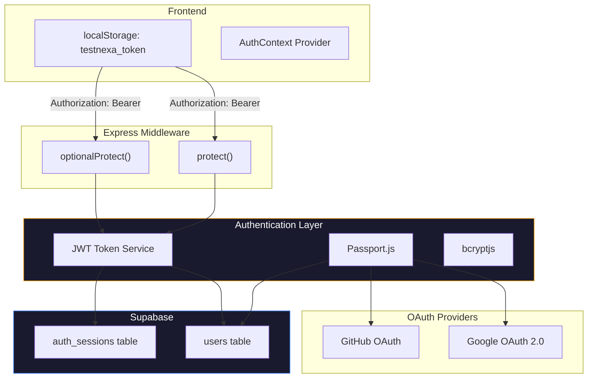

# Authentication — Testnexa AI

> Authentication architecture, flows, and session management.

---

## Overview

Testnexa AI implements a multi-strategy authentication system supporting:

1. **Email/Password** — Traditional registration with JWT tokens
2. **Google OAuth 2.0** — One-click Google sign-in
3. **GitHub OAuth** — Developer-friendly GitHub login
4. **Guest Mode** — Anonymous access with limited functionality

---

## Architecture



---

## JWT Token System

### Token Generation

Tokens are generated using `jsonwebtoken` with the following structure:

```javascript
const token = jwt.sign(
  { id: userId, sessionId: authSessionId },
  process.env.JWT_SECRET,
  { expiresIn: '7d' }
);
```

**Token payload:**
| Field | Description |
|-------|-------------|
| `id` | User UUID from Supabase |
| `sessionId` | Auth session UUID for session-level revocation |
| `iat` | Issued at timestamp |
| `exp` | Expiration timestamp (7 days) |

### Token Storage

- **Frontend:** `localStorage.setItem('testnexa_token', token)`
- **Transmission:** `Authorization: Bearer <token>` header on every API request

---

## Middleware

### `protect` (Required Auth)

Used on endpoints that strictly require authentication.

**Behavior:**
1. Extracts token from `Authorization: Bearer <token>` header
2. Verifies JWT signature and expiration
3. Checks for guest user tokens (`guest_` prefix in ID)
4. Validates session status in `auth_sessions` (not revoked, not expired)
5. Looks up user in Supabase `users` table
6. Attaches `req.user` object
7. Returns `401` if any check fails

**Guest User Handling:**
```javascript
if (decoded.id.toString().startsWith('guest_')) {
    req.user = { _id: decoded.id, id: decoded.id, isTemporary: true };
    return next();
}
```

### `optionalProtect` (Optional Auth)

Used on endpoints that work for both authenticated and anonymous users.

**Behavior:**
1. If `Authorization` header is present, extracts and verifies token
2. If valid, attaches `req.user` and `req.sessionId`
3. If missing or invalid, continues without error (`req.user = undefined`)
4. Never blocks the request

**Used by:** `/api/v1/generate`, `/api/v1/copilot/*`, `/api/v1/auth/logout`

---

## Email/Password Authentication

### Registration Flow

```
POST /api/v1/auth/register
```

1. Validate input (name, email, password) with Joi
2. Check if email already exists in Supabase
3. Hash password with `bcryptjs`
4. Create user record in `users` table
5. Generate JWT token
6. Create `auth_session` record
7. Send welcome email via Nodemailer (background, non-blocking)
8. Return token + user object

**Rate Limit:** 5 requests per 15 minutes

### Login Flow

```
POST /api/v1/auth/login
```

1. Validate input (email, password) with Joi
2. Look up user by email in Supabase
3. Compare password hash with `bcryptjs.compare()`
4. Update `last_login` and increment `login_count`
5. Generate JWT token with embedded session ID
6. Create `auth_session` record with device/browser info
7. Return token + user object

**Rate Limit:** 10 requests per 15 minutes

---

## OAuth Authentication

### Google OAuth

**Setup:**
- Strategy: `passport-google-oauth20`
- Scopes: `['profile', 'email']`
- Callback: `/api/v1/auth/google/callback`

**Flow:**
1. User clicks "Continue with Google"
2. Frontend navigates to `GET /api/v1/auth/google`
3. Passport redirects to Google consent screen
4. User authorizes Testnexa
5. Google redirects to callback URL
6. Passport strategy executes:
   - Extracts email, displayName, avatar from profile
   - Calls `supabaseService.upsertOAuthUser()` (insert or update)
   - Detects if user is new (for welcome email)
7. Generate JWT token
8. Redirect to `{FRONTEND_URL}?token={jwt}`
9. Frontend extracts token from URL params, stores in localStorage
10. Welcome email dispatched in background (if new user)

### GitHub OAuth

**Setup:**
- Strategy: `passport-github2`
- Scopes: `['user:email']`
- Callback: `/api/v1/auth/github/callback`

**Flow:** Identical to Google OAuth, with GitHub-specific profile extraction. Falls back to `username@github.com` if email is not public.

### OAuth Error Handling

On failure, redirects to: `{FRONTEND_URL}/login?error={error_message}`

---

## Guest Mode

Guest users receive a temporary JWT token with a `guest_` prefixed ID:

```javascript
req.user = {
    _id: 'guest_' + uniqueId,
    id: 'guest_' + uniqueId,
    isTemporary: true
};
```

**Limitations:**
- Limited number of free generations
- No history persistence
- No workspace session saving
- No access to protected routes (`protect` middleware rejects on user lookup)

---

## Session Management

### Auth Session Records

Every login (email or OAuth) creates an `auth_sessions` record:

```javascript
{
    user_id: userId,
    session_identifier: jwtSessionId,
    device: "Windows Desktop",    // parsed from User-Agent
    browser: "Chrome 130",        // parsed from User-Agent
    os: "Windows 11",             // parsed from User-Agent
    user_agent: rawUserAgent,
    ip_address: req.ip,
    location: "Unknown Location",
    expires_at: new Date(Date.now() + 7 * 24 * 60 * 60 * 1000),
    last_active_at: new Date()
}
```

### Activity Tracking

The `protect` middleware updates `last_active_at` on every authenticated request, but throttled to once every 2 minutes to avoid excessive writes:

```javascript
if (Date.now() - new Date(session.lastActiveAt).getTime() > 2 * 60 * 1000) {
    supabaseService.touchAuthSession(session.id).catch(() => {});
}
```

### Session Revocation

- **Single session:** `POST /api/v1/auth/sessions/:sessionId/revoke` — Sets `revoked_at`
- **All others:** `POST /api/v1/auth/sessions/revoke-others` — Revokes all except current
- **Logout:** `POST /api/v1/auth/logout` — Revokes current session

When a revoked session's token is used, the `protect` middleware detects `revoked_at !== null` and returns:

```json
{
    "success": false,
    "code": "SESSION_REVOKED",
    "message": "Session has been revoked or expired. Please sign in again."
}
```

---

## Password Reset

### Forgot Password Flow

```
POST /api/v1/auth/forgot-password
```

1. Validate email format
2. Look up user in Supabase
3. If user exists:
   - Generate cryptographic reset token
   - Set `reset_password_token` and `reset_password_expire` (time-limited)
   - Send reset email via Nodemailer with link: `{FRONTEND_URL}/reset-password/{token}`
4. Always return success (prevents email enumeration)

**Rate Limit:** 5 requests per 15 minutes

### Reset Password Flow

```
PUT /api/v1/auth/reset-password/:token
```

1. Find user by `reset_password_token` where `reset_password_expire > NOW()`
2. Hash new password with bcryptjs
3. Update user: set new password, clear token fields, set `password_changed_at`
4. Return success

---

## Rate Limiting

Authentication endpoints use specific rate limiters:

| Endpoint | Window | Max Requests | Message |
|----------|--------|-------------|---------|
| `POST /auth/login` | 15 minutes | 10 | Too many sign-in attempts |
| `POST /auth/register` | 15 minutes | 5 | Too many account creation attempts |
| `POST /auth/forgot-password` | 15 minutes | 5 | Too many password reset requests |
| `PUT /auth/reset-password` | 15 minutes | 5 | Too many password reset requests |

---

## Security Considerations

- Passwords hashed with bcryptjs (adaptive cost factor)
- JWT secret stored in environment variable (`JWT_SECRET`)
- OAuth client secrets never exposed to frontend
- Session revocation provides immediate token invalidation
- Rate limiting prevents brute-force attacks
- Password reset tokens are time-limited
- Email enumeration prevented (forgot-password always returns success)
- Guest tokens have limited scope and no database access

---

*Last updated: September 2026*
