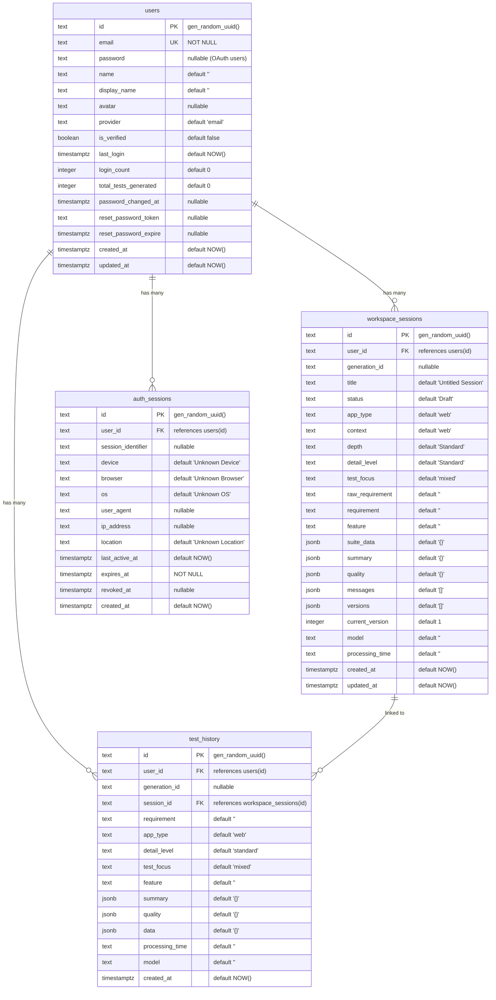
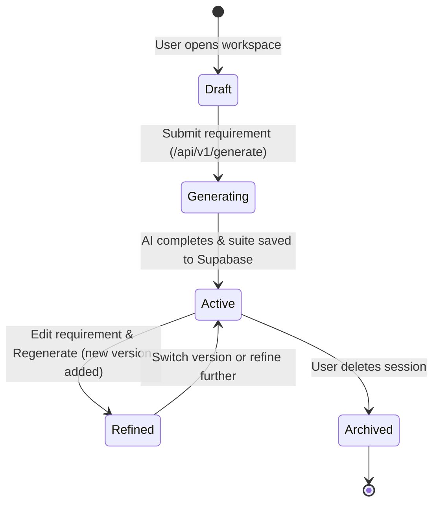
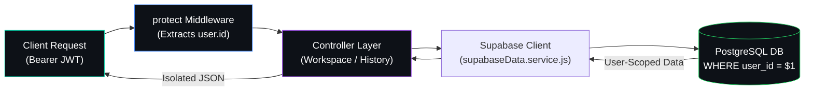

# Database — Testnexa AI

> Supabase PostgreSQL schema documentation and data model.

---

## Overview

Testnexa AI uses **Supabase** (managed PostgreSQL) as its sole persistence layer. The schema consists of **4 tables** covering users, workspace sessions, test history, and authentication sessions.

> **Migration Note:** The project originally used MongoDB Atlas but was fully migrated to Supabase PostgreSQL (see commit `38c6f44`).

---

## Entity-Relationship Diagram



---

## Table Definitions

### 1. `users`

Stores all registered user accounts (email + OAuth).

| Column | Type | Default | Description |
|--------|------|---------|-------------|
| `id` | TEXT (PK) | `gen_random_uuid()` | UUID primary key |
| `email` | TEXT (UNIQUE) | — | User email address (required) |
| `password` | TEXT | NULL | bcrypt hash (null for OAuth users) |
| `name` | TEXT | `''` | Full name |
| `display_name` | TEXT | `''` | Display name for UI |
| `avatar` | TEXT | NULL | Avatar URL (from OAuth provider) |
| `provider` | TEXT | `'email'` | Auth provider: `email`, `google`, `github` |
| `is_verified` | BOOLEAN | `false` | Email verification status |
| `last_login` | TIMESTAMPTZ | `NOW()` | Last login timestamp |
| `login_count` | INTEGER | `0` | Total login count |
| `total_tests_generated` | INTEGER | `0` | Lifetime test generation count |
| `password_changed_at` | TIMESTAMPTZ | NULL | Last password change |
| `reset_password_token` | TEXT | NULL | Active reset token |
| `reset_password_expire` | TIMESTAMPTZ | NULL | Reset token expiry |
| `created_at` | TIMESTAMPTZ | `NOW()` | Account creation |
| `updated_at` | TIMESTAMPTZ | `NOW()` | Last profile update |

**Indexes:**
- `idx_users_email` on `email`
- `idx_users_reset_token` on `reset_password_token`

---

### 2. `workspace_sessions`

Stores AI workspace sessions with full generation state.

| Column | Type | Default | Description |
|--------|------|---------|-------------|
| `id` | TEXT (PK) | `gen_random_uuid()` | Session UUID |
| `user_id` | TEXT (FK) | — | References `users(id)` ON DELETE CASCADE |
| `generation_id` | TEXT | NULL | Links to generation request |
| `title` | TEXT | `'Untitled Session'` | User-editable session name |
| `status` | TEXT | `'Draft'` | Session status |
| `app_type` | TEXT | `'web'` | Target platform |
| `context` | TEXT | `'web'` | Generation context |
| `depth` | TEXT | `'Standard'` | Legacy depth field |
| `detail_level` | TEXT | `'Standard'` | Generation detail level |
| `test_focus` | TEXT | `'mixed'` | Test category focus |
| `raw_requirement` | TEXT | `''` | Original unmodified requirement |
| `requirement` | TEXT | `''` | Current (possibly refined) requirement |
| `feature` | TEXT | `''` | AI-detected feature name |
| `suite_data` | JSONB | `'{}'` | Full test suite data (test cases, metadata) |
| `summary` | JSONB | `'{}'` | Generation summary statistics |
| `quality` | JSONB | `'{}'` | Quality scores and coverage metrics |
| `messages` | JSONB | `'[]'` | Copilot conversation messages |
| `versions` | JSONB | `'[]'` | Version history snapshots |
| `current_version` | INTEGER | `1` | Active version number |
| `model` | TEXT | `''` | AI model used |
| `processing_time` | TEXT | `''` | Generation duration string |
| `created_at` | TIMESTAMPTZ | `NOW()` | Session creation |
| `updated_at` | TIMESTAMPTZ | `NOW()` | Last modification |

**Indexes:**
- `idx_workspace_sessions_user_id` on `user_id`
- `idx_workspace_sessions_status` on `status`
- `idx_workspace_sessions_updated_at` on `updated_at DESC`
- `idx_workspace_sessions_generation_id` on `generation_id`

**Relationships:**
- `user_id` → `users(id)` ON DELETE CASCADE

---

### 3. `test_history`

Immutable log of all test generation events.

| Column | Type | Default | Description |
|--------|------|---------|-------------|
| `id` | TEXT (PK) | `gen_random_uuid()` | History entry UUID |
| `user_id` | TEXT (FK) | — | References `users(id)` ON DELETE CASCADE |
| `generation_id` | TEXT | NULL | Generation request identifier |
| `session_id` | TEXT (FK) | NULL | References `workspace_sessions(id)` ON DELETE SET NULL |
| `requirement` | TEXT | `''` | Input requirement text |
| `app_type` | TEXT | `'web'` | Target platform |
| `detail_level` | TEXT | `'standard'` | Generation depth |
| `test_focus` | TEXT | `'mixed'` | Category focus |
| `feature` | TEXT | `''` | AI-detected feature name |
| `summary` | JSONB | `'{}'` | Test count summary |
| `quality` | JSONB | `'{}'` | Quality assessment |
| `data` | JSONB | `'{}'` | Full test suite data |
| `processing_time` | TEXT | `''` | Duration string |
| `model` | TEXT | `''` | AI model used |
| `created_at` | TIMESTAMPTZ | `NOW()` | Generation timestamp |

**Indexes:**
- `idx_test_history_user_id` on `user_id`
- `idx_test_history_generation_id` on `generation_id`
- `idx_test_history_created_at` on `created_at DESC`

**Relationships:**
- `user_id` → `users(id)` ON DELETE CASCADE
- `session_id` → `workspace_sessions(id)` ON DELETE SET NULL

---

### 4. `auth_sessions`

Tracks active login sessions for device management and security.

| Column | Type | Default | Description |
|--------|------|---------|-------------|
| `id` | TEXT (PK) | `gen_random_uuid()` | Session UUID |
| `user_id` | TEXT (FK) | — | References `users(id)` ON DELETE CASCADE (NOT NULL) |
| `session_identifier` | TEXT | NULL | JWT-embedded session ID |
| `device` | TEXT | `'Unknown Device'` | Parsed device type |
| `browser` | TEXT | `'Unknown Browser'` | Parsed browser name |
| `os` | TEXT | `'Unknown OS'` | Parsed operating system |
| `user_agent` | TEXT | NULL | Raw User-Agent string |
| `ip_address` | TEXT | NULL | Client IP address |
| `location` | TEXT | `'Unknown Location'` | Geo-location estimate |
| `last_active_at` | TIMESTAMPTZ | `NOW()` | Last activity (updated every 2 min) |
| `expires_at` | TIMESTAMPTZ | — | Session expiry (NOT NULL) |
| `revoked_at` | TIMESTAMPTZ | NULL | Set when session is revoked |
| `created_at` | TIMESTAMPTZ | `NOW()` | Login timestamp |

**Indexes:**
- `idx_auth_sessions_user_id` on `user_id`
- `idx_auth_sessions_expires` on `expires_at`
- `idx_auth_sessions_revoked` on `revoked_at`

**Relationships:**
- `user_id` → `users(id)` ON DELETE CASCADE

---

## JSONB Data Structures

### `suite_data` (in `workspace_sessions`)

```json
{
  "functional": [/* test case objects */],
  "negative": [/* test case objects */],
  "edge": [/* test case objects */],
  "apiChecklist": [/* test case objects */],
  "understanding": {
    "feature": "string",
    "business_rules": ["string"],
    "inputs": ["string"],
    "outputs": ["string"],
    "risk_areas": ["string"]
  }
}
```

### `summary` (in both tables)

```json
{
  "total": 25,
  "functional": 8,
  "negative": 6,
  "edge": 7,
  "api": 4
}
```

### `quality` (in both tables)

```json
{
  "coverageConfidence": 85,
  "ambiguityScore": "Low",
  "assumptions": ["string"]
}
```

---

## Session Lifecycle & State Machine



---

## Data Access & Isolation Pipeline



---

## Database Operations

All database operations are centralized in `supabaseData.service.js` (26KB). Key operations include:

| Operation | Method | Description |
|-----------|--------|-------------|
| `findUserByEmail` | SELECT | Look up user by email |
| `findUserById` | SELECT | Look up user by UUID |
| `createUser` | INSERT | Register new email user |
| `upsertOAuthUser` | UPSERT | Create or update OAuth user |
| `saveTestHistory` | INSERT | Persist generation result |
| `getTestHistory` | SELECT | Fetch user's generation history |
| `createWorkspaceSession` | INSERT | Create new workspace |
| `updateWorkspaceSession` | UPDATE | Update session data |
| `getWorkspaceSessions` | SELECT | List user's sessions |
| `createAuthSession` | INSERT | Record new login |
| `getAuthSession` | SELECT | Check session validity |
| `touchAuthSession` | UPDATE | Update last_active_at |
| `revokeAuthSession` | UPDATE | Set revoked_at timestamp |

---

## Schema Setup

Run the schema in your Supabase SQL Editor:

```bash
# The schema file is located at:
backend/supabase_schema.sql
```

The schema is idempotent — it uses `CREATE TABLE IF NOT EXISTS` and `ADD COLUMN IF NOT EXISTS` for safe re-runs.

---

*Last updated: September 2026*
