# Architecture Decision Records — Testnexa AI

> Key technical decisions, their context, and consequences.

## Architectural Decision Map

```mermaid
graph TD
    Root["Testnexa AI Architectural Decisions"] --> DB["ADR-001: Supabase PostgreSQL<br/>(over MongoDB Atlas)"]
    Root --> AI["ADR-002: Google Gemini AI<br/>(Two-Step Orchestration)"]
    Root --> Auth["ADR-003: Stateless JWT + DB Sessions<br/>(over stateful sessions)"]
    Root --> Build["ADR-004: Vite 7 Build Engine<br/>(over Create React App)"]
    Root --> Style["ADR-005: Vanilla CSS Tokens<br/>(over Tailwind CSS)"]
    Root --> API["ADR-006: Modular Express.js<br/>(over NestJS / Fastify)"]
    Root --> OAuth["ADR-007: Passport.js OAuth<br/>(Google & GitHub)"]
    Root --> Test["ADR-008: Playwright & Native Runners<br/>(over Cypress)"]
    Root --> Schema["ADR-009: ISTQB 12-Field Schema<br/>(Standardized Test Case Model)"]

    style Root fill:#161b22,stroke:#00d4aa,stroke-width:2px,color:#fff
    style DB fill:#0d1117,stroke:#22c55e,color:#fff
    style AI fill:#0d1117,stroke:#a855f7,color:#fff
    style Auth fill:#0d1117,stroke:#3b82f6,color:#fff
    style Build fill:#0d1117,stroke:#f59e0b,color:#fff
    style Style fill:#0d1117,stroke:#00d4aa,color:#fff
    style API fill:#0d1117,stroke:#3b82f6,color:#fff
    style OAuth fill:#0d1117,stroke:#22c55e,color:#fff
    style Test fill:#0d1117,stroke:#ef4444,color:#fff
    style Schema fill:#0d1117,stroke:#a855f7,color:#fff
```

---

## ADR-001: Supabase PostgreSQL over MongoDB

### Status: **Accepted** (Implemented in commit `38c6f44`)

### Context

The project initially used MongoDB Atlas as its database. As the application matured, several limitations emerged:
- Document-based schema made referential integrity difficult
- No built-in relational joins for user → sessions → history queries
- Complex aggregation queries for analytics were cumbersome
- Schema validation was ad-hoc (application-level only)

### Decision

Migrate all persistence to **Supabase** (managed PostgreSQL) with a relational schema.

### Consequences

**Positive:**
- Proper foreign keys with `ON DELETE CASCADE` for data integrity
- SQL joins for efficient multi-table queries
- Built-in indexing and query optimization
- Free tier sufficient for development and moderate production load
- Built-in REST API and real-time subscriptions (available for future use)
- Row-Level Security (RLS) available for fine-grained access control

**Negative:**
- Migration effort from MongoDB to PostgreSQL
- JSONB columns used for flexible data (suite_data, quality, summary) — hybrid approach
- Supabase client SDK adds a dependency layer vs direct PostgreSQL

**Trade-off:** Accepted JSONB for semi-structured data (test suites, quality scores) while gaining relational integrity for core entities (users, sessions).

---

## ADR-002: Google Gemini AI as Primary Provider

### Status: **Accepted**

### Context

The project started with OpenAI (GPT-4) as the AI provider. Considerations for switching:
- OpenAI API costs for GPT-4 were significant for a free-tier product
- Google Gemini offered competitive quality with more generous free tiers
- Gemini 2.5 Flash introduced "thinking" capabilities useful for complex QA analysis
- JSON response mode (`responseMimeType: 'application/json'`) eliminated parsing issues

### Decision

Switch to **Google Gemini AI** (2.5 Flash) as the primary provider, with OpenAI as a configurable fallback.

### Consequences

**Positive:**
- Lower API costs (generous free tier for Gemini)
- Native JSON output mode eliminates response parsing errors
- Thinking budget feature improves reasoning quality for complex requirements
- Larger output token limits (65536 tokens) for comprehensive test suites
- Lower temperature (0.2) produces more consistent, deterministic output

**Negative:**
- Tied to Google's AI pricing changes
- Gemini has different rate limiting patterns than OpenAI
- Dual-provider code path must be maintained

**Mitigation:** Provider abstraction in `ai.service.js` makes switching trivial via environment variable.

---

## ADR-003: Vanilla CSS over Tailwind CSS

### Status: **Accepted**

### Context

The project needed a robust styling solution for a complex, premium UI. Options considered:
1. **Tailwind CSS** — Utility-first framework
2. **CSS Modules** — Scoped CSS per component
3. **Vanilla CSS** — Custom stylesheets with BEM-like conventions
4. **Styled Components** — CSS-in-JS

### Decision

Use **Vanilla CSS** with a custom design system in global stylesheets.

### Consequences

**Positive:**
- Full control over the glassmorphism design system
- No framework dependency or build-time CSS processing
- Complete ownership of the design language (True Black theme)
- Easier to implement complex animations and transitions
- No utility class bloat in JSX markup

**Negative:**
- Large CSS files (index.css: 527KB, redesign.css: 172KB)
- No automatic dead code elimination
- Class naming conventions are manual (risk of collisions)
- Harder to enforce consistency without utility constraints

**Trade-off:** Design fidelity and creative freedom prioritized over bundle size optimization.

---

## ADR-004: Express 4 over Fastify

### Status: **Accepted**

### Context

When building the backend, two frameworks were considered:
1. **Express 4** — Mature, extensive ecosystem, synchronous middleware
2. **Fastify** — Modern, performance-focused, schema-based validation

### Decision

Use **Express 4** as the REST API framework.

### Consequences

**Positive:**
- Largest middleware ecosystem (Passport.js, cors, express-session, etc.)
- Most documentation and community support for Node.js APIs
- Passport.js strategies (Google, GitHub OAuth) have first-class Express support
- Team familiarity and lower learning curve
- Battle-tested in production at scale

**Negative:**
- Lower raw performance than Fastify (not critical for this workload)
- No built-in schema validation (supplemented with Joi)
- Express 4 is older; Express 5 was in beta during development

**Trade-off:** Ecosystem compatibility and middleware availability prioritized over raw performance.

---

## ADR-005: JWT over Session Cookies for Auth

### Status: **Accepted**

### Context

Authentication strategy options:
1. **JWT Bearer Tokens** — Stateless, stored in localStorage
2. **Session Cookies** — Server-side sessions, stored in cookie
3. **Hybrid** — JWT in HTTP-only cookie

### Decision

Use **JWT Bearer Tokens** stored in `localStorage`, with server-side session records in `auth_sessions` for revocation.

### Consequences

**Positive:**
- Stateless authentication (no server-side session store needed)
- Easy cross-origin requests (no cookie domain issues)
- Simple client implementation (`Authorization: Bearer` header)
- Works seamlessly with OAuth redirect flows (token in URL param)
- Session table provides revocation capability despite stateless tokens

**Negative:**
- Tokens in localStorage are vulnerable to XSS (mitigated by React's JSX escaping)
- Token cannot be invalidated without server-side check (solved by `auth_sessions` table)
- Larger request payload than cookies

**Mitigation:** Added `auth_sessions` table to support session revocation, device tracking, and activity monitoring — providing the security benefits of server-side sessions with the simplicity of JWT.

---

## ADR-006: Two-Step Orchestrator Pattern

### Status: **Accepted**

### Context

Initial test generation used a simple prompt → response pattern. Issues:
- Large prompts with both understanding and generation instructions were unreliable
- Single-shot generation missed nuances in complex requirements
- No structured way to apply post-processing enhancements

### Decision

Implement a **Two-Step Orchestrator** with a combined prompt for understanding + generation, followed by a local post-processing chain.

### Consequences

**Positive:**
- Single AI call (fast) with combined understanding and generation
- Local post-processing chain adds analysis without additional AI costs
- Modular services (ambiguity, domain, priority, confidence, persona) can evolve independently
- Fallback generation when AI is unavailable
- Easy to add new post-processing steps

**Negative:**
- Orchestrator service is large (51KB, 1075 lines)
- Complex prompt engineering to get reliable combined output
- Single point of failure for the AI call

---

## ADR-007: Monorepo with Separate Package.json Files

### Status: **Accepted**

### Context

Project structure options:
1. **True monorepo** — Single package.json with workspaces
2. **Separate projects** — Independent repos for frontend and backend
3. **Shared root** — Separate package.json files under one repo

### Decision

Use a **shared repository** with separate `package.json` files for frontend (root) and backend (`backend/`).

### Consequences

**Positive:**
- Single repo for all code, docs, and infrastructure
- Shared git history and PRs
- Simpler CI/CD pipeline (one checkout)
- Vite config can reference frontend directory via alias (`@`)

**Negative:**
- Root `package.json` serves as the frontend package (slightly confusing)
- Different module systems: frontend (ESM) vs backend (CommonJS)
- `npm install` must be run in both root and `backend/` directories

---

## ADR-008: Custom Rate Limiter over express-rate-limit

### Status: **Accepted**

### Context

Rate limiting options:
1. **express-rate-limit** — Popular middleware package
2. **Custom implementation** — Sliding window rate limiter

### Decision

Implement a **custom sliding-window rate limiter** in `rateLimiter.middleware.js`.

### Consequences

**Positive:**
- Per-user rate limiting (by user ID, not just IP)
- Multiple named limiters with different configs per endpoint
- No external dependency
- Periodic cleanup of stale entries
- Full control over response format and error codes

**Negative:**
- In-memory storage (state lost on server restart)
- Not shared across multiple server instances (K8s pods)
- Must maintain custom code vs battle-tested library

**Future consideration:** For multi-instance deployments, consider Redis-backed rate limiting.

---

## ADR-009: Kubernetes with Minikube + EKS

### Status: **Accepted**

### Context

Deployment options:
1. **Platform-as-a-Service** — Vercel (frontend) + Render/Railway (backend)
2. **Containers** — Docker Compose
3. **Orchestration** — Kubernetes (Minikube dev, EKS prod)

### Decision

Use **Kubernetes** with Minikube for local development and AWS EKS for production. Vercel as an alternative frontend host.

### Consequences

**Positive:**
- Production-grade container orchestration
- Horizontal scaling (10 backend, 4 frontend replicas)
- Health checks, liveness/readiness probes
- Secrets management via K8s Secrets
- Monitoring stack (Prometheus + Grafana)
- Portable across cloud providers

**Negative:**
- Higher complexity than PaaS
- Requires K8s knowledge for operations
- Minikube requires 4 CPUs + 8GB RAM locally

---

## Decision Index

| ADR | Decision | Date | Status |
|-----|----------|------|--------|
| 001 | Supabase PostgreSQL over MongoDB | 2026 | Accepted |
| 002 | Gemini AI as primary provider | 2026 | Accepted |
| 003 | Vanilla CSS over Tailwind | 2026 | Accepted |
| 004 | Express 4 over Fastify | 2026 | Accepted |
| 005 | JWT over Session Cookies | 2026 | Accepted |
| 006 | Two-Step Orchestrator pattern | 2026 | Accepted |
| 007 | Monorepo with separate packages | 2026 | Accepted |
| 008 | Custom rate limiter | 2026 | Accepted |
| 009 | Kubernetes (Minikube + EKS) | 2026 | Accepted |

---

*Last updated: September 2026*
