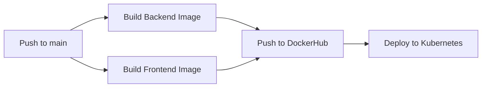

# Deployment — Testnexa AI

> Complete deployment guide for all target environments.

---

## Deployment Targets

| Target | Frontend | Backend | Status |
|--------|----------|---------|--------|
| **Local Development** | Vite dev server (:5173) | Node.js (:5000) | ✅ Primary |
| **Docker (Local)** | Nginx container | Node.js container | ✅ Supported |
| **Minikube** | K8s pod (×4 replicas) | K8s pod (×10 replicas) | ✅ Supported |
| **AWS EKS** | K8s pod + LoadBalancer | K8s pod + ClusterIP | ✅ Production |
| **Vercel** | Static SPA hosting | — | ✅ Frontend only |

---

## 1. Local Development

### Prerequisites

- Node.js v20 or higher
- A Supabase project (free tier works)
- Google Gemini API key

### Frontend

```bash
# From project root
npm install
npm run dev
# → http://localhost:5173
```

### Backend

```bash
cd backend
npm install

# Copy and configure environment variables
cp .env.example .env
# Edit .env with your keys (see docs/ENVIRONMENT.md)

npm run dev
# → http://localhost:5000
```

### Verify

- Open `http://localhost:5173` in browser
- Test health endpoint: `curl http://localhost:5000/health`
- Test readiness: `curl http://localhost:5000/ready`

---

## 2. Docker

### Frontend Docker Build

The frontend uses a **multi-stage build**: Node.js builds the Vite app, then Nginx serves it.

```bash
# From project root
docker build \
  -t testnexa-frontend:latest \
  --build-arg VITE_API_BASE_URL=http://localhost:5000/api/v1 \
  .
```

**Dockerfile highlights:**
- Stage 1: `node:20-alpine` — installs deps, runs `npm run build`
- Stage 2: `nginx:alpine` — serves static files from `/usr/share/nginx/html`
- Custom `nginx.conf` for SPA routing (all routes → `index.html`)
- Health check via `wget` on port 80

### Backend Docker Build

```bash
# From project root
docker build -t testnexa-backend:latest ./backend
```

**Dockerfile highlights:**
- Base: `node:20-alpine`
- Non-root user (`appuser:appgroup`) for security
- Production deps only (`npm ci --omit=dev`)
- Health check on `/health` endpoint

### Run with Docker

```bash
# Backend
docker run -d \
  --name testnexa-backend \
  -p 5000:5000 \
  --env-file backend/.env \
  testnexa-backend:latest

# Frontend
docker run -d \
  --name testnexa-frontend \
  -p 80:80 \
  testnexa-frontend:latest
```

---

## 3. Kubernetes — Minikube

### Prerequisites

- Docker Desktop installed and running
- Minikube installed
- kubectl installed

### Start Minikube

```bash
minikube start --cpus=4 --memory=8192
```

### Build Images in Minikube

```bash
# Point shell to Minikube's Docker daemon
eval $(minikube docker-env)       # Linux/macOS
& minikube -p minikube docker-env --shell powershell | Invoke-Expression  # PowerShell

# Build images
docker build -t testnexa-frontend:latest \
  --build-arg VITE_API_BASE_URL=http://testnexa-backend-service:5000/api/v1 .
docker build -t testnexa-backend:latest ./backend
```

### Configure Secrets

Edit `k8s/secret.yaml` and replace placeholder values with base64-encoded secrets:

```bash
echo -n "your_supabase_url" | base64
echo -n "your_jwt_secret" | base64
```

### Deploy

```bash
# Apply manifests in order
kubectl apply -f k8s/namespace.yaml
kubectl apply -f k8s/configmap.yaml
kubectl apply -f k8s/secret.yaml
kubectl apply -f k8s/nginx-configmap.yaml
kubectl apply -f k8s/backend-deployment.yaml
kubectl apply -f k8s/backend-service.yaml
kubectl apply -f k8s/frontend-deployment.yaml
kubectl apply -f k8s/frontend-service.yaml
```

### Verify

```bash
kubectl get pods -n testnexa
kubectl get svc -n testnexa
kubectl logs -n testnexa -l app=testnexa-backend --tail=50
```

### Access

```bash
minikube service testnexa-frontend-service -n testnexa --url
# Or: http://<minikube-ip>:30080
```

---

## 4. Kubernetes — AWS EKS (Production)

### Prerequisites

- AWS CLI configured (`aws configure`)
- kubectl installed
- Active EKS cluster

### Connect to EKS

```bash
aws eks update-kubeconfig --region <region> --name <cluster-name>
```

### Push Images to DockerHub

```bash
docker push <your-dockerhub>/testnexa-frontend:latest
docker push <your-dockerhub>/testnexa-backend:latest
```

> Update `image:` fields in `k8s/backend-deployment.yaml` and `k8s/frontend-deployment.yaml`.

### Deploy

```bash
kubectl apply -f k8s/
```

### Verify

```bash
kubectl get pods -n testnexa           # Expect 14 pods (10 backend + 4 frontend)
kubectl get svc testnexa-frontend-service -n testnexa  # Get LoadBalancer URL
```

### EKS Differences from Minikube

| Feature | Minikube | EKS |
|---------|----------|-----|
| Frontend access | NodePort (:30080) | AWS LoadBalancer (public URL) |
| Backend replicas | 10 | 10 |
| Frontend replicas | 4 | 4 |
| Scaling | Manual | Auto-scaling available |

---

## 5. Vercel (Frontend Only)

The frontend can be deployed to Vercel as a static SPA.

### Configuration

`vercel.json` at project root:

```json
{
  "rewrites": [
    { "source": "/(.*)", "destination": "/index.html" }
  ]
}
```

### Deploy

```bash
npx vercel --prod
```

### Environment Variable

Set `VITE_API_BASE_URL` in Vercel's project settings to point to your backend URL.

---

## 6. Monitoring — Prometheus + Grafana

### Deploy Monitoring Stack

```bash
kubectl apply -f k8s/monitoring/namespace.yaml
kubectl apply -f k8s/monitoring/prometheus-config.yaml
kubectl apply -f k8s/monitoring/prometheus-deployment.yaml
kubectl apply -f k8s/monitoring/grafana-deployment.yaml
```

### Access

| Service | URL | Credentials |
|---------|-----|-------------|
| Prometheus | `http://<ip>:30090` | None |
| Grafana | `http://<ip>:30030` | `admin` / `admin123` |

### Recommended Grafana Dashboards

Import by ID:
- **3119** — Kubernetes Cluster Monitoring (CPU, Memory, Pods)
- **6417** — Kubernetes Cluster (Prometheus)
- **15661** — Node Exporter Full

---

## 7. CI/CD Pipeline

GitHub Actions workflow (`.github/workflows/ci-cd.yaml`):

### Triggers

- **Push to `main`** — Build + Push + Deploy
- **Pull Request to `main`** — Build only (no push)

### Pipeline Stages



### Required Secrets

| Secret | Description |
|--------|-------------|
| `DOCKERHUB_USERNAME` | DockerHub account username |
| `DOCKERHUB_TOKEN` | DockerHub access token |

### Image Tags

Each build produces two tags:
- `latest` — Always points to newest build
- `<git-sha>` — Immutable tag for rollback

---

---

## 5. Vercel & HTTPS Configuration

### Vercel Frontend Deployment

The frontend repository is configured for immediate deployment to Vercel via [`vercel.json`](file:///d:/Project/Testnexa%20AI/vercel.json):

1. **SPA Rewrites**: All client routes (`/`, `/features`, `/workflow`, `/contact`, `/privacy`, `/terms`, etc.) rewrite to `/index.html`.
2. **Security Headers**: Edge automatically serves:
   - `X-Content-Type-Options: nosniff`
   - `X-Frame-Options: DENY`
   - `Referrer-Policy: strict-origin-when-cross-origin`
   - `Permissions-Policy: camera=(), microphone=(), geolocation=()`
3. **Static Asset Caching**: Built static assets under `/assets/` are served with `Cache-Control: public, max-age=31536000, immutable`.
4. **Environment Variables**: Set `VITE_API_BASE_URL` in the Vercel Project Dashboard pointing to the secure backend URL (e.g., `https://api.testnexa.ai/api/v1`).

### HTTPS & Reverse Proxy Verification

- **HTTPS Ingress**: HTTPS is terminated at the cloud ingress/CDN layer (Vercel, AWS ALB, Cloudflare, or Nginx Ingress).
- **Application Server**: Express is configured with `app.set('trust proxy', 1)` to correctly inspect client protocol headers (`X-Forwarded-Proto`).
- **HSTS**: When requests arrive via HTTPS in production (`x-forwarded-proto === 'https'`), Express sets `Strict-Transport-Security: max-age=31536000; includeSubDomains; preload`.
- **Local Development**: Runs gracefully over HTTP on `http://localhost:5173` and `http://localhost:5000` without forced redirects or self-signed certificate conflicts.

---

## Port Summary

| Service | Type | Internal Port | External Port |
|---------|------|---------------|---------------|
| Frontend (Dev) | Vite | 5173 | 5173 |
| Backend (Dev) | Express | 5000 | 5000 |
| Frontend (K8s) | NodePort | 80 | 30080 |
| Backend (K8s) | ClusterIP | 5000 | — |
| Prometheus | NodePort | 9090 | 30090 |
| Grafana | NodePort | 3000 | 30030 |

---

## Useful Commands

```bash
# Scale backend replicas
kubectl scale deployment testnexa-backend -n testnexa --replicas=15

# Rolling update after new image push
kubectl rollout restart deployment testnexa-backend -n testnexa
kubectl rollout restart deployment testnexa-frontend -n testnexa

# Check rollout status
kubectl rollout status deployment testnexa-backend -n testnexa

# Delete everything
kubectl delete namespace testnexa
kubectl delete namespace monitoring
```

---

*Last updated: September 2026*

