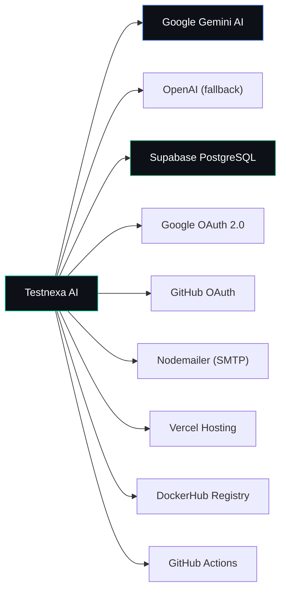

# Integrations — Testnexa AI

> Third-party service integrations and configuration.

---

## Integration Map



---

## 1. Google Gemini AI

**Purpose:** Primary AI engine for test case generation and Copilot analysis.

### SDK

```
@google/generative-ai: ^0.24.1
@google/genai: ^1.38.0
```

### Configuration

File: `backend/src/config/ai.config.js`

```javascript
gemini: {
    apiKey: process.env.GEMINI_API_KEY,
    model: process.env.GEMINI_MODEL || 'gemini-1.5-flash',
    maxTokens: parseInt(process.env.GEMINI_MAX_TOKENS) || 8192,
    temperature: parseFloat(process.env.GEMINI_TEMPERATURE) || 0.7,
}
```

### Usage

File: `backend/src/services/ai.service.js`

```javascript
const genAI = new GoogleGenerativeAI(aiConfig.gemini.apiKey);
const model = genAI.getGenerativeModel({
    model: 'gemini-2.5-flash',
    systemInstruction: SYSTEM_PROMPT
});

const result = await model.generateContent({
    contents: [{ role: "user", parts: [{ text: prompt }] }],
    generationConfig: {
        maxOutputTokens: 65536,
        temperature: 0.2,
        responseMimeType: 'application/json',
        thinkingConfig: { thinkingBudget: 2048 }  // For 2.5+ models
    }
});
```

### Features Used

- JSON response mode (`responseMimeType: 'application/json'`)
- System instructions for QA persona
- Thinking budget for reasoning models (Gemini 2.5+)
- Retry with exponential backoff (3 attempts)

### Error Handling

- Rate limit (429 / `RESOURCE_EXHAUSTED`) → Exponential backoff up to 5s base
- Quota exceeded → Propagated to client with retry guidance
- General errors → Fallback test case generator activated

### Setup

1. Get API key from [Google AI Studio](https://aistudio.google.com/)
2. Set `GEMINI_API_KEY` in backend `.env`
3. Set `AI_PROVIDER=gemini` in backend `.env`

---

## 2. OpenAI (Fallback)

**Purpose:** Alternative AI provider for test generation.

### Configuration

```javascript
openai: {
    apiKey: process.env.OPENAI_API_KEY,
    model: process.env.OPENAI_MODEL || 'gpt-4',
    maxTokens: parseInt(process.env.OPENAI_MAX_TOKENS) || 2000,
    temperature: parseFloat(process.env.OPENAI_TEMPERATURE) || 0.7,
}
```

### Usage

Direct HTTP requests to OpenAI's Chat Completions API via Axios (no SDK dependency):

```javascript
const response = await axios.post(
    'https://api.openai.com/v1/chat/completions',
    { model, messages, max_tokens, temperature },
    { headers: { 'Authorization': `Bearer ${apiKey}` } }
);
```

### Setup

1. Get API key from [OpenAI Platform](https://platform.openai.com/)
2. Set `OPENAI_API_KEY` in backend `.env`
3. Set `AI_PROVIDER=openai` in backend `.env`

---

## 3. Supabase (PostgreSQL)

**Purpose:** Primary database for all persistence (users, sessions, history, auth sessions).

### SDK

```
@supabase/supabase-js: ^2.116.0  (both frontend and backend)
```

### Backend Client

File: `backend/src/config/supabase.js`

```javascript
const { createClient } = require('@supabase/supabase-js');
const supabase = createClient(
    process.env.SUPABASE_URL,
    process.env.SUPABASE_SECRET_KEY
);
```

### Frontend Client

File: `frontend/services/supabaseClient.js`

Used for any direct Supabase operations from the client side.

### Data Service

File: `backend/src/services/supabaseData.service.js` (26KB)

Centralizes all database operations with:
- Graceful degradation if Supabase is unavailable (`isAvailable` flag)
- All CRUD operations for users, sessions, history, auth sessions
- Error handling and logging

### Setup

1. Create a project at [supabase.com](https://supabase.com)
2. Run `backend/supabase_schema.sql` in Supabase SQL Editor
3. Set `SUPABASE_URL` and `SUPABASE_SECRET_KEY` in backend `.env`

---

## 4. Google OAuth 2.0

**Purpose:** Social login via Google accounts.

### SDK

```
passport-google-oauth20: ^2.0.0
```

### Configuration

File: `backend/src/config/passport.config.js`

```javascript
passport.use(new GoogleStrategy({
    clientID: process.env.GOOGLE_CLIENT_ID,
    clientSecret: process.env.GOOGLE_CLIENT_SECRET,
    callbackURL: process.env.GOOGLE_CALLBACK_URL,
    proxy: true
}, async (accessToken, refreshToken, profile, done) => {
    // Extract email, name, avatar from profile
    // Upsert user in Supabase
    // Return authenticated user
}));
```

### Setup

1. Go to [Google Cloud Console](https://console.cloud.google.com/)
2. Create OAuth 2.0 Client ID (Web application type)
3. Add authorized redirect URI: `http://localhost:5000/api/v1/auth/google/callback`
4. Set `GOOGLE_CLIENT_ID`, `GOOGLE_CLIENT_SECRET`, `GOOGLE_CALLBACK_URL` in `.env`

---

## 5. GitHub OAuth

**Purpose:** Social login via GitHub accounts.

### SDK

```
passport-github2: ^0.1.12
```

### Configuration

File: `backend/src/config/passport.config.js`

```javascript
passport.use(new GitHubStrategy({
    clientID: process.env.GITHUB_CLIENT_ID,
    clientSecret: process.env.GITHUB_CLIENT_SECRET,
    callbackURL: process.env.GITHUB_CALLBACK_URL,
    proxy: true
}, async (accessToken, refreshToken, profile, done) => {
    // Extract email (or fallback to username@github.com)
    // Upsert user in Supabase
    // Return authenticated user
}));
```

### Setup

1. Go to [GitHub Developer Settings](https://github.com/settings/developers)
2. Create a new OAuth App
3. Set callback URL: `http://localhost:5000/api/v1/auth/github/callback`
4. Set `GITHUB_CLIENT_ID`, `GITHUB_CLIENT_SECRET`, `GITHUB_CALLBACK_URL` in `.env`

---

## 6. Nodemailer (SMTP)

**Purpose:** Email delivery for welcome emails and password reset flows.

### SDK

```
nodemailer: ^8.0.3
```

### Configuration

File: `backend/src/services/email.service.js`

Uses SMTP transport (default: Gmail):

```javascript
const transporter = nodemailer.createTransport({
    host: process.env.SMTP_HOST || 'smtp.gmail.com',
    port: process.env.SMTP_PORT || 587,
    auth: {
        user: process.env.SMTP_USER,
        pass: process.env.SMTP_PASS
    }
});
```

### Email Types

| Email | Trigger | Content |
|-------|---------|---------|
| **Welcome** | New user registration (email or OAuth) | Welcome message with getting started guide |
| **Password Reset** | Forgot password request | Reset link with time-limited token |

### Setup (Gmail)

1. Enable 2-Step Verification on your Google account
2. Generate an App Password: Google Account → Security → App Passwords
3. Set `SMTP_USER` (your email) and `SMTP_PASS` (app password) in `.env`

---

## 7. Vercel

**Purpose:** Frontend static site hosting with SPA routing.

### Configuration

File: `vercel.json` (project root)

```json
{
  "rewrites": [
    { "source": "/(.*)", "destination": "/index.html" }
  ]
}
```

### Behavior

- All routes rewrite to `index.html` (React Router handles routing)
- Static assets served from Vite build output
- Environment variables set in Vercel dashboard

---

## 8. DockerHub

**Purpose:** Container image registry for CI/CD deployment.

### Images

| Image | Source | Description |
|-------|--------|-------------|
| `testnexa-frontend:latest` | Root `Dockerfile` | Nginx + React SPA |
| `testnexa-backend:latest` | `backend/Dockerfile` | Node.js API server |

### CI/CD Integration

GitHub Actions builds and pushes images on every merge to `main`.

### Tags

- `latest` — Always the newest build
- `<git-sha>` — Immutable commit-specific tag

---

## 9. GitHub Actions

**Purpose:** CI/CD pipeline for automated builds and deployment.

### Workflow

File: `.github/workflows/ci-cd.yaml`

**Triggers:** Push to `main`, PR to `main`

**Jobs:**
1. `build-backend` — Docker build + push backend image
2. `build-frontend` — Docker build + push frontend image  
3. `deploy` — Kubernetes deployment instructions (manual)

### Required Secrets

| Secret | Purpose |
|--------|---------|
| `DOCKERHUB_USERNAME` | DockerHub login |
| `DOCKERHUB_TOKEN` | DockerHub access token |

---

## Integration Status

| Integration | Status | Critical | Notes |
|-------------|--------|----------|-------|
| Google Gemini AI | ✅ Active | Yes | Primary AI engine |
| OpenAI | ⚠️ Available | No | Fallback only |
| Supabase | ✅ Active | Yes | Sole database |
| Google OAuth | ✅ Active | No | Requires client credentials |
| GitHub OAuth | ✅ Active | No | Requires client credentials |
| Nodemailer | ✅ Active | No | Requires SMTP credentials |
| Vercel | ✅ Active | No | Frontend hosting only |
| DockerHub | ✅ Active | No | CI/CD image registry |
| GitHub Actions | ✅ Active | No | Build automation |

---

*Last updated: September 2026*
