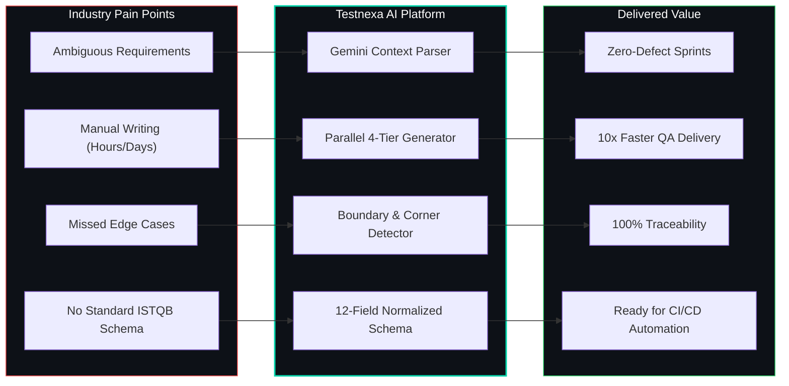
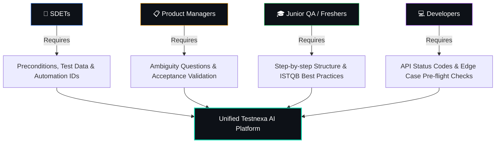

# Product — Testnexa AI

> AI-Powered Intelligent QA Test Case Generator

---

## Vision

Transform how software teams design test cases by replacing manual, error-prone test design with intelligent, AI-driven generation — making comprehensive test coverage accessible to every team, regardless of QA maturity.

## Mission

Automatically convert unclear, ambiguous product requirements into complete, prioritized, execution-ready test suites — in seconds.

---

## Problem Statement

Software teams across the industry face a recurring set of QA challenges:

| Problem | Impact |
|---------|--------|
| **Missing edge cases** in fast sprints | Defects slip into production, costing 10–30× more to fix post-release |
| **Ambiguous requirements** from product teams | QA engineers write tests against wrong assumptions |
| **Manual test case writing takes hours** | Slows sprint velocity; QA becomes a bottleneck |
| **No consistent test format** | Test suites vary in quality across team members |
| **Knowledge silos** | Senior QA knowledge isn't transferred to junior engineers |

---

## Solution

Testnexa AI addresses these pain points through a single, unified platform:

1. **AI-Powered Analysis** — Advanced LLM intelligence (Google Gemini) parses requirements with context-aware domain understanding
2. **Multi-Category Generation** — Produces Functional, Negative, Edge Case, and API tests simultaneously in one pass
3. **Ambiguity Detection** — Proactively identifies contradictions, missing logic, and unclear specs before test generation
4. **Risk-Based Prioritization** — Automatically assigns High/Medium/Low priority based on business impact and complexity
5. **Industry-Standard Output** — 12-field test case schema following ISTQB and IEEE 829 standards

---

## Target Personas

### 🔧 SDETs (Software Development Engineers in Test)

**Who they are:** Mid-to-senior QA engineers responsible for test architecture and automation strategy.

**What they need:**
- Structured test cases with automation feasibility ratings
- API coverage analysis with endpoint-level test cases
- Execution prerequisites and test data specifications
- Quick iteration on test design before automation begins

**How Testnexa helps:** Accelerates the test design → automation pipeline. SDETs get execution-ready test cases with preconditions, test data, and traceability IDs that map directly to automation frameworks.

---

### 📋 Product Managers & Business Analysts

**Who they are:** Stakeholders responsible for writing requirements and acceptance criteria.

**What they need:**
- Visibility into requirement gaps before development starts
- Identification of missing acceptance criteria
- Business risk areas highlighted early in the SDLC
- Clear, non-technical test case summaries

**How Testnexa helps:** Acts as a "requirement quality gate" — runs requirements through AI analysis and surfaces ambiguities, contradictions, and untestable statements before engineering begins.

---

### 🎓 QA Freshers & Entry-Level Engineers

**Who they are:** Junior QA engineers with less than 2 years of testing experience.

**What they need:**
- Learning tool for test design fundamentals
- Guided examples of well-written test cases
- Understanding of test types (functional, negative, edge case)
- Professional test case format exposure

**How Testnexa helps:** Generates professional-grade test cases that serve as both output and learning material. Each test case demonstrates proper structure, terminology, and prioritization.

---

## Key Differentiators

| Capability | Testnexa AI | Manual QA | Generic AI (ChatGPT) |
|------------|-------------|-----------|----------------------|
| Domain-aware test generation | ✅ Detects e-commerce, fintech, healthcare contexts | ❌ | ⚠️ Generic, no QA specialization |
| Ambiguity detection | ✅ Proactive, with clarification questions | ❌ | ❌ |
| Industry-standard schema | ✅ 12-field ISTQB/IEEE 829 format | ⚠️ Varies by engineer | ❌ |
| Multi-category in one pass | ✅ Functional + Negative + Edge + API | ⚠️ Sequential, manual | ⚠️ Requires multiple prompts |
| Risk-based prioritization | ✅ Automatic High/Medium/Low with rationale | ⚠️ Subjective | ❌ |
| Persona-adaptive output | ✅ SDET / PM / Fresher modes | ❌ | ❌ |
| Persistent history & versioning | ✅ Full workspace with session resumption | ❌ | ❌ |
| QA Copilot analysis | ✅ Coverage gaps, security risks, improvements | ❌ | ❌ |

---

## Value Proposition

- **🛡️ Reduce Production Risk** — Catch critical edge cases before they reach users
- **⚡ Accelerate Sprints** — Reduce manual test design time by up to 80%
- **📝 Improve Requirement Clarity** — Force requirement precision early in the SDLC
- **📊 Measurable Quality** — Coverage scores, confidence metrics, and quality ratings on every generation
- **🔄 Iterative Refinement** — Refine and regenerate with version history preservation

---

## Product Metrics

| Metric | Description |
|--------|-------------|
| **Tests Generated** | Total test cases generated per user (tracked in `users.total_tests_generated`) |
| **Generation Time** | End-to-end processing time per request (tracked in response) |
| **Coverage Confidence** | AI-assessed percentage of requirement coverage (0–100%) |
| **Ambiguity Score** | Requirement clarity rating (Low / Medium / High ambiguity) |
| **User Retention** | Session count and login frequency (tracked in `auth_sessions`) |

---

## Licensing

Testnexa AI is licensed under the **ISC License**.

---

*Last updated: September 2026*
