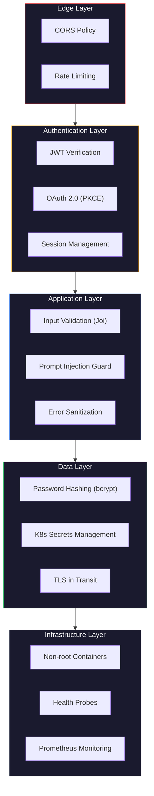

# Security — Testnexa AI

> Security measures, threat mitigations, and best practices.

---

## Security Architecture Overview

Testnexa AI implements defense-in-depth security across all layers:



---

## CORS Configuration

The backend enforces strict Cross-Origin Resource Sharing:

```javascript
app.use(cors({
    origin: function(origin, callback) {
        if (!origin) return callback(null, true);
        if (origin.startsWith('http://localhost:')) {
            return callback(null, true);
        }
        if (origin === process.env.FRONTEND_URL) {
            return callback(null, true);
        }
        return callback(new Error('Not allowed by CORS'));
    },
    credentials: true
}));
```

**Policy:**
- Allows all `localhost` origins (development)
- Allows only the configured `FRONTEND_URL` (production)
- Rejects all other origins
- Credentials (cookies, auth headers) are enabled

---

## Rate Limiting

A custom sliding-window rate limiter protects against abuse:

### Implementation

- **Algorithm:** Sliding window with per-key timestamp arrays
- **Key:** User ID (if authenticated) or IP address (if anonymous)
- **Cleanup:** Stale entries purged every 10 minutes

### Configured Limits

| Endpoint Group | Window | Max Requests | Purpose |
|----------------|--------|-------------|---------|
| Login | 15 min | 10 | Prevent brute-force password attacks |
| Registration | 15 min | 5 | Prevent account spam |
| Password Reset | 15 min | 5 | Prevent reset flood |
| Copilot | 5 min | 40 | Prevent AI abuse |

### Rate Limit Response

```json
{
    "success": false,
    "code": "RATE_LIMIT_ERROR",
    "message": "Too many sign-in attempts. Please wait 15 minutes before trying again.",
    "retryAfter": 542
}
```

Response includes `Retry-After` header with seconds until window resets.

---

## Input Validation

### Joi Schema Validation

All API inputs are validated using Joi schemas in `validation.service.js`:

- **Requirement text:** Minimum 20 characters
- **App type:** Enum validation (`web`, `mobile`, `api`, `desktop`)
- **Detail level:** Enum validation (`basic`, `medium`, `detailed`)
- **Email format:** RFC 5322 compliance
- **Password strength:** Minimum length enforcement

### Prompt Injection Protection

The `validation.service.js` includes conversational prompt rejection rules to block:
- Attempts to manipulate the AI system prompt
- Non-requirement inputs (greetings, random text)
- Malicious prompt injection patterns

---

## Password Security

### Hashing

All passwords are hashed using **bcryptjs** with adaptive cost factor:

```javascript
const hashedPassword = await bcrypt.hash(password, 10);
const isMatch = await bcrypt.compare(inputPassword, hashedPassword);
```

### Password Reset

- Reset tokens are cryptographically generated
- Tokens are time-limited (stored with `reset_password_expire`)
- Used tokens are immediately cleared after successful reset
- Endpoint always returns success to prevent email enumeration

---

## Session Security

### JWT Security

- Tokens signed with `JWT_SECRET` environment variable
- Tokens expire after 7 days
- Session ID embedded in token for session-level revocation

### Session Validation

Every authenticated request validates:
1. JWT signature and expiration
2. Session not revoked (`revoked_at IS NULL`)
3. Session not expired (`expires_at > NOW()`)
4. User still exists in database

### Session Revocation

Immediate token invalidation via database check:
- Individual sessions can be revoked
- "Revoke all other sessions" for security incidents
- Logout revokes the current session

---

## Open Redirect Protection

OAuth callback redirects are controlled:
- Frontend URL is configured via `FRONTEND_URL` environment variable
- OAuth callbacks redirect only to the configured frontend
- No user-controlled redirect parameters in auth flows

---

## Docker Security

### Non-Root Containers (Backend)

```dockerfile
# Create non-root user
RUN addgroup -S appgroup && adduser -S appuser -G appgroup

# Set ownership
RUN chown -R appuser:appgroup /app

# Switch to non-root user
USER appuser
```

### Minimal Images

- **Frontend:** Multi-stage build → `nginx:alpine` (no Node.js in production)
- **Backend:** `node:20-alpine` with production-only dependencies (`npm ci --omit=dev`)

### Health Checks

Both containers include Docker `HEALTHCHECK` directives:
- Frontend: HTTP check on port 80
- Backend: HTTP check on `/health` endpoint

---

## Kubernetes Security

### Secrets Management

Sensitive values stored as Kubernetes Secrets (`k8s/secret.yaml`):
- Supabase URL and keys
- JWT secret
- OAuth client IDs and secrets
- SMTP credentials

All secret values are base64-encoded and injected as environment variables.

### Network Isolation

- Frontend: Exposed via NodePort (`:30080`) or LoadBalancer
- Backend: Internal ClusterIP only (`:5000`) — not directly accessible from outside
- Frontend proxies API requests to backend via internal DNS

### Resource Limits

Kubernetes manifests define CPU and memory limits to prevent resource exhaustion.

---

## Error Handling

### Sanitized Error Responses

The global error handler in `server.js` ensures:
- Stack traces are never exposed to clients
- Error responses follow a consistent format
- Internal server errors return generic messages
- Custom error classes (`AIServiceError`, `RateLimitError`) map to appropriate HTTP status codes

```javascript
app.use((err, req, res, next) => {
    logger.error('Unhandled error', err);
    const errorResponse = formatErrorResponse(err);
    const statusCode = err.statusCode || 500;
    res.status(statusCode).json(errorResponse);
});
```

---

## API Security Headers & Cache Control

Security headers and cache controls are actively applied at both the Express backend and edge layer (`vercel.json`):

- **`X-Content-Type-Options: nosniff`**: Prevents MIME-type sniffing exploits.
- **`X-Frame-Options: DENY`**: Mitigates clickjacking attacks.
- **`Referrer-Policy: strict-origin-when-cross-origin`**: Limits sensitive referrer data leakage.
- **`Permissions-Policy: camera=(), microphone=(), geolocation=()`**: Disables unnecessary browser hardware APIs.
- **`Strict-Transport-Security`**: `max-age=31536000; includeSubDomains; preload` (enforced when running under HTTPS in production).
- **`Cache-Control: no-store, no-cache, must-revalidate, proxy-revalidate`**: Strictly applied to all `/api/` endpoints to ensure authenticated user data, tokens, and workspace sessions are never cached by intermediate proxies or browser caches.

---

## Frontend Secrets & Credential Isolation

A zero-secret client architecture is enforced:

1. **Client Environment Auditing**:
   - The frontend `.env` contains strictly `VITE_API_BASE_URL`.
   - Direct browser Supabase client calls have been deprecated; all database transactions are proxied through validated backend Express endpoints.
   - Production Vite bundle builds have been audited; zero AI API keys (`GEMINI_API_KEY`, `OPENAI_API_KEY`), database service keys, JWT signing keys, or SMTP passwords exist in frontend chunks.

2. **Spam & Abuse Protection**:
   - Contact form submissions are throttled via `contactRateLimiter` (5 submissions per 15 minutes per IP).
   - Honeypot trap field (`website`) silently discards automated bot submissions.
   - Message body input is constrained to a maximum of 2,000 characters and sanitized before transport.

---

## Data Privacy & Compliance Posture

- **No Uncertified Compliance Claims**: TestNexa AI explicitly avoids false claims of formal SOC 2, ISO 27001, or certified GDPR/CCPA compliance. Concrete, verifiable technical controls are documented instead.
- **AI Processing Isolation**: User requirements processed through the AI pipeline are executed statelessly via official APIs; prompts and generated test suites are not used to train third-party foundation models.
- **Authentication Credentials**: User passwords are encrypted with bcrypt (10 rounds). Tokens are signed via HMAC SHA-256 with server-side `JWT_SECRET`.
- **Telemetry Sanitization**: The frontend analytics client (`frontend/utils/analytics.js`) strictly filters out credentials, tokens, prompts, and requirements before any prospective dispatch, and honors user cookie consent preferences.

---

## Status of Security Controls

| Area | Current State | Verification Status |
|------|--------------|---------------------|
| HTTPS | HSTS & Trust-proxy configured in Express; enforced at ingress/CDN | REQUIRES DEPLOYMENT CONFIGURATION |
| Frontend Secrets | Fully isolated; zero secrets in client bundle | VERIFIED / DONE |
| Security Headers | Express middleware + `vercel.json` headers | VERIFIED / DONE |
| API Caching | `no-store` explicitly set on all `/api/*` routes | VERIFIED / DONE |
| SQL Injection | Mitigated by parameterized Supabase/PostgreSQL queries | VERIFIED / DONE |
| XSS Protection | React auto-escaping + strict CSP headers | VERIFIED / DONE |
| Form Spam Protection | Sliding-window rate limiter + hidden honeypot | VERIFIED / DONE |

---

*Last updated: September 2026*

