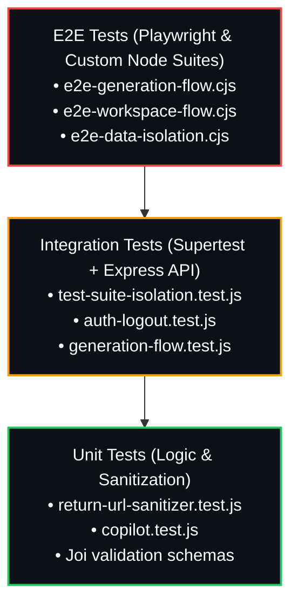
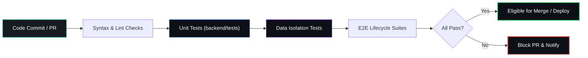

# Testing — Testnexa AI

> Test strategy, test files, and how to run tests.

---

## Overview

The Testnexa AI backend includes a mix of **unit tests** and **end-to-end (E2E) tests** covering authentication, test generation, data isolation, and the QA Copilot feature.

The frontend uses **Playwright** (devDependency) for browser-based testing.

## Test Pyramid & Coverage Topology



## CI / Automated Test Pipeline



---

## Test Directory Structure

```
backend/tests/
├── auth-logout.test.js            # Auth logout and session revocation
├── copilot.test.js                # QA Copilot analysis engine
├── generation-flow.test.js        # Test generation pipeline
├── test-suite-isolation.test.js   # Multi-user data isolation
├── return-url-sanitizer.test.js   # Open redirect protection
├── verify_auth.js                 # Auth verification utility
├── e2e-data-isolation.cjs         # E2E: Cross-user data scoping
├── e2e-generation-flow.cjs        # E2E: Full generation lifecycle
└── e2e-workspace-flow.cjs         # E2E: Workspace session management
```

---

## Unit Tests

### 1. Auth Logout (`auth-logout.test.js`)

**Coverage:**
- POST `/api/v1/auth/logout` — session revocation
- Session invalidation and token cleanup
- Revoke single session
- Revoke all other sessions
- Verify revoked session returns `SESSION_REVOKED` error

### 2. Copilot (`copilot.test.js`)

**Coverage:**
- POST `/api/v1/copilot/analyze` — suite analysis
- Context building with various scope levels
- Test case extraction from different suite data formats
- Suggestion generation quality
- Rate limiting enforcement

### 3. Generation Flow (`generation-flow.test.js`)

**Coverage:**
- POST `/api/v1/generate` — test case generation
- Input validation (minimum characters, valid app types)
- Orchestrator pipeline execution
- Response schema validation (12-field test case format)
- History persistence for authenticated users

### 4. Test Suite Isolation (`test-suite-isolation.test.js`)

**Coverage:**
- Multi-tenant data scoping
- User A cannot access User B's test suites
- User A cannot access User B's workspace sessions
- Deletion scoping (can only delete own data)
- Session CRUD operations scoped to authenticated user

### 5. Return URL Sanitizer (`return-url-sanitizer.test.js`)

**Coverage:**
- Open redirect protection on auth callbacks
- Prevents redirect to external domains
- Allows only `FRONTEND_URL` and relative paths
- Edge cases: protocol-relative URLs, data URIs

---

## End-to-End Tests

### 1. E2E Data Isolation (`e2e-data-isolation.cjs`)

**What it tests:**
- Create two separate user accounts
- User A generates test suites
- User B generates test suites
- Verify User A cannot see User B's data and vice versa
- Verify workspace session scoping
- Verify history isolation

### 2. E2E Generation Flow (`e2e-generation-flow.cjs`)

**What it tests:**
- Full lifecycle: register → login → generate → view history
- Generation with different settings (app types, detail levels)
- Response format validation
- Error handling for invalid inputs

### 3. E2E Workspace Flow (`e2e-workspace-flow.cjs`)

**What it tests:**
- Create workspace session
- Generate test suite linked to session
- Refine and regenerate (version creation)
- Version history preservation
- Session resumption after re-login
- Session deletion

---

## Running Tests

### Backend Unit Tests

```bash
# From the backend directory
cd backend

# Run all tests (currently echoes error — test runner not configured)
npm test

# Run individual test files directly
node tests/auth-logout.test.js
node tests/copilot.test.js
node tests/generation-flow.test.js
node tests/test-suite-isolation.test.js
node tests/return-url-sanitizer.test.js
```

### Backend E2E Tests

```bash
# E2E tests use CommonJS (.cjs) and require a running backend
cd backend

# Start the backend server first
npm run dev

# In another terminal, run E2E tests
node tests/e2e-data-isolation.cjs
node tests/e2e-generation-flow.cjs
node tests/e2e-workspace-flow.cjs
```

### Frontend Tests

```bash
# Playwright is available as a devDependency
# From the project root
npx playwright test
```

---

## Test Scripts (Root Backend)

Additional test utilities exist in the backend root:

| File | Purpose |
|------|---------|
| `test-accuracy-enhancements.js` | Validates AI accuracy improvements |
| `test-persona-enhancements.js` | Tests persona-adaptive output |
| `test-openai.js` | OpenAI integration testing |
| `test-api.ps1` | PowerShell API test script |
| `test-new-key.ps1` | API key validation script |
| `test-simple.ps1` | Quick smoke test script |

---

## Testing Conventions

### File Naming

- Unit tests: `*.test.js` (ES Module)
- E2E tests: `*.cjs` (CommonJS for direct Node execution)
- Utility scripts: `test-*.js` or `test-*.ps1`

### Test Data

- Tests use isolated user accounts
- No shared state between test runs
- Database state is verified, not assumed

### Assertions

Tests use direct assertion checks with descriptive error messages. Example pattern:

```javascript
const response = await fetch(`${API_URL}/api/v1/generate`, {
    method: 'POST',
    headers: { 'Content-Type': 'application/json' },
    body: JSON.stringify({ requirement, appType: 'web' })
});

const data = await response.json();
assert(data.success === true, 'Generation should succeed');
assert(data.data.functional.length > 0, 'Should have functional tests');
```

---

## CI/CD Integration

The GitHub Actions CI/CD pipeline (`ci-cd.yaml`) currently focuses on Docker image builds. Test execution can be integrated by adding a test job before the build stage:

```yaml
jobs:
  test:
    name: Run Tests
    runs-on: ubuntu-latest
    steps:
      - uses: actions/checkout@v4
      - uses: actions/setup-node@v4
        with:
          node-version: '20'
      - run: cd backend && npm ci
      - run: cd backend && npm test
```

---

## Coverage Areas

| Area | Unit Tests | E2E Tests | Status |
|------|-----------|-----------|--------|
| Authentication (login/register) | ✅ | ✅ | Covered |
| OAuth flows (Google/GitHub) | ⚠️ Partial | ❌ | Needs manual testing |
| Session management | ✅ | ✅ | Covered |
| Test generation | ✅ | ✅ | Covered |
| Data isolation | ✅ | ✅ | Covered |
| QA Copilot | ✅ | ❌ | Unit covered |
| Open redirect | ✅ | ❌ | Unit covered |
| Rate limiting | ✅ | ❌ | Unit covered |
| Frontend components | ❌ | ❌ | Not yet covered |
| Frontend routing | ❌ | ⚠️ Playwright | Basic coverage |

---

*Last updated: September 2026*
