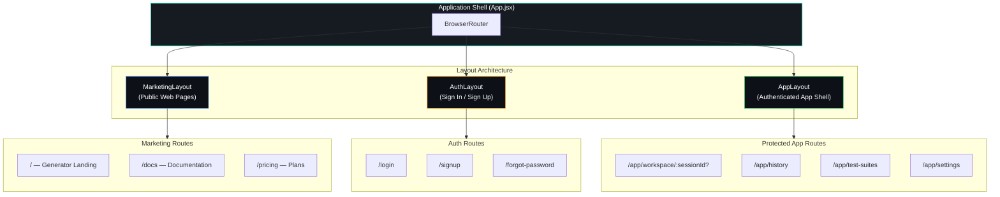
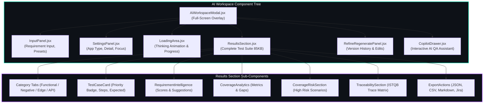

# UI / UX — Testnexa AI

> Design system, component architecture, and interaction patterns.

---

## Design Philosophy

Testnexa AI follows an **enterprise-grade dark theme** design language that conveys professionalism, trust, and technical sophistication. The design draws from modern B2B SaaS platforms with influences from:

- **True Black** base palette for maximum contrast
- **Glassmorphism** for depth and layering
- **Micro-animations** for responsive, alive-feeling interactions
- **Enterprise typography** with a restrained hierarchy

---

## Color System

### Core Palette & Design Tokens

TestNexa AI adheres strictly to a high-contrast, technical dark palette:

| Token | Hex / Value | Usage |
|-------|-------------|-------|
| **Background** | `#050505` | Master page background |
| **Surface** | `#0A0A0A` | Secondary content sections, input backdrops |
| **Elevated** | `#111111` | Floating cards, panels, modals, dropdowns |
| **Border** | `#1C1C1C` | Crisp card borders and dividers |
| **Primary Text** | `#F5F5F5` | Primary headlines, titles, active text |
| **Secondary Text** | `#A3A3A3` | Supporting copy, navigation links, explanations |
| **Muted Text** | `#737373` | Form captions, timestamps, fine print |
| **Brand Accent** | `#00D9C0` | Restrained turquoise accent for status, active states, focus outlines |

### CTA Hierarchy & Button Standardization

To maximize conversion clarity without visual clutter or competing colors:

1. **Primary CTA**:
   - Styling: Solid high-contrast white `#F5F5F5` background with dark `#050505` text, bold weight.
   - Usage: Main conversion action (`[Get Started]` in Navbar, `[Generate Test Suite →]` in Hero).
2. **Secondary CTA**:
   - Styling: Transparent background with `#1C1C1C` / `#333333` border and `#F5F5F5` white text.
   - Usage: Exploratory navigation (`[Explore Workflow]`, `[View Documentation]`).
3. **Turquoise Accent (`#00D9C0`)**:
   - Reserved strictly for product highlights, active tabs, keyboard focus rings (`:focus-visible`), and key status badges.
   - Never used as competing light-blue button styles or aggressive neon glow effects.

### Semantic Colors

| Token | Value | Usage |
|-------|-------|-------|
| **Priority High** | `#ef4444` | High-priority test cases, critical errors |
| **Priority Medium** | `#f59e0b` | Medium-priority items, warnings |
| **Priority Low** | `#22c55e` | Low-priority items, success states |
| **Info** | `#3b82f6` | Informational badges, links |
| **Purple Accent** | `#a855f7` | Secondary highlights, backend indicators |

---

## Typography

### Font Stack

```css
font-family: 'Inter', -apple-system, BlinkMacSystemFont, 'Segoe UI', Roboto, sans-serif;
```

### Type Scale

| Level | Size | Weight | Usage |
|-------|------|--------|-------|
| H1 | 48–56px | 700 | Hero headlines |
| H2 | 32–40px | 600 | Section titles |
| H3 | 24–28px | 600 | Subsection titles |
| H4 | 18–20px | 500 | Card titles |
| Body | 15–16px | 400 | Paragraphs, descriptions |
| Small | 13–14px | 400 | Labels, metadata |
| Caption | 11–12px | 400 | Timestamps, fine print |

---

## Layout System

### Three Layout Tiers



1. **MarketingLayout** — Public-facing pages with `Navbar` + `Footer`
   - Full-width hero sections with constrained content (max-width: 1240px)
   - Scroll-reveal animations on section entry

2. **AuthLayout** — Minimal chrome for login/signup flows
   - Centered card layout with animated background
   - No navbar or footer distraction

3. **AppLayout** — Authenticated application shell
   - Collapsible sidebar navigation
   - Content area with breadcrumb navigation
   - Protected by `ProtectedRoute` component

### Grid System

- **Max content width:** 1240px (global constraint)
- **Gutter:** 24px (desktop), 16px (mobile)
- **Section padding:** 80px vertical (desktop), 48px (mobile)

---

## Responsive Breakpoints

| Breakpoint | Width | Layout Changes |
|------------|-------|----------------|
| **Desktop XL** | > 1440px | Max-width container centered |
| **Desktop** | 1024–1440px | Full layout with sidebar |
| **Tablet** | 768–1023px | Collapsed sidebar, adjusted grid |
| **Mobile Large** | 576–767px | Stack layout, hamburger menu |
| **Mobile** | < 576px | Single column, full-width cards |

---

## Component Architecture & Hierarchy



## Component Inventory

### Navigation & Layout (6)

| Component | File | Purpose |
|-----------|------|---------|
| `Navbar` | `Navbar.jsx` | Global navigation with auth-aware menu |
| `NavbarAccountMenu` | `NavbarAccountMenu.jsx` | User profile dropdown with session management |
| `Footer` | `Footer.jsx` | Site-wide footer with link columns |
| `ScrollToTop` | `ScrollToTop.jsx` | Route-change scroll reset |
| `AnimatedBackground` | `AnimatedBackground.jsx` | Particle animation canvas |
| `ProtectedRoute` | `ProtectedRoute.jsx` | Auth guard wrapper |

### Landing Page Sections (10)

| Component | File | Purpose |
|-----------|------|---------|
| `Hero` | `Hero.jsx` | Landing hero with value props and CTAs |
| `Features` | `Features.jsx` | 6-card feature showcase grid |
| `PainPoints` | `PainPoints.jsx` | Problem vs. Solution comparison |
| `HowItWorks` | `HowItWorks.jsx` | 4-step process visualization |
| `WhoIsThisFor` | `WhoIsThisFor.jsx` | Persona cards (SDET, PM, Fresher) |
| `WhyThisMatters` | `WhyThisMatters.jsx` | Key metrics value proposition |
| `ProductPreview` | `ProductPreview.jsx` | Interactive product demo section |
| `ProductWorkflow` | `ProductWorkflow.jsx` | Workflow visualization |
| `IndustryInsights` | `IndustryInsights.jsx` | Industry data and insights |
| `FinalCTA` | `FinalCTA.jsx` | Bottom call-to-action section |

### AI Workspace (6)

| Component | File | Purpose |
|-----------|------|---------|
| `AiWorkspaceModal` | `AiWorkspaceModal.jsx` | Full-screen AI workspace overlay |
| `InputPanel` | `InputPanel.jsx` | Requirement input with example dropdown |
| `ResultsSection` | `ResultsSection.jsx` | Complete test suite display (85KB) |
| `RefineRegeneratePanel` | `RefineRegeneratePanel.jsx` | Iterative refinement controls |
| `SettingsPanel` | `SettingsPanel.jsx` | Generation settings (app type, detail level) |
| `LoadingArea` | `LoadingArea.jsx` | Generation loading state with progress |

### Analytics & Insights (5)

| Component | File | Purpose |
|-----------|------|---------|
| `CoverageAnalytics` | `CoverageAnalytics.jsx` | Coverage metrics dashboard |
| `CoverageRiskSection` | `CoverageRiskSection.jsx` | Risk analysis display |
| `RequirementIntelligence` | `RequirementIntelligence.jsx` | Requirement quality analysis |
| `TraceabilitySection` | `TraceabilitySection.jsx` | Requirement-to-test traceability matrix |
| `TestSuiteSection` | `TestSuiteSection.jsx` | Test suite overview cards |

### User Account (5)

| Component | File | Purpose |
|-----------|------|---------|
| `ProfileModal` | `ProfileModal.jsx` | User profile management (47KB) |
| `LoginModal` | `LoginModal.jsx` | Quick login overlay |
| `UpgradeModal` | `UpgradeModal.jsx` | Plan upgrade dialog |
| `FeedbackModal` | `FeedbackModal.jsx` | User feedback collection |
| `HistorySidebar` | `HistorySidebar.jsx` | Collapsible generation history panel |

### Contextual AI (Copilot subdirectory)

| Component | Purpose |
|-----------|---------|
| Copilot Drawer | Floating bottom-right QA assistant |
| Analysis Results | Copilot findings display |
| Suggestion Cards | AI-suggested test improvements |

---

## Interaction Patterns

### Micro-Animations

- **Scroll Reveal** — Sections fade-in and slide-up on viewport entry via `useScrollReveal` hook
- **Hover Effects** — Cards lift with subtle box-shadow increase and border glow
- **Button Feedback** — Scale transform on press, gradient shift on hover
- **Loading States** — Shimmer skeleton placeholders during data fetch
- **Particle Background** — Animated canvas particles on landing page hero
- **CSS Shimmer** — Pure CSS shimmer text effect on hero headline

### Glassmorphism

Applied to modals, cards, and elevated surfaces:

```css
background: rgba(255, 255, 255, 0.03);
backdrop-filter: blur(20px);
border: 1px solid rgba(255, 255, 255, 0.06);
border-radius: 16px;
```

### Toast Notifications

- Desktop notification API for generation completion alerts
- In-app toast messages for success/error states

---

## Stylesheet Architecture

| File | Size | Scope |
|------|------|-------|
| `index.css` | 527KB | Global design system, resets, utilities |
| `redesign.css` | 172KB | Core component styles |
| `enterprise-qa.css` | 77KB | QA workspace and workbench styles |
| `copilotDrawer.css` | 24KB | Copilot assistant panel |
| `HelpPage.css` | 16KB | Help center page |
| `bestPractices.css` | 16KB | Best practices page |
| `apiReference.css` | 16KB | API documentation page |
| `legalPage.css` | 16KB | Terms, privacy, legal pages |
| `aboutPage.css` | 11KB | About page |
| `auth.css` | 9KB | Login, signup, reset password |
| `NavbarAccountMenu.css` | 7KB | Profile dropdown menu |
| `AiWorkspaceModal.css` | 25KB | AI workspace overlay |
| `LoginModal.css` | 5KB | Quick login modal |

---

## Accessibility

- Semantic HTML5 elements (`<nav>`, `<main>`, `<section>`, `<article>`)
- Unique IDs on all interactive elements
- Keyboard-navigable menus and modals
- Focus management on route changes
- Sufficient color contrast ratios against dark backgrounds
- `aria-label` attributes on icon-only buttons

---

*Last updated: September 2026*
