# User Flows — Testnexa AI

> Detailed user journey maps for all key interactions.

---

## 1. Guest Trial Flow

A new visitor can use Testnexa without signing up, with limited free generations.

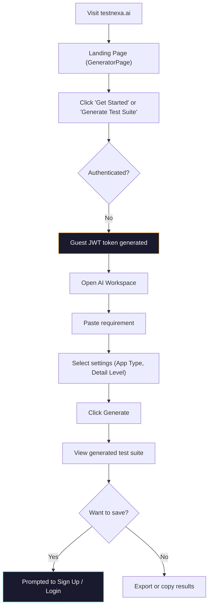

---

## 2. Registration Flow

### Email Registration

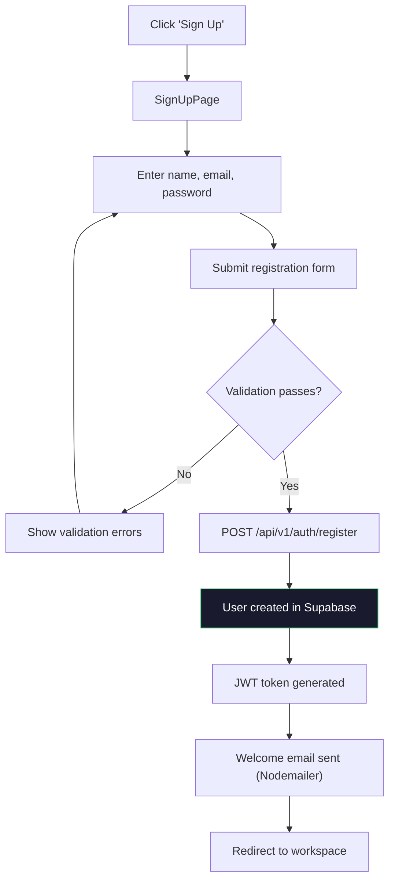

### OAuth Registration (Google / GitHub)

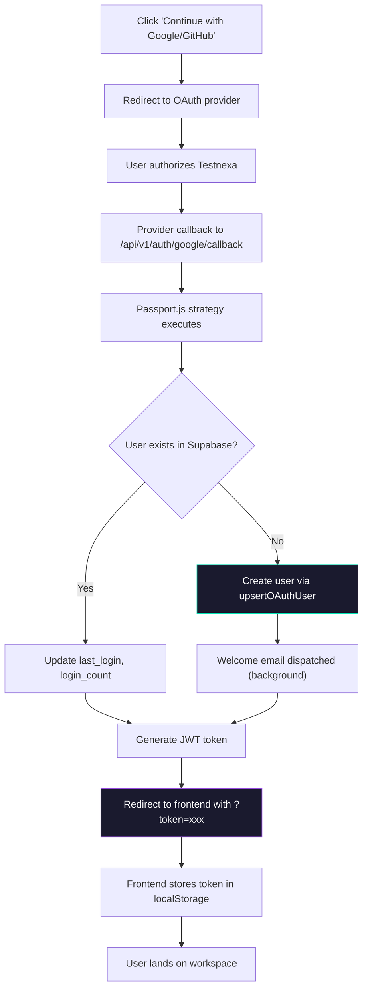

---

## 3. Test Suite Generation Flow

The core user journey — from requirement to test suite.

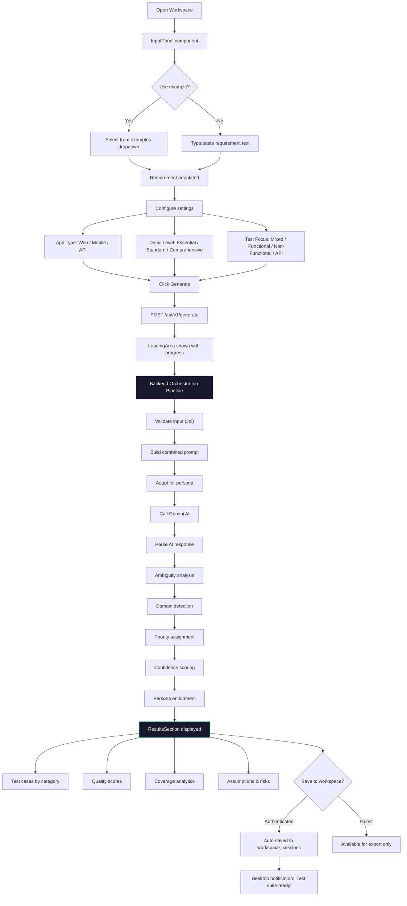

---

## 4. Refine & Regenerate Flow

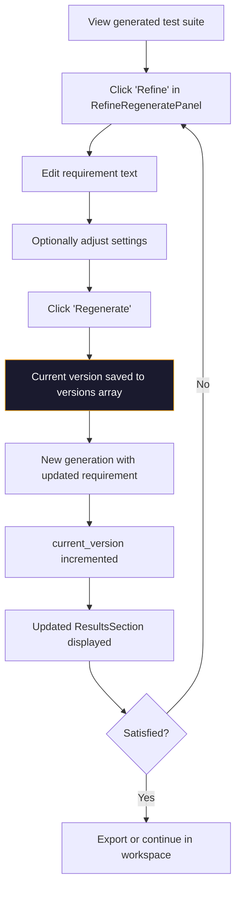

---

## 5. QA Copilot Interaction Flow

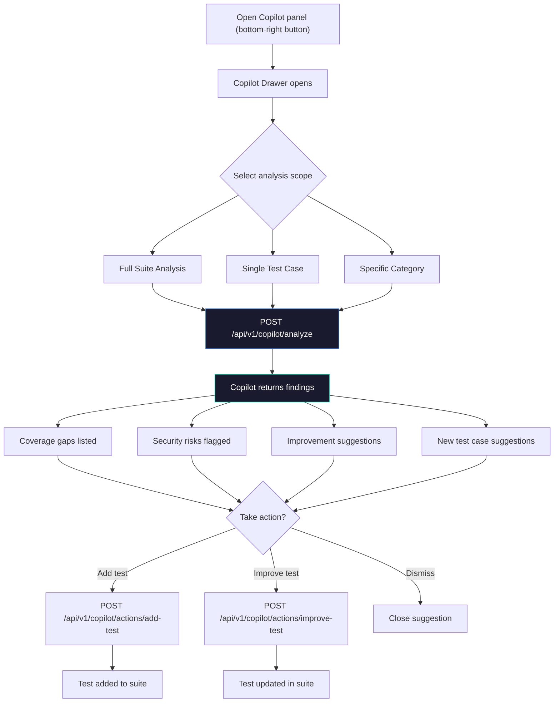

---

## 6. History & Session Resumption Flow

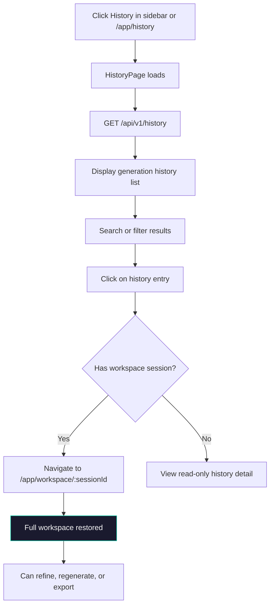

---

## 7. Login Flow

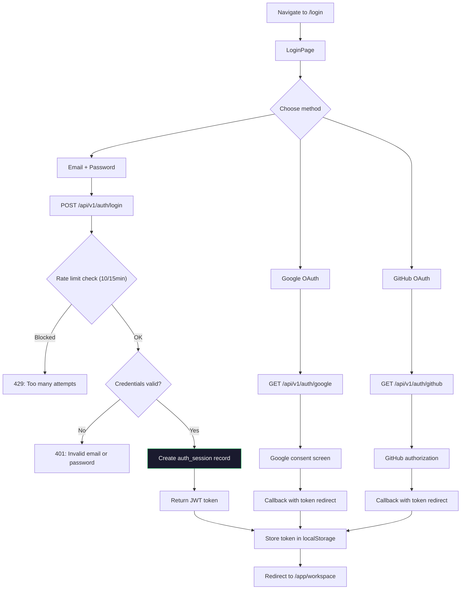

---

## 8. Password Reset Flow

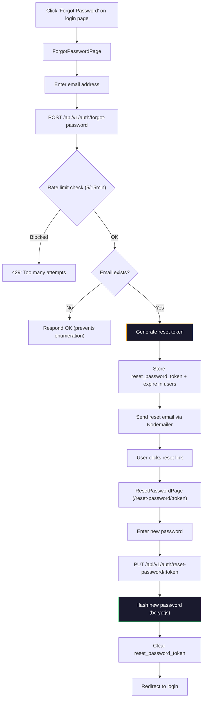

---

## 9. Test Suite Sharing Flow

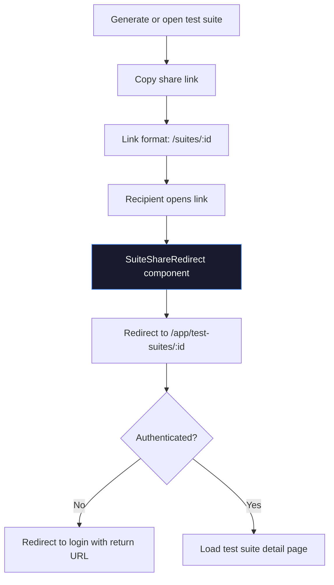

---

## 10. Logout & Session Revocation Flow

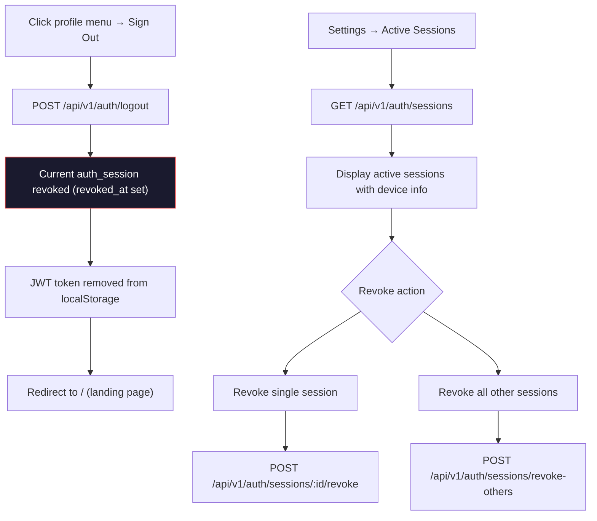

---

*Last updated: September 2026*
