# User Flows — Testnexa AI

> Comprehensive, end-to-end journey maps and technical walkthroughs for all user interactions.

---

## 🗺️ Master User Flow Index

| # | Journey Name | Primary Actor | Entry Route | Key API Endpoints | Data Persistence |
|---|---|---|---|---|---|
| **1** | [Guest Trial Flow](#1-guest-trial-flow) | Unregistered Visitor | `/` | `POST /api/v1/generate` | Ephemeral (localStorage) |
| **2** | [Registration Flow](#2-registration-flow) | New User | `/signup` | `POST /api/v1/auth/register`, OAuth callbacks | `users`, `auth_sessions` |
| **3** | [Test Generation Flow](#3-test-suite-generation-flow) | Any User | `/app/workspace` | `POST /api/v1/generate` | `workspace_sessions`, `test_history` |
| **4** | [Refine & Regenerate](#4-refine--regenerate-flow) | QA Engineer | Workspace Modal | `POST /api/v1/generate` (refine mode) | `versions` JSONB array updated |
| **5** | [QA Copilot Interaction](#5-qa-copilot-interaction-flow) | SDET / Tester | Copilot Drawer | `POST /api/v1/copilot/analyze` | Active suite patched |
| **6** | [History & Resumption](#6-history--session-resumption-flow) | Authenticated User | `/app/history` | `GET /api/v1/history`, `GET /api/v1/workspace/:id` | Read-only & full hydration |
| **7** | [Login & Authentication](#7-login-flow) | Returning User | `/login` | `POST /api/v1/auth/login`, OAuth | `auth_sessions` logged |
| **8** | [Password Reset Flow](#8-password-reset-flow) | Registered User | `/forgot-password` | `/forgot-password`, `/reset-password/:token` | Crypto token in `users` |
| **9** | [Test Suite Sharing](#9-test-suite-sharing-flow) | Team Member | `/suites/:id` | `GET /api/v1/test-suites/:id` | Read-access resolution |
| **10** | [Logout & Session Revocation](#10-logout--session-revocation-flow) | Authenticated User | Profile Menu / Settings | `POST /auth/logout`, `POST /auth/sessions/revoke` | `revoked_at` timestamp set |

---

## 1. Guest Trial Flow

Enables friction-free onboarding so prospective users can test the AI generator immediately without creating an account.

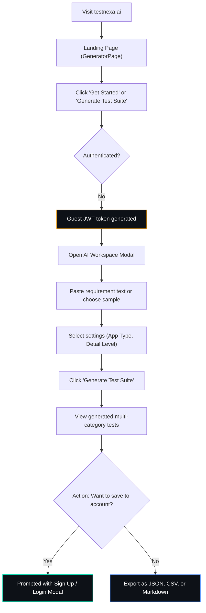

### Detailed Step-by-Step Walkthrough:
1. **Landing & Exploration:** A visitor lands on `/`. The page features an interactive preview with pre-populated example requirements (e.g. E-Commerce Checkout, OAuth Login).
2. **Guest Token Issuance:** When the guest clicks "Generate", the frontend calls the backend with `optionalProtect`. A client-side guest session ID is assigned and stored in `sessionStorage`.
3. **Execution:** The generation pipeline executes identically to an authenticated request, returning full ISTQB test cases, ambiguity warnings, and quality scores.
4. **Export vs Save:**
   - **Export:** The user can freely download Markdown, CSV, or raw JSON immediately.
   - **Save Attempt:** If the user clicks "Save to Workspace" or attempts to access `/app/history`, an auth modal opens. Upon signup/login, the in-memory guest suite is automatically linked to their newly created account.

---

## 2. Registration Flow

### A. Email + Password Registration

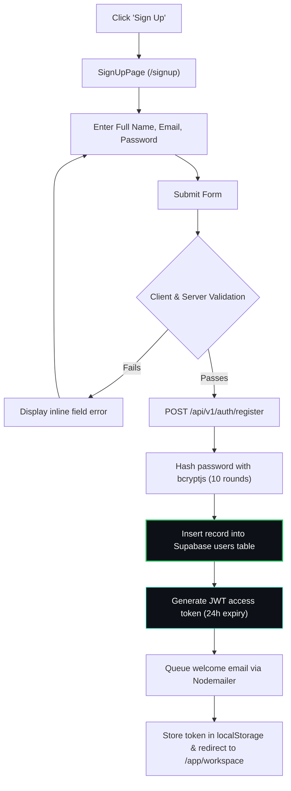

### B. OAuth Social Registration (Google & GitHub)

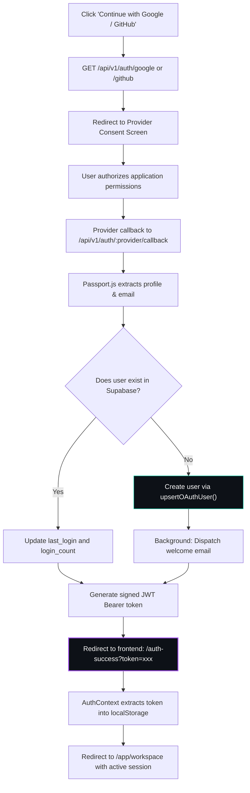

---

## 3. Test Suite Generation Flow

The core value engine of Testnexa AI — converting raw requirements into execution-ready ISTQB test suites.

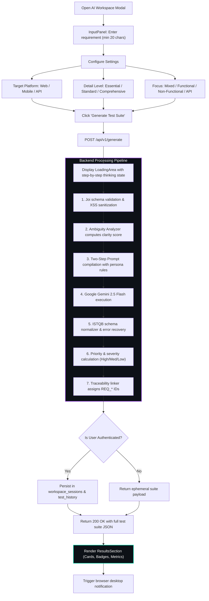

---

## 4. Refine & Regenerate Flow

Allows continuous test design iteration without losing previous work through automated session versioning.

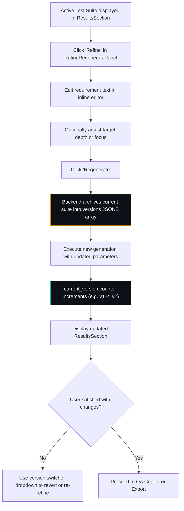

---

## 5. QA Copilot Interaction Flow

An embedded human-in-the-loop AI assistant that inspects the active test suite, discovers test gaps, and suggests immediate enhancements.

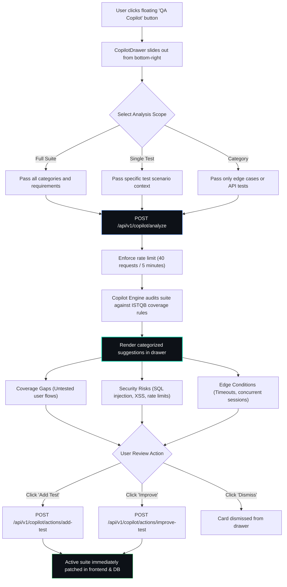

---

## 6. History & Session Resumption Flow

Ensures engineers never lose past generation work, allowing them to search, inspect, or fully resume past sessions.

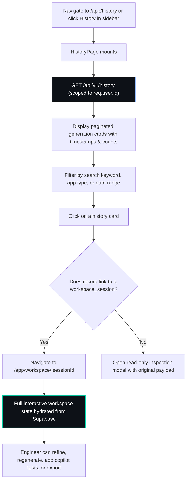

---

## 7. Login Flow

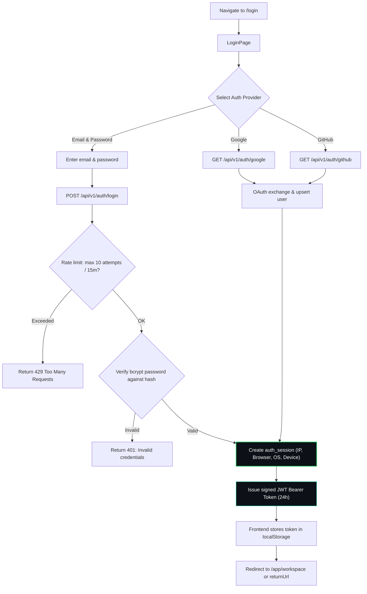

---

## 8. Password Reset Flow

Protects user accounts with timing-attack resistant reset mechanics and expiring cryptographic tokens.

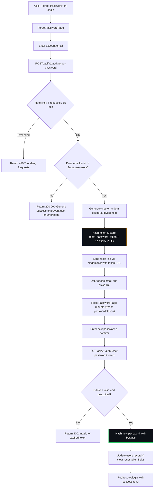

---

## 9. Test Suite Sharing Flow

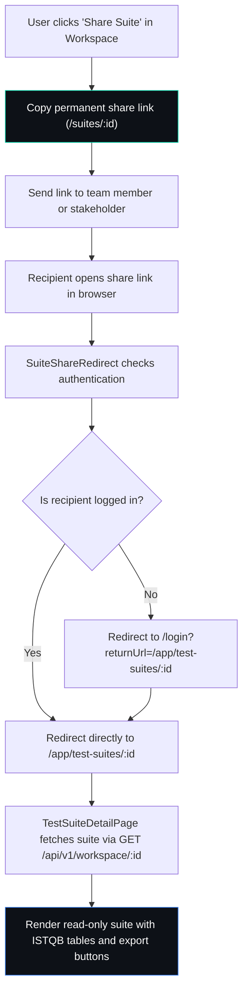

---

## 10. Logout & Session Revocation Flow

Supports multi-device session management with instant database-level token invalidation.

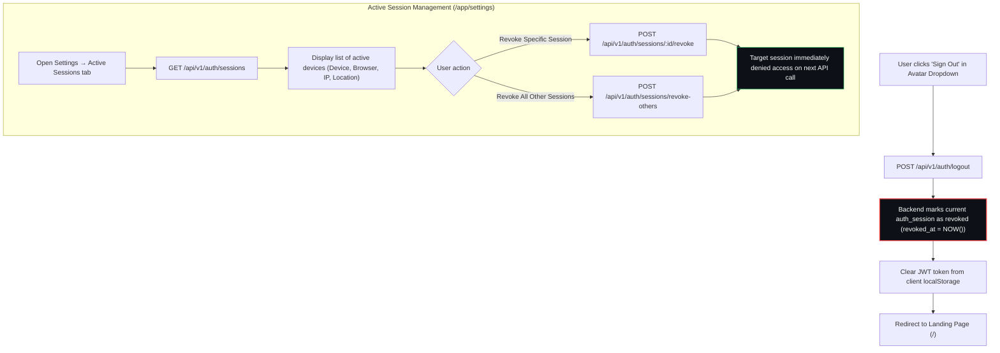

---

*Last updated: September 2026*
