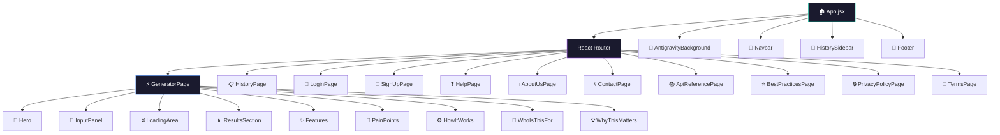
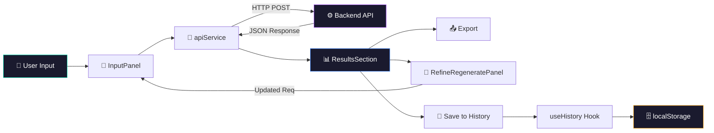
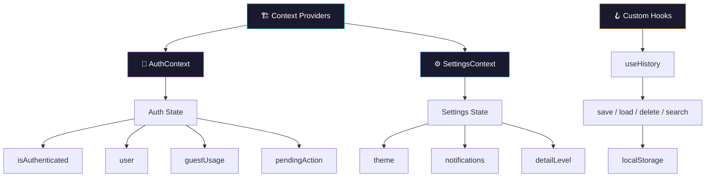
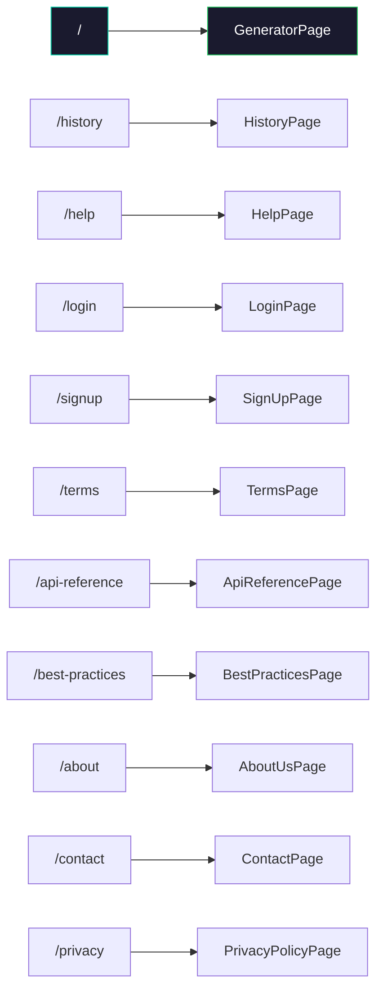

<h1 align="center">🖥️ Testnexa AI — Frontend</h1>

<p align="center">
  <b>Modern React UI for AI-Powered Test Generation</b><br/>
  <i>Premium dark-themed interface with glassmorphism design and animated backgrounds</i>
</p>

<p align="center">
  
  
  
  
  
</p>

---

## 🌟 Overview

The frontend is a modern, premium React single-page application featuring a glassmorphism dark UI with animated particle backgrounds. It provides the complete user experience for generating, viewing, refining, exporting, and managing AI-generated test suites.

---

## 🏗️ Architecture

### Component Hierarchy



### Data Flow



### State Management



### Page Routing Map



---

## 📂 Project Structure

```
frontend/
├── 📁 components/                   # Reusable UI Components (22 total)
│   ├── AnimatedBackground.jsx       # Canvas particle animation system
│   ├── AntigravityBackground.jsx    # Dynamic space warp background
│   ├── Features.jsx                 # 6-card feature showcase grid
│   ├── FeedbackModal.jsx            # User feedback collection modal
│   ├── Footer.jsx                   # Site-wide footer with links
│   ├── Hero.jsx                     # Landing hero section
│   ├── HistorySidebar.jsx           # Collapsible history drawer
│   ├── HowItWorks.jsx              # 4-step process visualization
│   ├── IndustryInsights.jsx         # Industry data & insights
│   ├── InputPanel.jsx              # Requirement textarea + settings
│   ├── LoadingArea.jsx             # Generation progress indicator
│   ├── LoginModal.jsx              # Quick login prompt modal
│   ├── Navbar.jsx                  # Top navigation + auth controls
│   ├── PainPoints.jsx             # Problem vs Solution cards
│   ├── ProfileModal.jsx           # User profile management
│   ├── RefineRegeneratePanel.jsx  # Iterative refinement controls
│   ├── ResultsSection.jsx         # Test suite results display
│   ├── ScrollToTop.jsx            # Route change scroll handler
│   ├── SettingsPanel.jsx          # User preferences panel
│   ├── UpgradeModal.jsx           # Pro upgrade prompt
│   ├── WhoIsThisFor.jsx           # Target audience personas
│   └── WhyThisMatters.jsx         # Value proposition section
├── 📁 pages/                       # Route-Level Pages (11 total)
│   ├── GeneratorPage.jsx           # Main AI test generator (home)
│   ├── HistoryPage.jsx             # Past generation history
│   ├── LoginPage.jsx               # Full login page (Email/OAuth)
│   ├── SignUpPage.jsx              # Registration page
│   ├── HelpPage.jsx               # Documentation & guides
│   ├── ApiReferencePage.jsx       # API documentation
│   ├── BestPracticesPage.jsx      # QA best practices
│   ├── AboutUsPage.jsx            # Company information
│   ├── ContactPage.jsx            # Contact form
│   ├── PrivacyPolicyPage.jsx      # Privacy policy
│   └── TermsPage.jsx             # Terms of service
├── 📁 context/                     # React Context Providers
│   ├── AuthContext.jsx             # Authentication state & methods
│   └── SettingsContext.jsx         # User preferences state
├── 📁 hooks/                       # Custom React Hooks
│   └── useHistory.js               # History CRUD with localStorage
├── 📁 services/                    # API Communication Layer
│   └── apiService.js               # Axios HTTP client for backend
├── 📁 styles/                      # Additional CSS modules
├── 📁 utils/                       # Utility functions
├── 📁 assets/                      # Static assets (images, etc.)
├── App.jsx                         # Root component with routing
├── App.css                         # App-level styles
├── main.jsx                        # React DOM entry point
└── index.css                       # Global design system (208KB)
```

---

## 🎨 Design System

| Element | Implementation |
|---|---|
| **Theme** | Premium dark mode (`#0d1117` base) |
| **Cards** | Glassmorphism with `backdrop-filter: blur()` |
| **Animations** | CSS `@keyframes` + canvas particle system |
| **Icons** | Lucide React (consistent stroke icons) |
| **Layout** | CSS Grid + Flexbox responsive system |
| **Background** | Antigravity particle warp animation |
| **Typography** | System font stack with gradient headings |
| **Colors** | Teal, Purple, Blue, Amber, Green, Rose accents |

---

## 🧩 Key Components

| Component | Description |
|---|---|
| **InputPanel** | Textarea with example requirements dropdown, detail level chips, language selector |
| **ResultsSection** | Full test suite display with tabs, quality scores, copy & export buttons |
| **RefineRegeneratePanel** | Edit requirement & regenerate with preserved context |
| **HistorySidebar** | Collapsible drawer with search, saved sessions, quick restore |
| **Navbar** | Responsive nav with auth state, sidebar toggle, new analysis button |
| **Hero** | Animated hero with badge, title, subtitle, and 3 feature cards |
| **Features** | 6-card grid with colored icons, descriptions, and bullet points |
| **AntigravityBackground** | Canvas-based space warp particle animation |

---

## 🚀 Getting Started

```bash
# From the project root
npm install
npm run dev

# Opens on http://localhost:5173
```

---

<p align="center">
  Part of <a href="https://github.com/KISHOR403/Testnexa-Ai"><b>Testnexa AI</b></a>
</p>
